<p align="center">
  
</p>
<h1 align="center">WhatAreYouSaying</h1>
<p align="center"><sub>Which audio did the speech model use for each word it wrote, and was that audio clean?</sub></p>

<p align="center">
  <a href="LICENSE"></a>
  <a href="https://www.python.org/downloads/"></a>
  <a href="requirements.txt"></a>
  <a href="https://github.com/gertelrina/aadd"></a>
  <a href="tests/"></a>
  <a href="provenance/clean_env_run.log"></a>
  <a href="#reproducibility"></a>
</p>
<p align="center">
  <a href="#backends-local-weights-vllm-llamacpp"></a>
  <a href="#100-voxceleb-clips-three-models"></a>
</p>

<p align="center">
  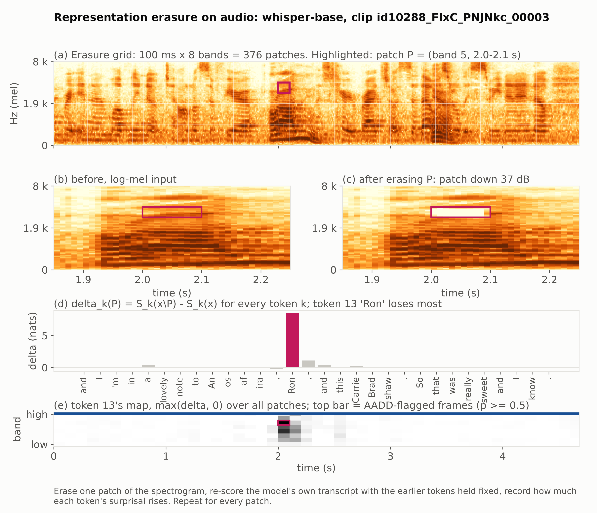
  <br><sub>The method on one clip (whisper-base). One patch of the spectrogram is erased, the model's own transcript is re-scored, and the tokens that became less likely are recorded. This is repeated for every patch.</sub>
</p>

<p align="center">
  
  <br><sub>One band of whisper-base's input, erased one patch at a time. The surprisal of the word "Ron" rises for one patch and barely changes for the others.</sub>
</p>

WhatAreYouSaying (WAYS) is an attribution tool for speech-to-text models. For every token a model
wrote, it reports which 100 ms of audio in which frequency band the token depended on, and whether
that audio was clean or degraded. It runs on local Whisper and Moonshine weights and on any
OpenAI-compatible speech server such as vLLM or llama.cpp. It needs no training and no labels. The
cost is one forward pass per erased patch.

The method combines two prior works. Representation erasure by Li, Monroe and Jurafsky
[[1]](#ref-1) measures what a neural network uses by deleting parts of its input and recording the
change in the likelihood of the correct label. AADD by Arina Gertel [[2]](#ref-2) labels what is
wrong with a recording and where, every 20 ms. The speech models are Whisper [[3]](#ref-3) and
Moonshine [[4]](#ref-4). The reproducibility steps follow two works on re-executable research
[[5]](#ref-5) [[6]](#ref-6) and are summarised under [Reproducibility](#reproducibility). The code
is MIT licensed, and changes are listed in [CHANGELOG.md](CHANGELOG.md).

**Contributions are welcome.** Open items are a CI workflow, a live vLLM or llama.cpp run, a larger
model, other languages and new tools. They are listed in [docs/help-wanted.md](docs/help-wanted.md),
and [CONTRIBUTING.md](CONTRIBUTING.md) covers setup and tests.

**Contents:** [What it answers](#what-it-answers) · [How it works](#how-it-works) · [What I verified](#what-i-verified) · [100 VoxCeleb clips](#100-voxceleb-clips-three-models) · [Detector backbones](#does-the-detectors-backbone-matter) · [Controlled damage](#controlled-damage-on-librispeech) · [One ambiguous clip](#one-ambiguous-clip-read-in-depth) · [Noise on and off](#real-noise-that-comes-and-goes-voicebank-demand) · [Latent space](#noise-in-the-latent-space) · [Install and use](#install-and-use) · [The tool framework](#the-tool-framework-sound-token-aud-cam-and-cross-check) · [The figure](#the-figure-plug-and-play) · [Backends](#backends-local-weights-vllm-llamacpp) · [Reproducibility](#reproducibility) · [Limitations](#limitations-and-future-work) · [Status](#status) · [References](#references) · [Layout](#repository-layout) · [Credits and licence](#credits-and-licence)

<details>
<summary><b>Stats for nerds</b> (the grid, the scores, the data, the cost)</summary>

| | |
|---|---|
| erasure grid | 100 ms x 8 mel-spaced bands (0, 372, 745, 1128, 1657, 2433, 3571, 5244, 8000 Hz), on Whisper's STFT (25 ms Hann window, 10 ms hop) |
| erased patch, measured in Whisper's log-mel input | down 33 to 36 dB on average over three real clips, worst patch 17 dB, which leaves it below each recording's own 10th-percentile background level |
| scores per token and patch | surprisal change in nats, Li et al.'s relative change, argmax flip; black-box servers get a 0/1 word-change map |
| cost | one teacher-forced forward pass per patch, batched 64 at a time; 4.3 s per clip for moonshine-base, about 15 s for whisper-base on an RTX 4000 Ada (20 GB) |
| VoxCeleb sample | 100 clips, simple random sample with seed 8001 from a fixed 1 500-clip test slice (sha256 `dfb0451d…`), 862 s of interview audio with human transcripts |
| controlled set | 60 LibriSpeech test-clean utterances, one 2 s degradation each from AADD's synthesiser, clean and degraded twins, three models |
| on-and-off set | 100 VoiceBank-DEMAND sentences (CC BY 4.0), real noise at 2.5 to 17.5 dB switched on and off in 4 to 7 segments per sentence, clean and noisy-throughout twins, three models, 30 min cap per model |
| detectors | AADD v3.1 (whisper-small backbone, 88.6 M parameters); AADD's head on whisper-base and on moonshine-base encoders (21 M each, AADD recipe on LibriSpeech dev-clean); plus AADD v3-lite (CRNN, 1.3 M) and v2 (EfficientNet-B0, 4.0 M) |
| tests | 41 CPU checks of the operator, the formulas, the figures (overlaps, page edges, repeatability, editable text), the latent view and the tool framework, 2 end-to-end HTTP checks against a mock OpenAI-compatible server |

</details>

## What it answers

A speech model turns a waveform into tokens. When it gets a word wrong, or gets a hard word right,
I want to know which part of the sound that word depended on, and whether that part was speech or
noise. Attention maps and gradients give only a loose answer. In an earlier study of mine, gradient
x input on whisper-tiny kept 92 % of its ranking after the decoder was re-initialised, which means
it mostly reflected input energy and not the model. Erasure tests the question directly by removing
a piece of audio and measuring what changes in the output.

For each clip WAYS returns three things:

* a map over time and frequency for every token,
* the top patch of every token drawn on the spectrogram, with the transcript below it in the same
  colours,
* a noise-focus ratio per token and per clip. It is the share of a token's evidence in audio that
  AADD flags as degraded, divided by the share of the clip that is flagged. A ratio of 1 means no
  preference.

<p align="center">
  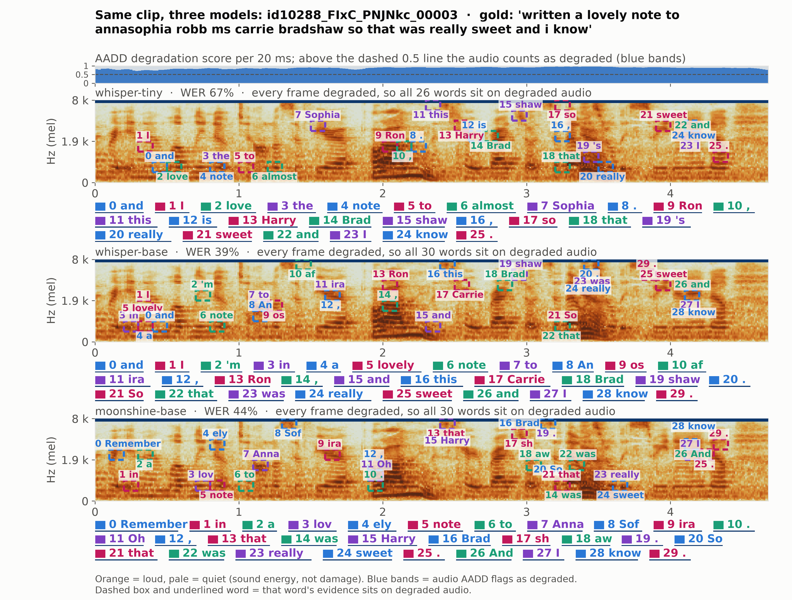
  <br><sub>One clip through three models. The spectrogram and the AADD strip are the same in every row, and only the boxes and the transcript strip differ. A colour and number identify one token.</sub>
</p>

## How it works

<p align="center">
  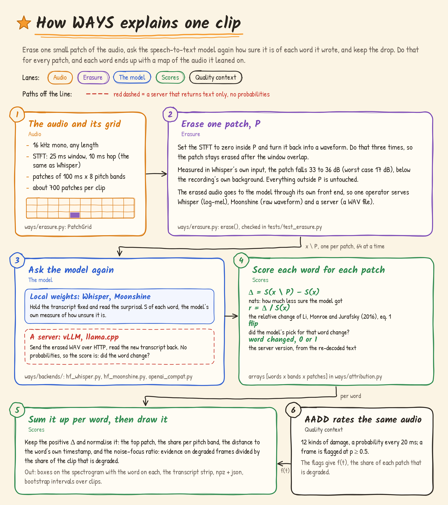
</p>

Li et al. [[1]](#ref-1) erase one dimension of the input by setting it to zero, then measure the
relative change in the negative log-likelihood of the correct label. For audio the "dimension" is a
patch of the time-frequency plane. With X = STFT(x) in Whisper's analysis settings (window 400
samples, hop 160, Hann, 16 kHz), patch P = (b, t) covers STFT frames [10t, 10t + 10) and the bins of
band b, and erasing it is

$$
\tilde{X}_P = X \odot (1 - \mathbb{1}_P), \qquad x \backslash P = \mathrm{ISTFT}(\tilde{X}_P)
$$

The erased waveform goes to the model through its own front end, so one operator serves Whisper
(log-mel input), Moonshine (raw waveform input) and a remote server (a WAV file over HTTP). With
y = (y₁ … y_K) the model's own greedy transcript and S_k(x) = −log p(y_k | y_<k, x) the surprisal of
token k under teacher forcing, every patch gets three scores from the same forward pass:

$$
\Delta_k(P) = S_k(x \backslash P) - S_k(x), \qquad
r_k(P) = \frac{\Delta_k(P)}{S_k(x)}, \qquad
\mathrm{flip}_k(P) = \big[\arg\max_v p(v \mid y_{<k}, x \backslash P) \neq y_k\big]
$$

Δ is in nats and positive when the patch supported the token. r is Li et al.'s equation 1 with the
sign flipped. flip is their discrete criterion, whether the decision changes. The non-negative mass
m_k(P) = max(Δ_k(P), 0) / Σ max(Δ_k, 0) gives the time profile, the band shares and the top patch
of a token. In the rest of this README a token's evidence means this mass. The noise-focus ratio
compares it with the AADD flags f(t), whose clip mean is f̄:

$$
\mathrm{NFR}_k = \frac{\sum_t \big(\sum_b m_k(b, t)\big)\, f(t)}{\bar{f}}
$$

<details>
<summary><b>Stats for nerds</b> (the fine print of the operator and the scores)</summary>

* Zeroing coefficients and resynthesising is not exact: the 25 ms windows overlap by 75 %, so the
  new signal's own STFT regains some energy in the patch from the frames and bins around it. WAYS
  applies the projection three times (zero, resynthesise, re-analyse). Measured in Whisper's log-mel
  on three real clips, the patch falls by 33 to 36 dB on average and by at least 17 dB in the worst
  case, below the clip's own 10th-percentile background. Without resynthesis the drop would be
  56 dB. The residual is the cost of resynthesising a waveform, which every backend takes as input. The waveform outside the
  patch's time span is unchanged to 1e-5, and only the two patches that share a window edge with P
  lose a little of their own energy (up to about 10 % of P's effect).
* Dividing by S_k(x) is a per-token constant, so every within-token summary is the same from Δ or
  from r. r only matters between tokens and is unstable for tokens the model was nearly certain of
  (S_k ≈ 0), so the summaries use Δ.
* A server that returns only text cannot give S_k. There WAYS re-decodes x\P, aligns the new
  transcript to y word by word with jiwer, and marks each original word that is not inside an
  "equal" alignment chunk. This is the "relative change in evaluation metric" form of erasure from
  the same paper, applied at word level with a value of 0 or 1 per patch.
* NFR is 1 when a token spreads its evidence without regard to the flags, above 1 when it leans on
  flagged audio, below 1 when it avoids it. It is undefined with no flagged frames and trivially 1
  when every frame is flagged, so the tables report it on the clips with 5 to 95 % of frames flagged
  ("informative" clips) as well as on all clips. Uncertainty is a 10 000-resample bootstrap over
  clips (seed 8001), and model differences are paired on the same clips.

</details>

## What I verified

Every formula above has a test in `tests/`. The numbers in the table are the values those tests and
the smoke runs measured on the hardware listed under [Reproducibility](#reproducibility).
`pytest tests -q` runs the CPU checks in about half a minute.

<details>
<summary><b>Stats for nerds</b> (every check and its result)</summary>

| check | how | result |
|---|---|---|
| ISTFT inverts STFT | random signal through both | max error 1e-5 |
| bands are disjoint and cover 0 to 8 kHz | bin ranges | 9 edges, 201 bins, no gaps |
| erasing a 550 Hz tone from band 1 | energy in the patch before and after | 19 dB down; the band-0 neighbour and the waveform outside the patch unchanged |
| erasing white noise in every band | same | 12.5 to 19.6 dB down |
| the erased patch in the model's input | Whisper log-mel, 200 random patches on each of 3 real clips | 33 to 36 dB down on average, 17 dB worst, below the clip's own background |
| the synthetic backend recovers the planted patch | a fake model whose surprisal rises by exactly 2 nats when its patch is erased | top patch found for both tokens; Δ within 0.1 of 2.0; r = Δ / S₀ exact; exactly one flip; other patches move less than 0.3 |
| mass normalisation and band shares sum to 1 | `token_mass`, `token_summary` | exact |
| NFR = 1 for uniform mass, 2 when all mass is on the flagged half | synthetic flags | exact |
| WER counts and normalisation | known sentences | S, D, I, N as expected; punctuation and case ignored |
| teacher-forced surprisal equals the generation scores | whisper-base and moonshine-base on the example clip | max difference 6.5e-6 (Moonshine); Whisper identical by construction |
| scoring twice gives the same number | same clip twice | difference 0.0 |
| black-box word-change map agrees with the white-box flips | mock OpenAI-compatible server backed by whisper-tiny, both routes | every changed word sits at or after a flipped token, 2 tests pass |
| AADD through the Python API equals the CLI scan | first sample clip, v3.1 | max difference 5e-5, flag agreement 100 % |
| the figures | synthetic arrays, long titles, 40-word transcripts, known windows | zero overlapping texts, nothing off the page, same bytes twice, every string editable |

</details>

## 100 VoxCeleb clips, three models

The three models were run on the same 100 clips, a simple random sample (seed 8001) from a fixed
1 500-clip VoxCeleb test slice. The sample is 862 s of interview audio with human reference
transcripts. Every patch of every clip was erased once per model, which is 695 patches per clip on
average and 69 456 teacher-forced forward passes per model. Brackets are 95 % bootstrap intervals
over clips.

<p align="center">
  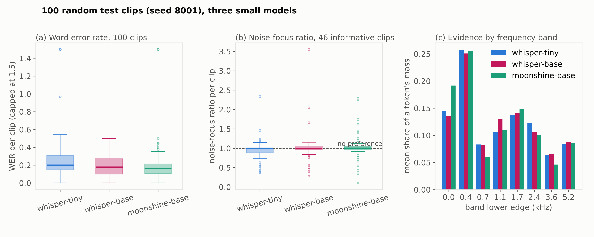
</p>

* **The maps are concentrated and differ between models.** A token's top patch carries 30 %
  (whisper-tiny), 26 % (whisper-base) and 31 % (moonshine-base) of its mass on average, out of
  about 700 patches. whisper-tiny concentrates more than whisper-base (paired difference +0.043
  [+0.029, +0.058]).
* **Whisper's top patches fall close to the token's timestamp.** The median distance from a token's
  top patch to its cross-attention timestamp is 0.12 s for whisper-base (80 % within 0.3 s) and
  0.31 s for whisper-tiny.
* **Most of the evidence is in the low bands.** All three models put a quarter of each token's mass
  in the 0.4 to 0.7 kHz band and 14 to 16 % above 3.6 kHz. Erasing a single patch changes the
  model's choice for a minority of tokens: 45 %, 33 % and 29 % of tokens have at least one such
  patch.
* **No model shows a preference for degraded audio on this data.** The noise-focus ratio is 0.93,
  1.04 and 1.04 on the 22 informative clips, and every interval contains 1. This reflects the data
  as much as the models. AADD flags 59 % of all frames, every frame in 32 clips and none in 22, so
  the flag varies little within a clip. The two datasets below were added for that reason.
* **Word error rate.** Corpus WER is 0.182 for whisper-base, 0.256 for moonshine-base and 0.383 for
  whisper-tiny.

<details>
<summary><b>Stats for nerds</b> (the tables, the paired differences, the band shares, two more clips)</summary>

| model | tokens | WER (mean over clips) | corpus WER | top-patch share | tokens with any flip | noise-focus ratio (v3) | focus, informative clips |
|---|---|---|---|---|---|---|---|
| whisper-tiny | 4034 | 0.35 [0.22, 0.55] | 0.383 | 0.30 [0.29, 0.32] | 0.45 [0.41, 0.48] | 0.97 [0.92, 1.03] | 0.93 [0.83, 1.03] (n=22) |
| whisper-base | 3267 | 0.20 [0.17, 0.22] | 0.182 | 0.26 [0.25, 0.27] | 0.33 [0.30, 0.36] | 1.01 [0.95, 1.10] | 1.04 [0.92, 1.18] (n=22) |
| moonshine-base | 4055 | 0.32 [0.16, 0.57] | 0.256 | 0.31 [0.29, 0.33] | 0.29 [0.26, 0.32] | 1.02 [0.96, 1.09] | 1.04 [0.93, 1.15] (n=22) |

| paired difference | WER | noise-focus ratio | top-patch share |
|---|---|---|---|
| whisper-base - moonshine-base | -0.124 [-0.380, +0.035] | -0.008 [-0.097, +0.077] | -0.050 [-0.069, -0.032] |
| whisper-tiny - whisper-base | +0.151 [+0.023, +0.355] | -0.042 [-0.089, -0.004] | +0.043 [+0.029, +0.058] |
| whisper-tiny - moonshine-base | +0.027 [-0.266, +0.305] | -0.050 [-0.131, +0.016] | -0.007 [-0.031, +0.017] |

| model | 0.0-0.4 kHz | 0.4-0.7 kHz | 0.7-1.1 kHz | 1.1-1.7 kHz | 1.7-2.4 kHz | 2.4-3.6 kHz | 3.6-5.2 kHz | 5.2-8.0 kHz |
|---|---|---|---|---|---|---|---|---|
| whisper-tiny | 0.15 | 0.26 | 0.08 | 0.11 | 0.14 | 0.12 | 0.06 | 0.08 |
| whisper-base | 0.14 | 0.25 | 0.08 | 0.13 | 0.14 | 0.11 | 0.07 | 0.09 |
| moonshine-base | 0.19 | 0.26 | 0.06 | 0.11 | 0.15 | 0.10 | 0.05 | 0.09 |

The per-clip WER means of moonshine and whisper-tiny have wide intervals because each has one clip
where the model looped and produced far more words than the reference. Per clip: 7 s for
whisper-tiny, 14 s for whisper-base and 4 s for moonshine-base on the GPU in
[Reproducibility](#reproducibility). A clip AADD rates clean is
`figures/vox_clean__id10271_gO805KoL2RM_00006.png` (whisper-base and moonshine-base agree on 25 of
26 words). A clip it flags end to end is `figures/vox_degraded__id10295_K1gPy1UKmBE_00007.png` (all
three models get it with one error, and the boxes still sit on the voiced harmonics).

</details>

<p align="center">
  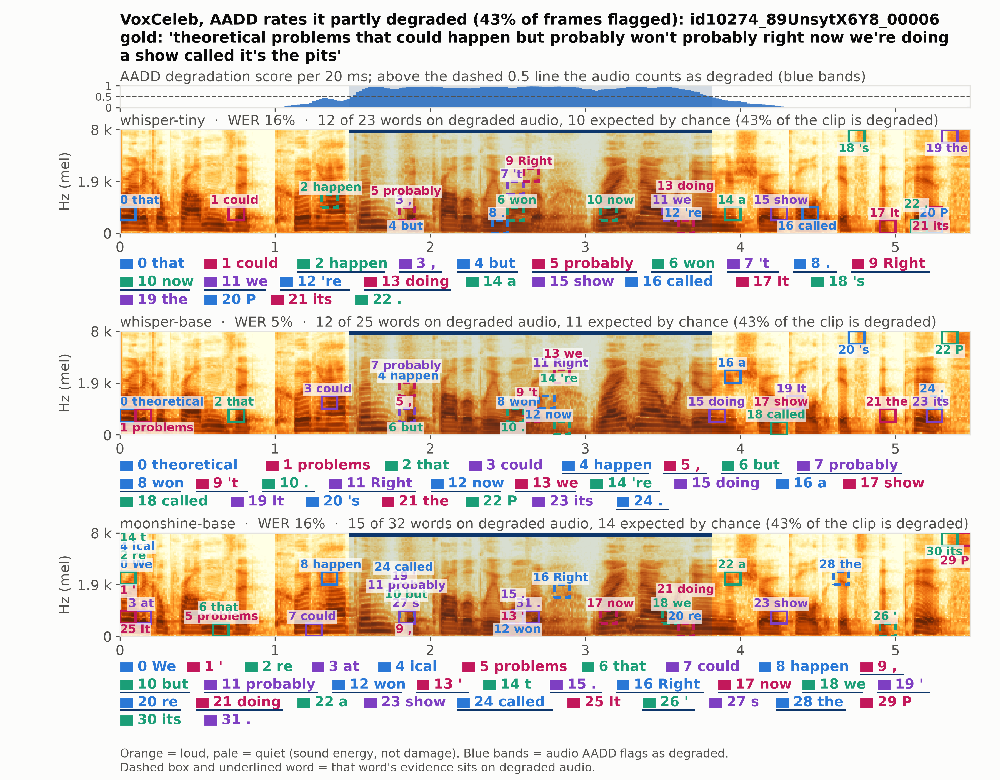
  <br><sub>How to read the clip figures. Colour in the spectrogram is sound energy (orange is loud, pale is quiet) and does not indicate damage. The blue band marks the audio AADD flags as degraded, here noise from 1.5 to 3.8 s, 43 % of the clip. A dashed box and an underlined word mean that the word's top patch lies on degraded audio. The row title compares the number of such words with the number expected by chance. All three models are at or just above chance here.</sub>
</p>

## Does the detector's backbone matter

AADD v3.1 contains a whisper-small encoder, so when it rates the audio that a Whisper model is
explained on, the detector and the model share a family. To check that the result does not depend
on this, I built two more detectors with AADD's own recipe and head
(`experiments/train_detectors.py`), one on the whisper-base encoder and one on the Moonshine
encoder. Each was trained on LibriSpeech dev-clean in under three minutes (validation frame AUC
0.982 and 0.967). The attribution maps are the same in this check. Only the flags that the
noise-focus ratio is computed against change.

<p align="center">
  
</p>

* On the controlled clips, where the damaged 2 s is known, AADD's own detector is the best of the
  three (92 % of frames flagged inside the window, 12 % outside). The whisper-base detector is
  close (83 % and 17 %) and the Moonshine detector is the weakest (74 % and 20 %).
* Under the two detectors that find the damage, every model's noise-focus ratio is at 1 with an
  interval that contains 1. Sharing the Whisper family does not produce a preference for degraded
  audio.
* Under the weakest detector the ratios drop to 0.84 to 0.90, because a detector that misplaces the
  damage flags frames the models do not depend on. The measure is only as reliable as the detector,
  so the main claim rests on the two datasets with known damage.

<details>
<summary><b>Stats for nerds</b> (the detectors, and the ratio under each of five)</summary>

| detector | parameters | weights | flags inside the damaged 2 s | flags outside | right class inside |
|---|---|---|---|---|---|
| whisper-small detector (AADD v3.1) | 88.6 M | AADD v3.1 release | 0.92 | 0.12 | 0.91 |
| whisper-base detector | 21.0 M | AADD recipe on LibriSpeech dev-clean | 0.83 | 0.17 | 0.77 |
| moonshine-base detector | 21.0 M | AADD recipe on LibriSpeech dev-clean | 0.74 | 0.20 | 0.58 |

| detector | whisper-tiny | whisper-base | moonshine-base | paired whisper-base − moonshine-base |
|---|---|---|---|---|
| whisper-small detector (AADD v3.1) | 0.93 [0.83, 1.03] (n=22) | 1.04 [0.92, 1.18] (n=22) | 1.04 [0.93, 1.15] (n=22) | +0.004 [-0.088, +0.097] |
| whisper-base detector | 1.01 [0.96, 1.07] (n=65) | 1.03 [0.99, 1.07] (n=65) | 1.02 [0.97, 1.07] (n=65) | +0.007 [-0.023, +0.036] |
| moonshine-base detector | 0.84 [0.78, 0.91] (n=67) | 0.90 [0.84, 0.96] (n=67) | 0.86 [0.79, 0.92] (n=67) | +0.043 [+0.002, +0.086] |
| AADD v3-lite (CRNN, 1.3 M) | 1.04 [0.94, 1.16] (n=17) | 1.00 [0.90, 1.14] (n=17) | 1.00 [0.88, 1.15] (n=17) | +0.000 [-0.050, +0.060] |
| AADD v2 (EfficientNet-B0, 4.0 M, 1 s) | 0.94 [0.85, 1.03] (n=46) | 0.94 [0.85, 1.03] (n=46) | 0.93 [0.84, 1.02] (n=46) | +0.009 [-0.059, +0.076] |

Both extra detectors were trained with AADD's event sampler, coloured noise and a crowd of other
speakers for noise, synthetic room responses for reverb, 4 000 steps of 12 windows each, never on
test-clean (which the controlled set uses).

</details>

## Controlled damage on LibriSpeech

The VoxCeleb flags cover too much of every clip to show whether a model depends on damaged audio.
The second dataset therefore has known damage instead of a detector's estimate. It is 60
LibriSpeech test-clean utterances (5 to 10 s, seed 8001), each with one degradation inserted into
one 2 s window at a random position by AADD's v3 synthesiser. There are ten clips per class: pink
noise at 0 dB SNR, reverberation, clipping, low-pass, mains hum and clicks. The audio outside the
window is bit-identical to the clean twin. Each model scored every clip clean and degraded, and
tokens were matched between the two transcripts. "In-window tokens" are those that drew at least
half their evidence from the window when the audio was clean.

<p align="center">
  
</p>

* **Damage increases the share of evidence inside the damaged window.** For in-window tokens the
  share inside the window rises from 0.73 to 0.82 for whisper-base (paired +0.088 [+0.067,
  +0.110]), from 0.76 to 0.83 for whisper-tiny and from 0.76 to 0.84 for moonshine-base. Tokens
  spoken outside the window also draw slightly more from it (paired +0.056 [+0.041, +0.074] for
  whisper-base). In-window tokens become 0.10 nats more surprising to whisper-base and
  out-of-window tokens 0.02, so the evidence concentrates where the transcript is least certain.
* **AADD finds the inserted damage.** It flags 100 % of frames inside a noise or reverb window and
  3 to 20 % outside, with the right class. Clicks are the hardest class (70 % inside).
* **Noise and reverberation raise the word error rate, and the other four classes barely do.**
  whisper-tiny goes from 0.09 to 0.24 WER under noise and from 0.15 to 0.37 under reverb.
  whisper-base loses about half as much. Hum and clicks move WER by at most 0.03 and the evidence
  shares by at most 0.04. A degradation that does not change the transcript also leaves the maps
  almost unchanged.

<details>
<summary><b>Stats for nerds</b> (per model and per kind of damage)</summary>

| model | WER clean | WER degraded | paired rise | tokens kept | in-window tokens: mass in window, clean -> degraded | paired change | surprisal rise in / out |
|---|---|---|---|---|---|---|---|
| whisper-tiny | 0.08 [0.06, 0.11] | 0.15 [0.11, 0.20] | +0.066 [+0.029, +0.109] | 0.88 [0.84, 0.92] | 0.76 [0.74, 0.78] -> 0.83 [0.81, 0.85] | +0.066 [+0.045, +0.087] | 0.13 [0.08, 0.18] / 0.03 [0.02, 0.05] |
| whisper-base | 0.06 [0.04, 0.08] | 0.09 [0.06, 0.11] | +0.029 [+0.014, +0.046] | 0.93 [0.91, 0.95] | 0.73 [0.72, 0.75] -> 0.82 [0.80, 0.84] | +0.088 [+0.067, +0.110] | 0.10 [0.06, 0.14] / 0.02 [0.01, 0.03] |
| moonshine-base | 0.05 [0.03, 0.07] | 0.09 [0.06, 0.12] | +0.037 [+0.016, +0.061] | 0.94 [0.92, 0.97] | 0.76 [0.74, 0.78] -> 0.84 [0.81, 0.86] | +0.072 [+0.047, +0.099] | 0.09 [0.05, 0.13] / 0.01 [-0.00, 0.02] |

| degradation | AADD flags inside | outside | right class inside | whisper-tiny: WER clean -> deg, mass-in clean -> deg | whisper-base: WER clean -> deg, mass-in clean -> deg | moonshine-base: WER clean -> deg, mass-in clean -> deg |
|---|---|---|---|---|---|---|
| noise | 1.00 | 0.03 | 1.00 | 0.09 -> 0.24, 0.73 -> 0.90 | 0.08 -> 0.16, 0.72 -> 0.89 | 0.07 -> 0.19, 0.73 -> 0.92 |
| reverb | 1.00 | 0.20 | 1.00 | 0.15 -> 0.37, 0.76 -> 0.84 | 0.07 -> 0.14, 0.75 -> 0.90 | 0.06 -> 0.16, 0.76 -> 0.88 |
| clipping | 0.90 | 0.15 | 0.89 | 0.06 -> 0.08, 0.75 -> 0.82 | 0.05 -> 0.07, 0.73 -> 0.81 | 0.07 -> 0.06, 0.77 -> 0.84 |
| lowpass | 1.00 | 0.05 | 1.00 | 0.04 -> 0.07, 0.77 -> 0.84 | 0.04 -> 0.03, 0.73 -> 0.83 | 0.02 -> 0.04, 0.76 -> 0.84 |
| hum | 0.92 | 0.23 | 0.91 | 0.11 -> 0.08, 0.79 -> 0.79 | 0.07 -> 0.07, 0.75 -> 0.75 | 0.05 -> 0.05, 0.77 -> 0.76 |
| clicks | 0.70 | 0.10 | 0.68 | 0.06 -> 0.07, 0.77 -> 0.77 | 0.04 -> 0.04, 0.71 -> 0.75 | 0.04 -> 0.04, 0.79 -> 0.79 |

Reverberation uses synthetic room impulse responses with RT60 0.6 to 1.0 s, and 88 to 94 % of tokens
survive the degradation unchanged. On clean LibriSpeech all three models sit at 0.05 to 0.08 WER.

</details>

<p align="center">
  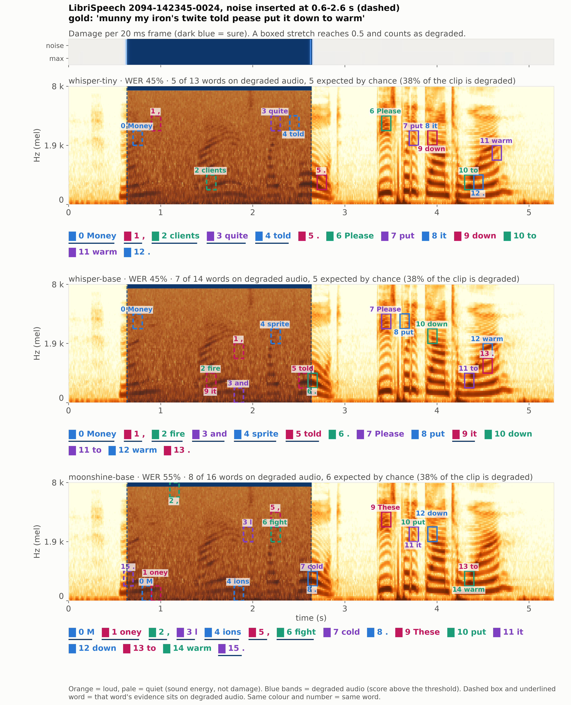
  <br><sub>LibriSpeech 2094-142345-0024 with pink noise at 0 dB inserted at 0.6 to 2.6 s (dashed). The clean twin is <code>figures/controlled_noise_clean__2094-142345-0024.png</code>.</sub>
</p>

## One ambiguous clip, read in depth

The clip above is ambiguous: the three models write different words for the same noisy two seconds.
Inside the noise whisper-tiny writes "clients quite told", whisper-base "fire and sprite told" and
moonshine-base "lions, fight cold", where the gold is "my iron's twite told". The sound-token
figure places each word by the erasure test and counts the words on the noise. The figure below
shows the same clip and the same three models through `aud-cam` with `tokens=True`. One backward
pass per token through the encoder gives each token a gradient map, drawn in grey, and the erasure
test's first patch is a tick in the token's colour. The script is `experiments/ambiguous_case.py`,
which also runs the clean twin.

<p align="center">
  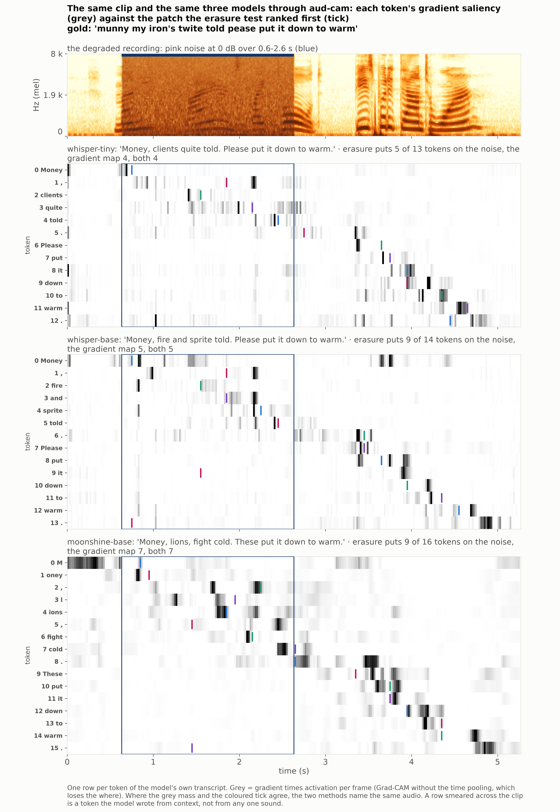
</p>

* **Both methods place the words of the noisy stretch on the noise.** "clients quite told", "fire
  and sprite told" and "lions, fight" carry 93 to 95 % of their erasure mass and 57 to 90 % of
  their gradient mass on the noise. Of the tokens the gradient map places on the noise, the erasure
  test places 4 of 4 there for whisper-tiny, 5 of 5 for whisper-base and 6 of 7 for moonshine-base.
  The exception is moonshine's "cold", whose first-ranked patch lies 20 ms past the end of the
  window with 59 % of its mass inside.
* **The erasure test places more tokens on the noise than the gradient map does**, 5, 7 and 8
  against 4, 5 and 7. The additional tokens are "Money" in both Whisper models (92 to 98 % of its
  erasure mass on the noise, 44 to 46 % of its gradient mass), whisper-base's "it" (62 % against
  11 %) and moonshine's "M" and final full stop. These tokens react when the noise is erased, but
  their encoder gradient lies elsewhere. The scores use a fixed transcript prefix, so the
  difference arises in the encoder: erasure measures the effect of a finite change to the input,
  which the encoder spreads over frames, and the gradient measures local sensitivity at each frame.
* **The models differ in how wide their gradient maps are.** whisper-base's maps are 0.5 to 0.8 s
  wide, whisper-tiny's 0.8 to 1.1 s and moonshine-base's 1.2 to 1.6 s. In all three the gradient
  maps follow the spoken order (rank correlation 0.86 to 0.94 with the token index). The erasure
  placement does too, except where it places "it" in the noise for whisper-base.

The next figure shows why the word error rate changed on this clip, and why it did not for
whisper-base. The clean and the degraded transcript of each model are aligned to the gold, and
every word is placed where its erasure evidence ranks first (`experiments/ambiguous_wer.py`, from
the saved attributions).

<p align="center">
  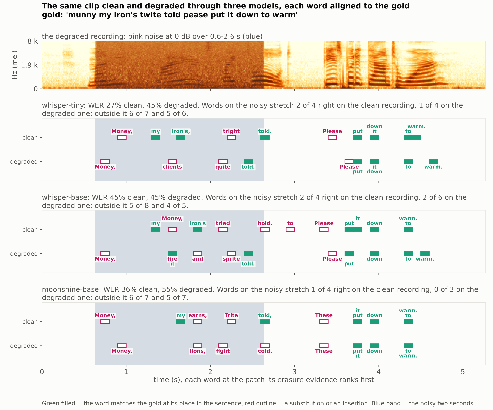
  <br><sub>Filled green marks a word that is right at its place in the sentence. A red outline marks a substitution or an insertion.</sub>
</p>

* **The error rate changes only through the noisy two seconds.** After the noise, "put it down to
  warm" is right in all six transcripts and the dialect word "pease" is wrong in all six, and the
  shared words keep their evidence within 0 to 200 ms. Inside the noise the words change in every
  model: whisper-tiny goes from "my iron's tright" to "clients quite", whisper-base from "my iron's
  tried to hold" to "fire and sprite told", moonshine-base from "my earns, Trite" to "lions, fight".
* **The window words draw more of their evidence from the noise.** Their erasure mass inside the
  window rises from 0.71 to 0.76 on the clean recording to 0.88 to 0.90 on the degraded one. The
  words outside the window are at 0.20 to 0.36. The per-token comparison below tests whether the
  new words depend on the noisy audio itself.
* **whisper-base stays at 45 % WER with different errors.** On the clean recording its five errors
  are near misses on the dialect ("Money" for "munny", "tried to hold" for "twite told", "Please"
  for "pease"). On the degraded one they are the same two dialect words plus three invented words
  in the noise. The rate is unchanged because one kind of error replaced another, which the rate
  alone does not show.

<details>
<summary><b>Stats for nerds</b> (the clean-to-degraded change per model)</summary>

| model | WER clean -> degraded | words on the noisy stretch | right on it | right outside it | shared words | evidence in the noise, window words | evidence in the noise, outside words |
|---|---|---|---|---|---|---|---|
| whisper-tiny | 27% -> 45% | 4 -> 4 | 2 of 4 -> 1 of 4 | 6 of 7 -> 5 of 6 | 8 | 0.76 -> 0.89 | 0.21 -> 0.20 |
| whisper-base | 45% -> 45% | 4 -> 6 | 2 of 4 -> 2 of 6 | 5 of 8 -> 4 of 5 | 6 | 0.72 -> 0.88 | 0.23 -> 0.26 |
| moonshine-base | 36% -> 55% | 4 -> 3 | 1 of 4 -> 0 of 3 | 6 of 7 -> 5 of 7 | 7 | 0.71 -> 0.90 | 0.21 -> 0.36 |

Words "on the noisy stretch" are those whose first-ranked erasure patch lies inside 0.6 to 2.6 s on
that recording. "told" moves in or out of the window between the two recordings, which is why the
outside counts are not the same size. Evidence in the noise is the mean share of a word's erasure
mass inside the window.

</details>

### Five tokens in the noise: erasure and encoder gradient compared

**Setting.** On the degraded recording whisper-base writes five tokens in the noisy stretch,
"Money", "fire", "and", "sprite", "told", where the gold has "munny my iron's twite told". One of
the five is right. On the clean recording the same stretch gives "Money", "my", "iron's", "tried",
"to", "hold", with three of six right. The question is which audio each token depended on: the
noise, the speech under it, or audio elsewhere in the clip. The erasure test alone does not settle
this. It measures how a token's surprisal responds when a patch is removed, and the encoder spreads
that change over frames, so a token can react to a patch it is not localised on. The encoder's
gradient for the same token is a second measurement of where the dependence lies.

**Reading 1, erasure (sound-token).** Each token's first-ranked 100 ms x band patch and the share
of its erasure mass inside the noisy 0.6 to 2.6 s.

| token | gold at that place | patch (s) | band (0 = lowest of 8) | erasure mass on the noise |
|---|---|---|---|---|
| Money | munny | 0.75 | 5 | 0.98 |
| fire | my iron's | 1.55 | 1 | 0.93 |
| and | | 1.85 | 0 | 0.94 |
| sprite | twite | 2.25 | 4 | 0.95 |
| told | told | 2.55 | 1 | 0.95 |

All five are on the noise with 93 to 98 % of their mass, and the three invented words lie within
0.2 s of the patches their clean-recording counterparts use ("my" 1.35 s, "iron's" 1.65 and 1.85 s,
"tried" 2.15 s). The erasure test shows that the words depend on what lies under those patches. It
cannot separate the noise from the speech under it, and it does not distinguish "told", which is
right, from "fire", which is not. These patches are the ones the controlled figure above draws, and
a second run of the tool returned the same five.

**Reading 2, the encoder's gradient (aud-cam, `tokens=True`).** For the same tokens, where the
per-frame gradient map sits at the top encoder layer, how wide it is, how much of it lies on the
noise, and the lowest that share gets over the seven layers.

| token | gradient centre (s) | width (s) | share on the noise, top layer | lowest share over layers | reading |
|---|---|---|---|---|---|
| Money | 2.21 | 1.05 | 0.46 | 0.46 | diffuse |
| fire | 1.61 | 0.70 | 0.88 | 0.64 | degraded |
| and | 2.11 | 0.78 | 0.86 | 0.62 | degraded |
| sprite | 1.91 | 0.57 | 0.90 | 0.60 | degraded |
| told | 2.26 | 0.69 | 0.70 | 0.39 | degraded |

<p align="center">
  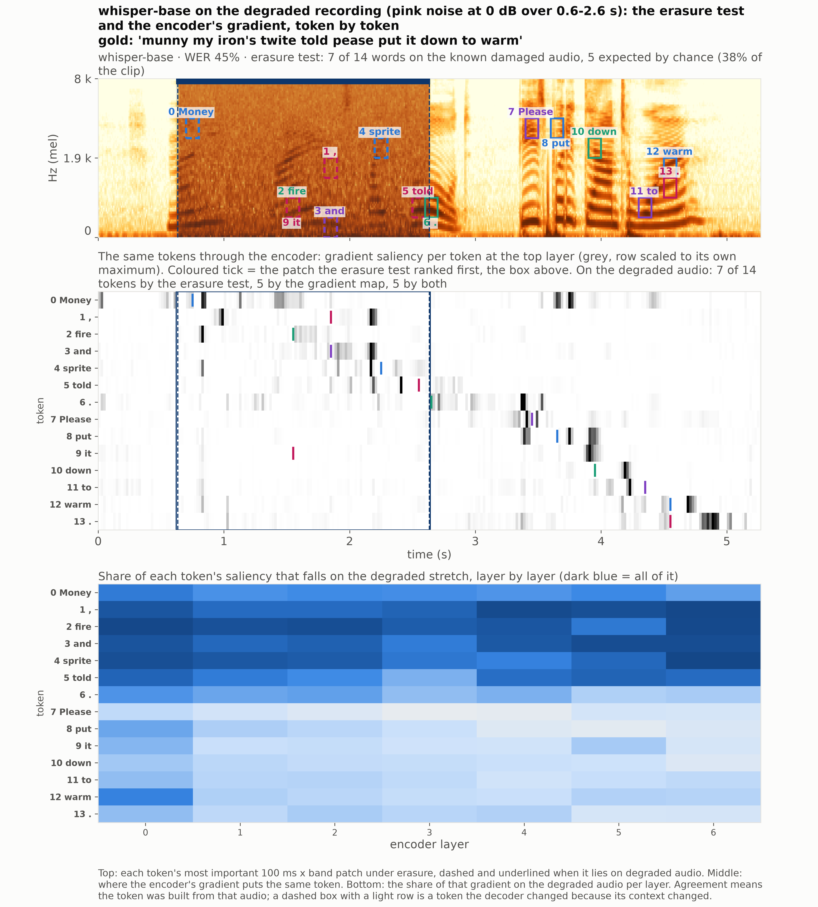
  <br><sub>The <code>cross-check</code> tool on whisper-base: the two readings of every token in one figure. Top, the erasure boxes (dashed on the noise). Middle, the encoder's gradient per token with the erasure patch as a tick. Bottom, the share of that gradient on the noise per layer.</sub>
</p>

**Interpretation.**

1. *Both methods localise the three invented words on the noise.* "fire", "and", "sprite" keep 86
   to 90 % of their gradient on the noise at the top layer and never fall below 0.60 at any layer,
   in maps 0.6 to 0.8 s wide, centred within 0.35 s of their erasure patch. Both methods therefore
   attribute these words to the noisy audio itself. The other two models write different words for
   the same two seconds ("clients quite" for whisper-tiny, "lions, fight" for moonshine-base),
   which is consistent with the signal being ambiguous there.
2. *The one correct word has gradient outside the noise.* "told" is the only window token whose
   gradient share falls below 0.4 (0.39 at layer 3), and it ends at 0.70. A third of its gradient
   lies past 2.63 s, where the noise ends and the last syllable is audible. The erasure test places
   it on the noise like the others (0.95), so only the gradient separates it. For moonshine-base
   the same patch gives "cold", and its gradient stays inside the noise (0.63 at the top layer,
   centred at 2.09 s).
3. *The two methods place "Money" differently.* Its erasure mass is on the noise (0.98, first patch
   at 0.75 s), but its gradient is diffuse (1.05 s wide, 0.46 on the noise at every layer, centred
   at 2.2 s). It stands for the dialect word "munny", and the model writes "Money" on the clean
   recording too, so the noise is not what makes it wrong.
4. *The count depends on the method.* The controlled figure above counts 7 of 14 words on degraded
   audio against 5 expected by chance. Requiring both methods to agree gives 5 of 14, the comma and
   the four content words. The two additional tokens, "it" and "Money", have their erasure evidence
   on the noise and their gradient elsewhere. Across the three models the erasure test agrees with
   the gradient map on 4 of 4, 5 of 5 and 6 of 7 tokens and adds one or two erasure-only tokens
   each time.
5. *The clean recording serves as the control.* After the noise, "put", "down", "to", "warm" keep
   the same erasure patch on both recordings (0 ms moved), and their gradient share on the noise
   falls from 0.3 to 0.6 at the input embedding to 0.1 to 0.2 at the top layer. At deeper layers
   the gradient for these words is concentrated on their own clean frames.

These are observations on one clip and three models. They show what the comparison can separate,
and they are not a general result about noisy speech.

The same comparison for any clip and any white-box model is one command:

```bash
ways cross-check clip.wav --backend hf-whisper=openai/whisper-base --window 0.63 2.63 --reference "what was said" --out out/clip
ways cross-check clip.wav --backend hf-moonshine=UsefulSensors/moonshine-base --aadd --out out/clip     # the detector's flags instead of a window
```

```python
from ways.tools import cross_check
from ways.tools.cross_check import table
res = cross_check(wav, sr, backend=("hf-whisper", "openai/whisper-base"), window=(0.63, 2.63), out="out/clip")
res.summary["on_degraded"]          # {'n_erase': 7, 'n_grad': 5, 'n_both': 5}
print(table(res, only_degraded=True))
```

<details>
<summary><b>Stats for nerds</b> (the three placements, every token under both readings, the clean-recording control)</summary>

Three ways of placing each token in time. The tokens are in spoken order, so rho(order) near 1 means the placement follows the speech. Width is the median effective width of a token's map at the top layer.

| model | recording | method | rho(order) | median width (s) | tokens placed in the window |
|---|---|---|---|---|---|
| whisper-tiny | degraded | erasure | 0.99 | 0.10 | 38% |
| whisper-tiny | degraded | grad x act | 0.86 | 0.87 | 46% |
| whisper-tiny | degraded | Grad-CAM | -0.30 | 1.78 | 54% |
| whisper-base | degraded | erasure | 0.85 | 0.10 | 50% |
| whisper-base | degraded | grad x act | 0.89 | 0.73 | 50% |
| whisper-base | degraded | Grad-CAM | -0.35 | 1.76 | 64% |
| moonshine-base | degraded | erasure | 0.64 | 0.10 | 50% |
| moonshine-base | degraded | grad x act | 0.94 | 1.22 | 50% |
| moonshine-base | degraded | Grad-CAM | 0.46 | 2.58 | 25% |
| whisper-tiny | clean | erasure | 0.98 | 0.10 | 47% |
| whisper-tiny | clean | grad x act | 0.90 | 0.65 | 59% |
| whisper-tiny | clean | Grad-CAM | -0.25 | 1.53 | 41% |
| whisper-base | clean | erasure | 0.99 | 0.10 | 44% |
| whisper-base | clean | grad x act | 0.93 | 0.67 | 50% |
| whisper-base | clean | Grad-CAM | 0.16 | 1.21 | 62% |
| moonshine-base | clean | erasure | 0.98 | 0.10 | 44% |
| moonshine-base | clean | grad x act | 0.94 | 1.18 | 56% |
| moonshine-base | clean | Grad-CAM | -0.03 | 2.43 | 44% |

Every token under both readings on the degraded recording, from the cross-check tool. The erasure patch and band are the first-ranked cell of the token's map, the ones the figures draw.

**whisper-tiny: 'Money, clients quite told. Please put it down to warm.'**  

| k | token | erasure patch (s) | band | erasure share on degraded | gradient centre (s) | width (s) | gradient share, top layer | lowest share over layers | reading |
|---|---|---|---|---|---|---|---|---|---|
| 0 | Money | 0.75 | 4 | 0.92 | 1.53 | 0.76 | 0.44 | 0.17 | split |
| 1 | , | 0.95 | 5 | 0.93 | 1.76 | 0.77 | 0.79 | 0.68 | degraded |
| 2 | clients | 1.55 | 1 | 0.95 | 1.74 | 0.76 | 0.84 | 0.73 | degraded |
| 3 | quite | 2.25 | 5 | 0.93 | 2.13 | 1.15 | 0.76 | 0.75 | diffuse |
| 4 | told | 2.45 | 5 | 0.93 | 2.29 | 1.14 | 0.64 | 0.54 | diffuse |
| 5 | . | 2.75 | 1 | 0.47 | 2.28 | 0.87 | 0.38 | 0.26 | clean |
| 6 | Please | 3.45 | 5 | 0.09 | 3.25 | 0.31 | 0.08 | 0.03 | clean |
| 7 | put | 3.75 | 4 | 0.36 | 3.37 | 0.55 | 0.13 | 0.13 | clean |
| 8 | it | 3.95 | 4 | 0.25 | 2.79 | 0.95 | 0.27 | 0.17 | clean |
| 9 | down | 3.95 | 4 | 0.03 | 3.51 | 0.90 | 0.10 | 0.10 | clean |
| 10 | to | 4.35 | 1 | 0.13 | 3.30 | 1.01 | 0.18 | 0.12 | diffuse |
| 11 | warm | 4.65 | 3 | 0.11 | 3.77 | 0.66 | 0.11 | 0.10 | clean |
| 12 | . | 4.45 | 1 | 0.48 | 3.03 | 1.59 | 0.24 | 0.24 | diffuse |

Tokens on the degraded audio: {'n_erase': 5, 'n_grad': 4, 'n_both': 4}

**whisper-base: 'Money, fire and sprite told. Please put it down to warm.'**  

| k | token | erasure patch (s) | band | erasure share on degraded | gradient centre (s) | width (s) | gradient share, top layer | lowest share over layers | reading |
|---|---|---|---|---|---|---|---|---|---|
| 0 | Money | 0.75 | 5 | 0.98 | 2.21 | 1.05 | 0.46 | 0.46 | diffuse |
| 1 | , | 1.85 | 3 | 0.91 | 1.89 | 0.47 | 0.89 | 0.71 | degraded |
| 2 | fire | 1.55 | 1 | 0.93 | 1.61 | 0.70 | 0.88 | 0.64 | degraded |
| 3 | and | 1.85 | 0 | 0.94 | 2.11 | 0.78 | 0.86 | 0.62 | degraded |
| 4 | sprite | 2.25 | 4 | 0.95 | 1.91 | 0.57 | 0.90 | 0.60 | degraded |
| 5 | told | 2.55 | 1 | 0.95 | 2.26 | 0.69 | 0.70 | 0.39 | degraded |
| 6 | . | 2.65 | 1 | 0.69 | 2.57 | 1.05 | 0.26 | 0.23 | diffuse |
| 7 | Please | 3.45 | 5 | 0.14 | 3.36 | 1.00 | 0.11 | 0.04 | clean |
| 8 | put | 3.65 | 5 | 0.42 | 3.48 | 0.47 | 0.09 | 0.06 | clean |
| 9 | it | 1.55 | 1 | 0.62 | 3.33 | 0.50 | 0.11 | 0.11 | split |
| 10 | down | 3.95 | 4 | 0.29 | 3.63 | 0.39 | 0.08 | 0.08 | clean |
| 11 | to | 4.35 | 1 | 0.04 | 3.03 | 0.87 | 0.18 | 0.13 | clean |
| 12 | warm | 4.55 | 3 | 0.07 | 3.65 | 0.75 | 0.22 | 0.15 | clean |
| 13 | . | 4.55 | 2 | 0.61 | 4.01 | 1.02 | 0.12 | 0.11 | diffuse |

Tokens on the degraded audio: {'n_erase': 7, 'n_grad': 5, 'n_both': 5}

**moonshine-base: 'Money, lions, fight cold. These put it down to warm.'**  

| k | token | erasure patch (s) | band | erasure share on degraded | gradient centre (s) | width (s) | gradient share, top layer | lowest share over layers | reading |
|---|---|---|---|---|---|---|---|---|---|
| 0 | M | 0.85 | 0 | 0.85 | 1.47 | 1.55 | 0.14 | 0.14 | diffuse |
| 1 | oney | 0.95 | 0 | 0.97 | 1.67 | 1.37 | 0.67 | 0.45 | diffuse |
| 2 | , | 1.15 | 7 | 0.85 | 2.23 | 1.41 | 0.69 | 0.56 | diffuse |
| 3 | l | 1.95 | 4 | 0.87 | 2.06 | 1.58 | 0.69 | 0.50 | diffuse |
| 4 | ions | 1.85 | 0 | 0.94 | 2.37 | 1.48 | 0.73 | 0.47 | diffuse |
| 5 | , | 2.25 | 5 | 0.73 | 2.02 | 1.20 | 0.74 | 0.43 | diffuse |
| 6 | fight | 2.25 | 4 | 0.93 | 2.37 | 1.41 | 0.57 | 0.52 | diffuse |
| 7 | cold | 2.65 | 1 | 0.59 | 2.09 | 0.85 | 0.63 | 0.23 | degraded |
| 8 | . | 2.65 | 1 | 0.42 | 2.87 | 1.34 | 0.18 | 0.18 | diffuse |
| 9 | These | 3.45 | 5 | 0.09 | 3.71 | 1.23 | 0.05 | 0.05 | diffuse |
| 10 | put | 3.75 | 4 | 0.08 | 3.59 | 0.85 | 0.06 | 0.05 | clean |
| 11 | it | 3.75 | 4 | 0.44 | 3.57 | 0.73 | 0.04 | 0.04 | clean |
| 12 | down | 3.95 | 4 | 0.43 | 3.76 | 0.80 | 0.03 | 0.03 | clean |
| 13 | to | 4.35 | 1 | 0.29 | 3.74 | 0.83 | 0.04 | 0.04 | clean |
| 14 | warm | 4.35 | 1 | 0.07 | 4.01 | 1.10 | 0.09 | 0.04 | diffuse |
| 15 | . | 0.65 | 1 | 0.58 | 4.38 | 1.01 | 0.06 | 0.06 | diffuse |

Tokens on the degraded audio: {'n_erase': 8, 'n_grad': 7, 'n_both': 6}

Control: tokens that appear in both transcripts of a model, and how far the erasure test and the gradient map moved them between the clean and the degraded recording. After the noise the audio is identical, so the anchors should stay.

| model | token | erase_t clean | erase_t degraded | cam_t clean | cam_t degraded | moved (erasure, ms) | moved (gradient, ms) |
|---|---|---|---|---|---|---|---|
| whisper-tiny | Money | 0.95 | 0.75 | 1.33 | 1.53 | -200 | +208 |
| whisper-tiny | told | 2.65 | 2.45 | 2.51 | 2.29 | -200 | -217 |
| whisper-tiny | Please | 3.45 | 3.45 | 3.22 | 3.25 | +0 | +33 |
| whisper-tiny | put | 3.75 | 3.75 | 3.22 | 3.37 | +0 | +145 |
| whisper-tiny | it | 3.95 | 3.95 | 2.93 | 2.79 | +0 | -132 |
| whisper-tiny | down | 3.95 | 3.95 | 3.55 | 3.51 | +0 | -44 |
| whisper-tiny | to | 4.35 | 4.35 | 3.07 | 3.30 | +0 | +235 |
| whisper-tiny | warm | 4.35 | 4.65 | 3.90 | 3.77 | +300 | -128 |
| whisper-base | Money | 0.95 | 0.75 | 1.65 | 2.21 | -200 | +562 |
| whisper-base | , | 1.55 | 1.85 | 1.89 | 1.89 | +300 | +5 |
| whisper-base | Please | 3.35 | 3.45 | 3.24 | 3.36 | +100 | +116 |
| whisper-base | put | 3.65 | 3.65 | 3.30 | 3.48 | +0 | +182 |
| whisper-base | it | 3.75 | 1.55 | 3.18 | 3.33 | -2200 | +143 |
| whisper-base | down | 3.95 | 3.95 | 3.46 | 3.63 | +0 | +164 |
| whisper-base | warm | 4.35 | 4.55 | 3.70 | 3.65 | +200 | -50 |
| moonshine-base | M | 1.55 | 0.85 | 1.49 | 1.47 | -700 | -24 |
| moonshine-base | oney | 0.75 | 0.95 | 1.09 | 1.67 | +200 | +578 |
| moonshine-base | These | 3.35 | 3.45 | 3.49 | 3.71 | +100 | +217 |
| moonshine-base | put | 3.75 | 3.75 | 3.43 | 3.59 | +0 | +157 |
| moonshine-base | it | 3.75 | 3.75 | 3.43 | 3.57 | +0 | +145 |
| moonshine-base | down | 3.95 | 3.95 | 3.37 | 3.76 | +0 | +387 |
| moonshine-base | to | 4.35 | 4.35 | 3.32 | 3.74 | +0 | +422 |
| moonshine-base | warm | 4.35 | 4.35 | 4.08 | 4.01 | +0 | -63 |

</details>

## Real noise that comes and goes: VoiceBank-DEMAND

This dataset tests whether each word's evidence stays with the word when noise comes and goes
inside a sentence. It is the VoiceBank-DEMAND test set [[7]](#ref-7), CC BY 4.0, downloaded from
Edinburgh DataShare with the archives' SHA-256 checked in `experiments/demand.py`. It holds VCTK
sentences from two speakers, each released clean and with one real DEMAND recording (bus, cafe,
living room, office, public square) mixed in at 2.5 to 17.5 dB, sample-aligned. I cut each sentence
into 4 to 7 segments and took each segment from the clean or the noisy twin in a random pattern
with at least two noisy runs and two clean runs. A sentence then reads, for example, noisy, clean,
noisy, clean, clean, noisy, with real noise and known boundaries. There are 100 clips (seed 8001)
in three conditions each: clean, noisy throughout, and on and off. The reference position of a word
is whisper-base's word timestamp on the clean recording, matched to each model's words by string
alignment.

<p align="center">
  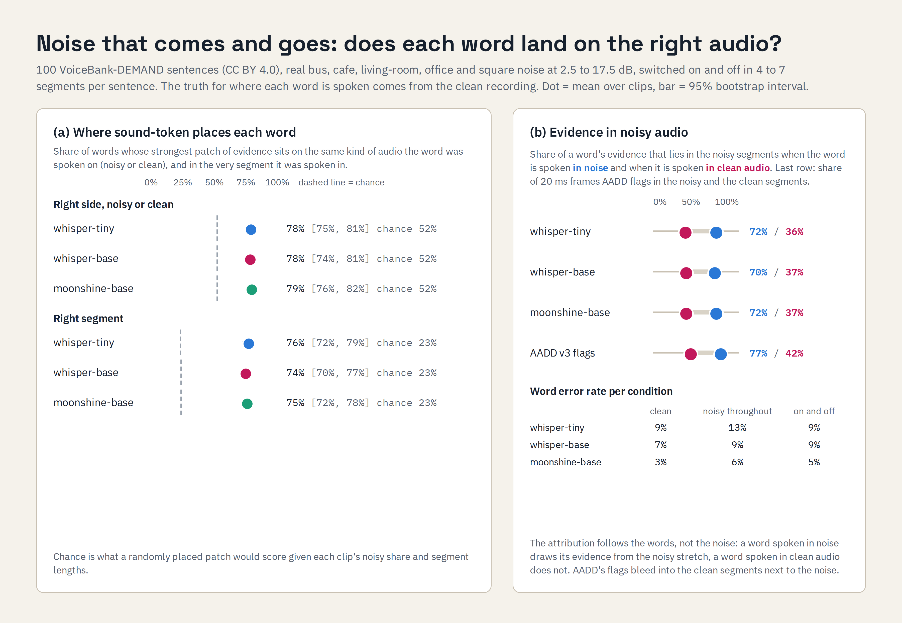
</p>

* **The evidence stays with the word.** 78 to 79 % of words have their evidence on the same kind of
  audio they were spoken on (chance 52 %), and 74 to 76 % in the segment they were spoken in
  (chance 23 %), for all three models. Intervals are in `experiments/results/demand/summary.md`.
* **Words spoken in noise draw on the noise, and words spoken in clean audio do not.** A word
  spoken in noise draws about 70 % of its evidence from the noisy segments. A word spoken in clean
  audio draws 36 to 37 %, below the 51 % of the clip that is noisy.
* **AADD detects the pattern with blurred boundaries.** It flags no frame of the clean recordings
  and 69 % of frames when the noise runs throughout. On the on-and-off clips it flags 77 % of the
  noisy frames but also 42 % of the clean ones, and it merges 2.4 noisy runs per clip into 1.5
  spans. The counts here therefore use the known boundaries, and the VoxCeleb flags should be read
  as coarse.
* **Word error rate is barely affected.** WER on the on-and-off clips is 0.09 for the Whisper
  models and 0.05 for moonshine-base, within 0.02 of clean. Each model ran under a 30 minute cap
  (24, 12 and 2 minutes).

<p align="center">
  
  <br><sub>p257_003, bus noise at 7.5 dB in the pattern noisy, clean, noisy, clean, clean, clean, noisy (dashed). The row titles count against the known windows. The same sentence with the noise throughout is <code>figures/demand_noisy__p257_003.png</code>.</sub>
</p>

## Noise in the latent space

The attribution shows which audio each word used. The latent view measures what the degraded audio
does to the model's internal representation, layer by layer (`ways/latent.py`, `ways aud-cam`). It
has two parts. **Spill-over** erases the degraded stretch with the same operator, runs the encoder
on both signals, and measures how far each layer's representation of each clean frame moves. A
layer that kept clean speech separate from the noise would not move. **Grad-CAM per layer** is the
gradient of the transcript's summed surprisal with respect to every encoder layer, pooled as in
Grad-CAM. Every layer is shown, as in AADD's own analysis of a Whisper encoder, and the figure
labels it a hint next to the spill-over.

<p align="center">
  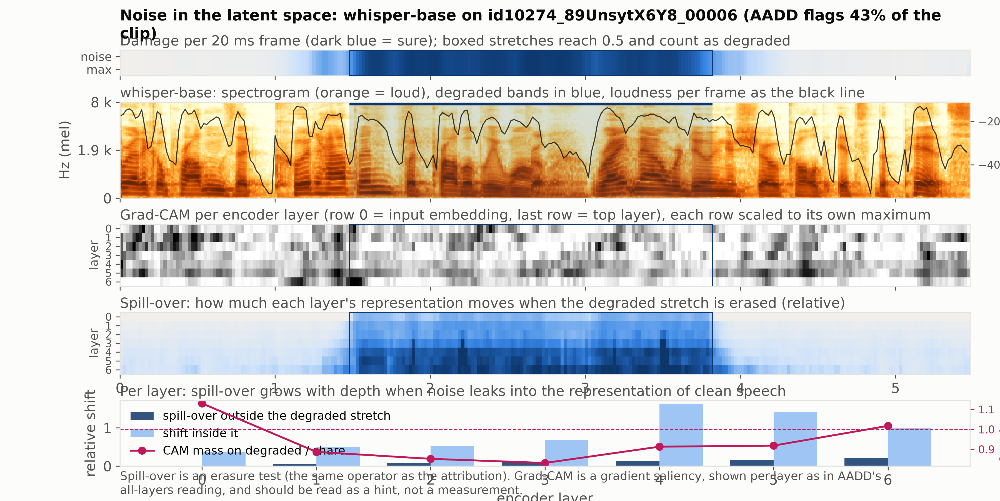
  <br><sub>whisper-base on the partly degraded clip. Inside the noise (the boxed stretch) every layer moves when the noise is erased. Outside it, the clean frames move more the deeper the layer, which shows the noise affecting the representation of clean speech. The Moonshine twin is <code>figures/latent__moonshine-base__id10274_89UnsytX6Y8_00006.png</code>.</sub>
</p>

Over the 60 controlled clips the spill-over outside the window grows with depth in every model:
whisper-tiny from 0.00 at the input to 0.19 at its top layer, whisper-base from 0.00 to 0.20,
moonshine-base from 0.12 to 0.29. Moonshine's input embedding already moves outside the window
because its encoder applies a GroupNorm with a single group right after its convolutions, which
normalises over the whole clip. The Grad-CAM focus on the degraded stretch stays between 0.8 and
1.2 in every layer of every model but one, and its correlation with loudness is weak. The gradients
therefore do not single out loud or degraded frames, whereas the representation shift does.

<details>
<summary><b>Stats for nerds</b> (whisper-base per layer on the controlled set)</summary>

| layer | spill-over outside | shift inside | CAM focus on degraded | rho(CAM, loudness) |
|---|---|---|---|---|
| 0 | 0.00 [0.00, 0.01] | 0.35 [0.34, 0.35] | 0.98 [0.81, 1.17] | -0.05 [-0.11, 0.01] |
| 1 | 0.04 [0.04, 0.05] | 0.49 [0.48, 0.50] | 0.89 [0.78, 1.00] | 0.00 [-0.06, 0.07] |
| 2 | 0.06 [0.05, 0.06] | 0.51 [0.50, 0.52] | 0.82 [0.73, 0.90] | -0.03 [-0.09, 0.02] |
| 3 | 0.09 [0.08, 0.09] | 0.66 [0.66, 0.67] | 0.85 [0.76, 0.95] | -0.12 [-0.18, -0.07] |
| 4 | 0.13 [0.12, 0.14] | 1.42 [1.35, 1.49] | 0.99 [0.87, 1.13] | -0.02 [-0.07, 0.03] |
| 5 | 0.15 [0.14, 0.16] | 1.29 [1.25, 1.34] | 0.85 [0.76, 0.94] | -0.03 [-0.09, 0.02] |
| 6 | 0.20 [0.19, 0.22] | 1.01 [1.00, 1.02] | 1.08 [0.97, 1.19] | -0.02 [-0.07, 0.02] |

The one exception on CAM focus is Moonshine's layer 3 on the VoxCeleb clips (1.6, interval 0.9 to
2.2), and no loudness correlation has an interval edge beyond 0.35. Tables for every model, on the
VoxCeleb clips and the controlled set: `experiments/results/latent/<model>/summary.md`.

</details>

## Install and use

```bash
git clone https://github.com/AlveeeRahman/WhatAreYouSaying && cd WhatAreYouSaying
python -m venv .venv && . .venv/bin/activate
pip install --extra-index-url https://download.pytorch.org/whl/cu128 -r requirements.txt   # or /cpu
pip install --no-deps -e .
pytest tests -q
```

WAYS needs Python 3.12 in any virtual environment. The first call downloads the model from the
Hugging Face Hub and, with `--aadd`, the AADD checkpoint (about 180 MB for v3), so it needs
internet once. Add `--revision <commit>` to pin the model snapshot. A GPU is optional for one clip.
The repository does not assume a home directory or a machine layout. The scripts call whatever
`python` is on the path (or `PY=`), the experiments read a data folder through
`WAYS_DATA=/path/to/it` (layout in `experiments/common.py`), and every path in a provenance file is
written relative to this repository or as `$WAYS_DATA/...`. Re-running the experiments is described
in [docs/reproducibility.md](docs/reproducibility.md#re-running).

```bash
ways explain clip.wav --backend hf-whisper --model openai/whisper-base --aadd --figure --out out/
ways quality clip.wav                      # just the AADD timeline
```

```python
import soundfile as sf
from ways import explain, load_backend
from ways.metrics import token_summary, clip_summary
from ways.quality import Quality

wav, sr = sf.read("clip.wav", dtype="float32")          # 16 kHz mono
att = explain(load_backend("hf-whisper", "openai/whisper-base"), wav)   # delta, rel, flip: [tokens, 8 bands, patches]
probs = Quality("v3").frames(wav)                        # AADD, [frames of 20 ms, 12 classes]
rows = token_summary(att, probs)                         # one dict per token: top patch, band shares, focus ratio
print(clip_summary(att, rows, probs))                    # att.save(path) / Attribution.load(path) keep the arrays
```

## The tool framework: sound-token, aud-cam and cross-check

A WAYS tool answers one question about one clip. It has a name, a one-line summary, a JSON schema
and a `run(wav, sr, **kwargs)` that returns a `ToolResult`. Three tools ship with the package:

* `sound-token` reports which audio each word used and whether that audio was clean or degraded.
* `aud-cam` reports what the degraded audio does inside the encoder, layer by layer.
* `cross-check` reports which tokens are on degraded audio under the erasure test and under the
  encoder's gradient, and whether the two agree.

Everything else goes through the registry in `ways.tools`. `ways tools` lists what is registered,
every tool is a CLI subcommand, `schemas()` hands the tools to a language model, and
`call(name, audio=...)` runs one by name. A package of your own adds a tool by registering a `Tool`
under the `ways.tools` entry-point group ([docs/tools.md](docs/tools.md),
[CONTRIBUTING.md](CONTRIBUTING.md)).

```bash
ways tools                       # sound-token  any backend  ...  /  aud-cam  white-box  ...  /  cross-check  white-box  ...
ways sound-token clip.wav --backend hf-whisper=openai/whisper-base --backend hf-moonshine=UsefulSensors/moonshine-base --aadd --out out/clip
ways aud-cam     clip.wav --backend hf-whisper=openai/whisper-base --aadd --granular --out out/clip
ways cross-check clip.wav --backend hf-whisper=openai/whisper-base --window 0.6 2.6 --out out/clip
```

`sound-token` writes `out/clip__sound-token.png` and an SVG twin. `aud-cam` writes
`out/clip__aud-cam.png`, with `--granular` the Grad-CAM lane, the spill-over lane and the
per-layer summary as their own figures, and with `--tokens` a gradient saliency per token (one
backward pass each) with its own figure and per-token summary. `cross-check` writes
`out/clip__cross-check.png`. All three print the `ToolResult` as JSON.

<p align="center">
  
</p>

```python
from ways.tools import sound_token, aud_cam, call, schemas

res = sound_token(wav, sr, backends=[("hf-whisper", "openai/whisper-base")], aadd=True, out="out/clip",
                  text={"title": "my clip", "caption": "my caption"})    # any heading or sentence of the figure
res.summary["models"][0]["focus_ratio_mean"], res.figure, res.data["attributions"]
res = aud_cam(wav, sr, backend=("hf-whisper", "openai/whisper-base"), window=(1.5, 3.8), out="out/clip", granular=True, tokens=True)
res.summary["per_layer"][-1]["shift_out"], res.figures["spillover"], res.summary["per_token"], res.figures["tokens"]
tools = schemas()                                  # OpenAI function shape; rename parameters to input_schema for Anthropic
call("aud-cam", audio="clip.wav", aadd=True, out="out/clip", granular=True).to_json()
```

`aud-cam` and `cross-check` need a white-box backend because they read the encoder. `sound-token`
also works through `openai-compat` with the black-box word-change map.

## The figure, plug and play

Every clip figure in this repository comes from one self-contained file, `ways/figure.py` (numpy
and matplotlib only). Copy it into any Python project and call it with your own audio, your own
degradation detector and your own attribution method.

```python
from ways.figure import ways_figure

ways_figure(
    wav, 16000,                               # mono waveform, any length
    quality=probs, quality_hop=0.02,          # any detector: [frames, classes] probabilities, seconds per frame
    quality_classes=["noise", "music", "reverb"],
    models=[{"name": "my-asr", "tokens": ["hello", "world"],
             "top": [(2, 14), (3, 20)],       # per word: (band, time index) of the audio patch it used most
             "patch_s": 0.1, "n_bands": 8, "wer": 0.1}],
    window=None,                              # or known damaged spans, counted against instead of the detector
    text={"title": "my clip", "x_time": "seconds", "caption": "my own caption"},   # any heading, axis name or sentence
    style={"width_in": 10, "font_size": 11},  # colours, fonts, sizes
    out="my_clip.png")                        # PNG at 300 dpi plus an SVG twin
```

Three rules are enforced in code:

* **Every string is data.** Headings, lane titles, axis names, verdict sentences and the caption
  are fields of `FigureText` and `LatentText`, and colours and sizes are fields of `FigureStyle`.
* **Text never overlaps.** Labels are placed from measured text widths. After drawing, every text
  box is checked against every other and against the page edge, and the function raises
  `LayoutError` instead of writing a bad figure.
* **The same inputs give the same bytes.** The font is bundled, the SVG hash salt is fixed and the
  metadata carries no dates. A test compares the SHA-256 of two runs.

## Backends: local weights, vLLM, llama.cpp

| backend | reached how | score | tested against |
|---|---|---|---|
| `hf-whisper` | transformers, in process | Δ, r, flip | whisper-tiny, whisper-base, 100 clips each |
| `hf-moonshine` | transformers, in process | Δ, r, flip | moonshine-base, 100 clips |
| `openai-compat` | HTTP, `/v1/audio/transcriptions` or `/v1/chat/completions` with `input_audio` | word changed, 0/1 | `tests/mock_server.py` (answers both routes with whisper-tiny) |

```bash
vllm serve openai/whisper-large-v3 --port 8000
ways explain clip.wav --backend openai-compat --route transcriptions --base-url http://localhost:8000/v1 \
     --model openai/whisper-large-v3 --patch 0.2 --bands 4 --out out/
```

The black-box path costs one request per patch, so the example uses a coarser grid. I have
not run a live vLLM or llama.cpp server for this repository. The client is the official `openai`
package and the request shapes are the ones both servers document ([docs/backends.md](docs/backends.md)).

## Reproducibility

<p align="center">
  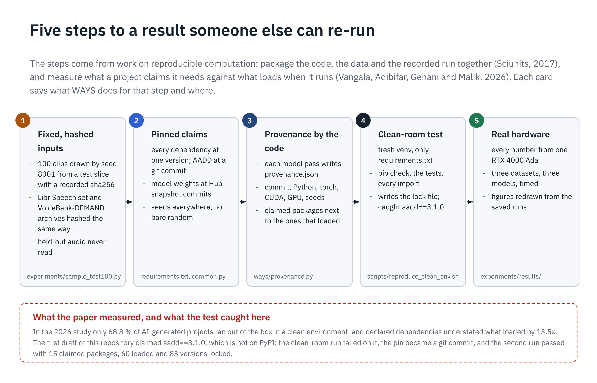
</p>

The five steps come from Sciunits [[5]](#ref-5), which packages code, data and the recorded run
together, and from the 2026 study of dependency gaps in AI-generated code [[6]](#ref-6), which
measures what a project claims against what loads when it runs. Each step is a file in this
repository, named on its card. The full checklist is [docs/reproducibility.md](docs/reproducibility.md)
and the audit against the paper is [docs/reproducibility_audit.md](docs/reproducibility_audit.md).
Everything in `experiments/results/` ran on one NVIDIA RTX 4000 Ada (20 GB), Ubuntu, Python
3.12.3, torch 2.11.0+cu128, transformers 5.5.4. Continuous integration is not set up yet. The
commands a workflow would run are `make test` and `make lint`.

<details>
<summary><b>Stats for nerds</b> (how the results were made, step by step)</summary>

<p align="center">
  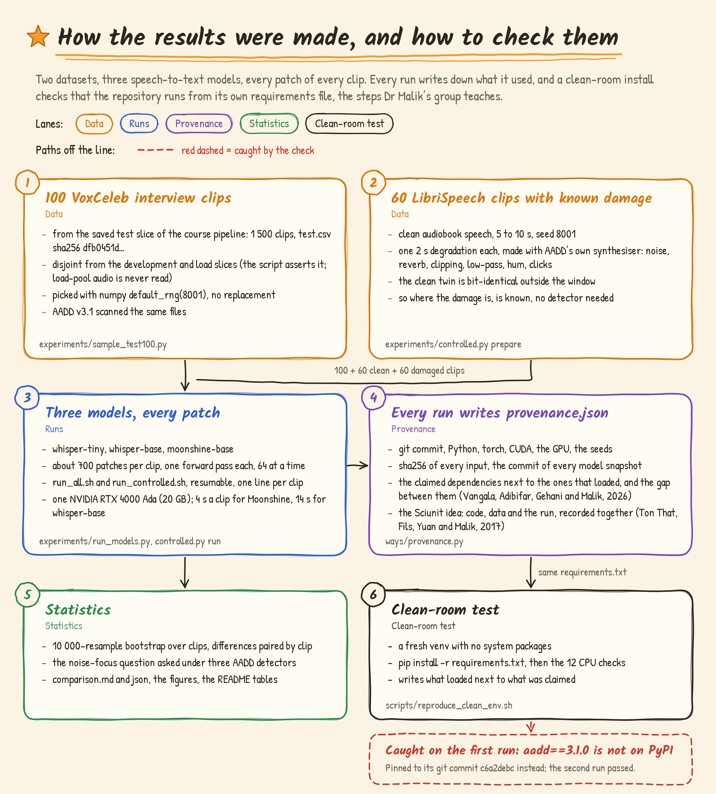
</p>

* The 100 clips are `default_rng(8001).choice(1500, 100, replace=False)` on a test slice with a
  recorded sha256, disjoint from the development and held-out slices (the script asserts it). The
  LibriSpeech set and the VoiceBank-DEMAND archives are hashed the same way.
* `requirements.txt` pins every version. AADD is pinned to a git commit because it is not on PyPI.
  An earlier version of the file listed `aadd==3.1.0`, which is not on PyPI, and the clean-environment run caught it. Model weights are
  pinned to Hugging Face snapshot commits (`experiments/common.py`).
* Every model pass writes `provenance.json` with the git commit, Python, torch and CUDA versions,
  the GPU, input hashes, model commits, seeds, the claimed dependency list and the runtime
  dependency list, plus the difference between the two.
* `scripts/reproduce_clean_env.sh` builds a fresh venv, installs only `requirements.txt` (CPU
  torch), runs the tests, imports every third-party module the code uses, and records what loaded:
  passed, 15 claimed packages, 60 distributions loaded, 83 resolved versions in
  `provenance/requirements-lock.txt`.

</details>

## Limitations and future work

* **The erasure is not a hard zero** (33 to 36 dB down on average, 17 dB worst) because of the
  window overlap, and a patch's two time neighbours lose up to about 10 % of its effect.
* **Teacher forcing scores the model's own transcript.** Δ measures how much a patch supported what
  the model wrote, not what it should have written. The WER column stays next to the maps for that
  reason.
* **AADD is a detector, not ground truth**, and its flags blur at boundaries. The noise-focus ratio
  is reported on the clips where it is informative and under five detectors, and the main claims
  rest on the two datasets with known damage.
* **Moonshine has no timestamps**, so the distance-to-timestamp summary exists only for Whisper.
* **Grad-CAM with time-pooled weights carries no per-token time information** on these encoders
  (shown on the ambiguous clip). The per-layer CAM is therefore a hint about layers, and the token
  view uses the per-frame gradient map, which is a saliency and not an erasure test.
* **The per-token comparison of erasure and gradient is one clip.** It shows what the two methods
  can separate. Why they disagree on some tokens is not established.
* **No live vLLM or llama.cpp run yet**, only the mock server.
* **Scale.** The results cover three small models and 260 clips. That supports paired comparisons
  with intervals, not claims about large models or other languages.

## Status

* Done (0.3.0): operator, three backends, scores, summaries, AADD context, the figure system, the
  latent view, the tool framework with three registered tools and plug-in discovery, the per-token
  gradient view and the ambiguous-clip experiment, tests, the three datasets through three models,
  the detector-backbone check, clean-environment run, provenance.
* Next: a CI workflow once Actions minutes are available (the test command is fixed), a live vLLM
  transcription run, a larger model on the same clips. Each is open to contributors in
  [docs/help-wanted.md](docs/help-wanted.md).

## References

<a id="ref-1"></a>[1] J. Li, W. Monroe, and D. Jurafsky, "Understanding neural networks through representation erasure," *arXiv:1612.08220*, Dec. 2016. [arXiv](https://arxiv.org/abs/1612.08220)

<a id="ref-2"></a>[2] A. Gertel, "AADD: Automatic Audio Degradation Detection," software, version 3.1.0, 2026, MIT licence. [GitHub](https://github.com/gertelrina/aadd) · [doi:10.5281/zenodo.24352878](https://doi.org/10.5281/zenodo.24352878)

<a id="ref-3"></a>[3] A. Radford, J. W. Kim, T. Xu, G. Brockman, C. McLeavey, and I. Sutskever, "Robust speech recognition via large-scale weak supervision," in *Proc. ICML*, 2023. [arXiv](https://arxiv.org/abs/2212.04356)

<a id="ref-4"></a>[4] N. Jeffries, E. King, M. Kudlur, G. Nicholson, J. Wang, and P. Warden, "Moonshine: Speech recognition for live transcription and voice commands," *arXiv:2410.15608*, 2024. [arXiv](https://arxiv.org/abs/2410.15608)

<a id="ref-5"></a>[5] D. H. Ton That, G. Fils, Z. Yuan, and T. Malik, "Sciunits: Reusable research objects," in *Proc. IEEE 13th Int. Conf. on e-Science*, 2017. [arXiv](https://arxiv.org/abs/1707.05731)

<a id="ref-6"></a>[6] B. P. Vangala, A. Adibifar, A. Gehani, and T. Malik, "AI-generated code is not reproducible (yet): An empirical study of dependency gaps in LLM-based coding agents," *arXiv:2512.22387*, v3, Mar. 2026. [arXiv](https://arxiv.org/abs/2512.22387)

<a id="ref-7"></a>[7] C. Valentini-Botinhao, "Noisy speech database for training speech enhancement algorithms and TTS models," University of Edinburgh, School of Informatics, Centre for Speech Technology Research, 2017, CC BY 4.0. [DataShare](https://datashare.ed.ac.uk/handle/10283/2791). Speech from the CSTR VCTK corpus, noise from DEMAND (J. Thiemann, N. Ito, and E. Vincent, 2013).

## Repository layout

<details>
<summary><b>Stats for nerds</b> (every folder and what it holds)</summary>

| Path | What it holds |
|---|---|
| `ways/erasure.py` | the STFT patch grid and the erasure operator |
| `ways/attribution.py` | `explain()`: Δ, r and flip per token and patch; the black-box word-change map |
| `ways/backends/` | `hf_whisper.py`, `hf_moonshine.py`, `openai_compat.py` (vLLM, llama.cpp) |
| `ways/quality.py` | AADD wrapper, flagged mask, degraded intervals |
| `ways/metrics.py` | token and clip summaries, noise-focus ratio, WER, bootstrap |
| `ways/figure.py` | the clip figure, the latent figure, the granular aud-cam lanes, the per-token figure and the cross-check figure, self-contained: text and style as data, overlap and page-edge check, repeatable bytes |
| `ways/latent.py` | spill-over under erasure, Grad-CAM per encoder layer, the per-token gradient map |
| `ways/plots.py` | the method, comparison and controlled-summary figures |
| `ways/provenance.py` | the provenance manifest (claimed and runtime dependencies, hashes, model commits, public paths) |
| `ways/tools/` | the tool framework: `base.py` (Tool, ToolResult), `registry.py` (register, get, schemas, entry-point discovery), `sound_token.py`, `aud_cam.py`, `cross_check.py` |
| `ways/cli.py` | `ways sound-token`, `ways aud-cam`, `ways cross-check`, `ways explain`, `ways latent`, `ways quality` |
| `tests/` | operator, formula, figure and tool checks; mock OpenAI-compatible server and the HTTP test |
| `experiments/` | sample selection, the three-model runs, the detector runs, the controlled LibriSpeech set (`controlled.py`), the VoiceBank-DEMAND set (`demand.py`), the latent runs; `common.py` holds the data-folder layout and the pinned model revisions |
| `experiments/results/` | per-clip rows, per-token tables, summaries, provenance (npz maps are not committed) |
| `figures/` | every figure in this README and its SVG twin |
| `docs/` | backends, reproducibility checklist and audit; `docs/images/`: the icon, the hand-drawn workflow figures and the two charts (sources in `src/`, rendered by `render.py`), the GIFs |
| `provenance/` | clean-environment run log, runtime dependency set, lock file |
| `scripts/reproduce_clean_env.sh` | the clean-environment execution test |
| `Makefile`, `CHANGELOG.md`, `CONTRIBUTING.md`, `SECURITY.md`, `CITATION.cff` | day-to-day targets, release notes, how to add a tool, what the code does with the network, how to cite |

</details>

## Credits and licence

WhatAreYouSaying is released under the MIT licence (see `LICENSE`). AADD [[2]](#ref-2) is MIT and
keeps its licence. Whisper weights are Apache-2.0, Moonshine weights MIT, transformers Apache-2.0.
The VoxCeleb audio and transcripts used in `experiments/` are not part of this repository. Only
clip ids, per-clip and per-token numbers, and figures are. LibriSpeech and VoiceBank-DEMAND are
CC BY 4.0.
