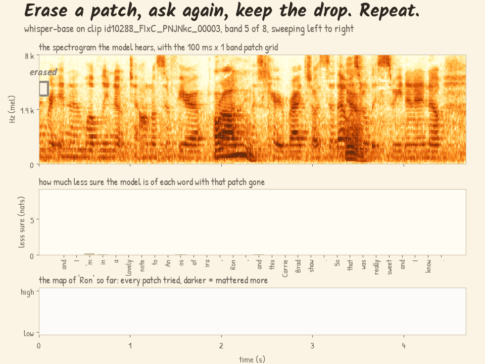
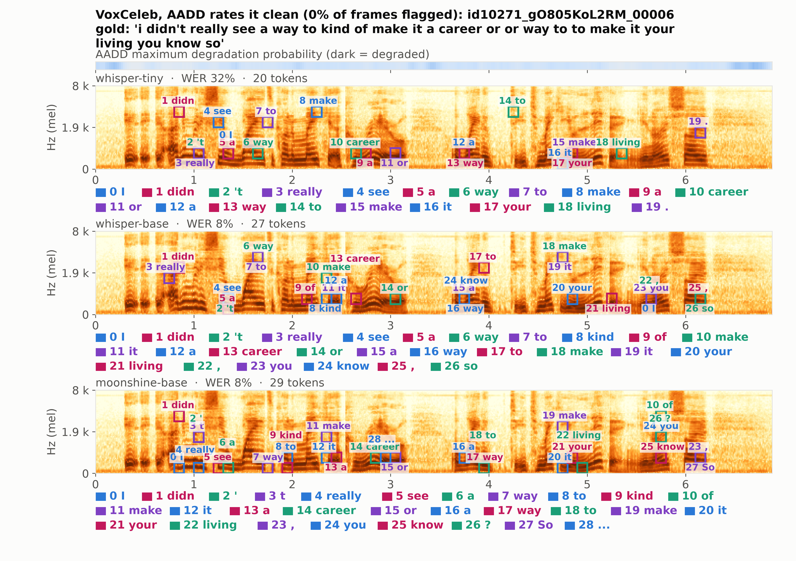
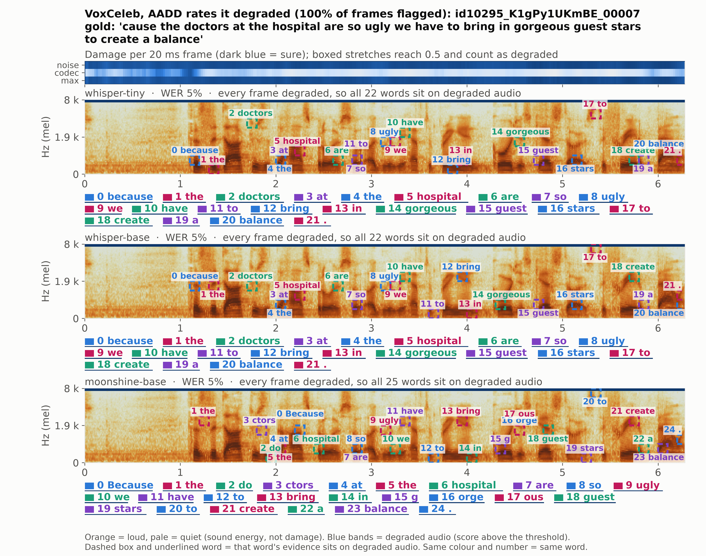
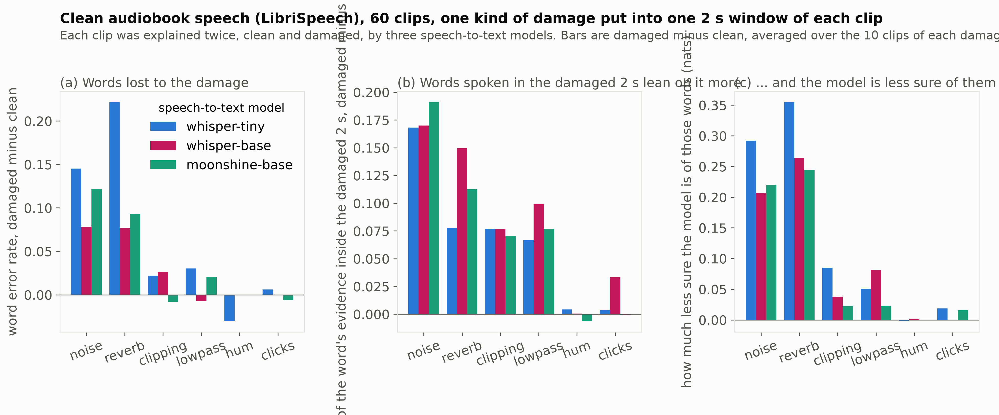
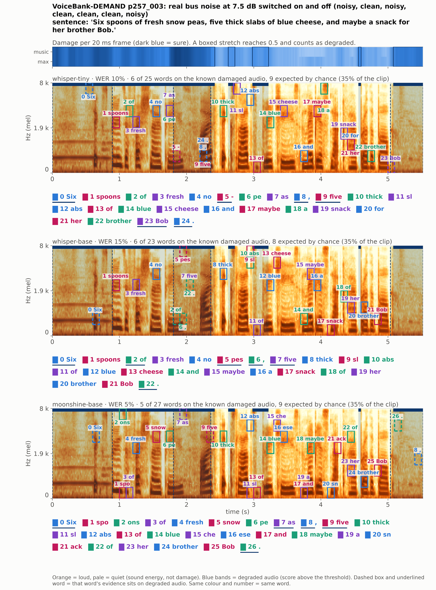
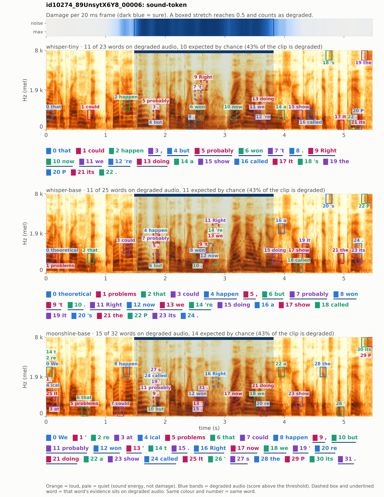
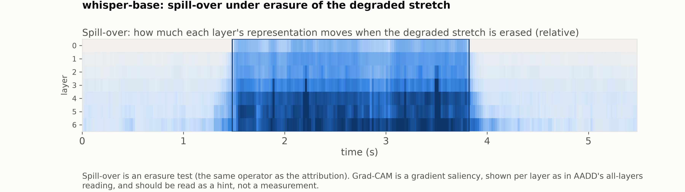
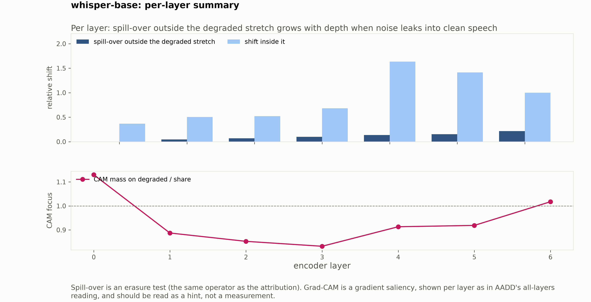

<p align="center">
  
</p>
<h1 align="center">WhatAreYouSaying</h1>
<p align="center"><sub>Which audio did the speech model use for each word it wrote, and was that audio clean?</sub></p>

<p align="center">
  <a href="LICENSE"></a>
  <a href="https://www.python.org/downloads/"></a>
  <a href="requirements.txt"></a>
  <a href="https://github.com/gertelrina/aadd"></a>
  <a href="tests/"></a>
  <a href="provenance/clean_env_run.log"></a>
  <a href="#reproducibility"></a>
</p>
<p align="center">
  <a href="#backends-local-weights-vllm-llamacpp"></a>
  <a href="#results-on-100-random-test-clips"></a>
</p>

<p align="center">
  
  <br><sub>The method on one clip (whisper-base). Erase one patch of the spectrogram, re-score the model's own transcript, note which token got less likely. Repeat for every patch.</sub>
</p>

WhatAreYouSaying (WAYS) tells you, for every token a speech-to-text model wrote, which 100 ms of
audio in which frequency band it leaned on, and whether that audio was clean or degraded. It works
with local Whisper and Moonshine weights, and with any OpenAI-compatible speech server such as vLLM
or llama.cpp. No training, no labels, one forward pass per erased patch.

It builds on two works and nothing else: representation erasure by Li, Monroe and Jurafsky
[[1]](#ref-1), which measures what a neural network uses by deleting parts of its input and
watching the likelihood of the right answer, and AADD by Arina Gertel [[2]](#ref-2), which says
what is wrong with a recording and where, every 20 ms. The speech models are Whisper
[[3]](#ref-3) and Moonshine [[4]](#ref-4). The reproducibility steps follow Dr Tanu Malik's work
on re-executable research [[5]](#ref-5) [[6]](#ref-6).

MIT licence. This is the framework behind the earlier per-token attribution study in
the pipeline repository,
rewritten so that it does not depend on that pipeline and so that the same erasure operator serves
every model.

**Contents:** [What it answers](#what-it-answers) · [How it works](#how-it-works) · [What I verified](#what-i-verified) · [Results on 100 random test clips](#results-on-100-random-test-clips) · [Does the detector's backbone matter](#does-the-detectors-backbone-matter) · [Controlled degradation](#controlled-degradation-on-librispeech) · [Real noise on and off](#real-noise-that-comes-and-goes-voicebank-demand) · [Install and use](#install-and-use) · [Two tools](#two-tools-sound-token-and-aud-cam) · [The figure](#the-figure-plug-and-play) · [Latent space](#noise-in-the-latent-space) · [Backends](#backends-local-weights-vllm-llamacpp) · [Reproducibility](#reproducibility) · [Limitations and future work](#limitations-and-future-work) · [Status](#status) · [References](#references) · [Repository layout](#repository-layout) · [Credits and licence](#credits-and-licence)

<details><summary>Stats for nerds</summary>

| | |
|---|---|
| erasure grid | 100 ms x 8 mel-spaced bands (0, 372, 745, 1128, 1657, 2433, 3571, 5244, 8000 Hz), on Whisper's STFT (25 ms Hann window, 10 ms hop) |
| erased patch, measured in Whisper's log-mel input | down 33 to 36 dB on average over three real clips, worst patch 17 dB, which leaves it below each recording's own 10th-percentile background level |
| scores per token and patch | surprisal change in nats, Li et al.'s relative change, argmax flip; black-box servers get a 0/1 word-change map |
| cost | one teacher-forced forward pass per patch, batched 64 at a time; 4.3 s per clip for moonshine-base, about 15 s for whisper-base on an RTX 4000 Ada (20 GB) |
| sample | 100 clips, simple random sample with seed 8001 from the saved 1 500-clip test slice (sha256 `dfb0451d…`), total 862 s of audio |
| controlled set | 60 LibriSpeech test-clean utterances, one 2 s degradation each from AADD's synthesiser, clean and degraded twins, three models |
| on-and-off set | 100 VoiceBank-DEMAND sentences (CC BY 4.0), real noise at 2.5 to 17.5 dB switched on and off in 4 to 7 segments per sentence, clean and noisy-throughout twins, three models, 30 min cap per model |
| detectors | AADD v3.1 (whisper-small backbone, 88.6 M parameters); AADD's head on whisper-base and on moonshine-base encoders (21 M each, AADD recipe on LibriSpeech dev-clean); plus AADD v3-lite (CRNN, 1.3 M) and v2 (EfficientNet-B0, 4.0 M) |
| tests | 35 CPU checks of the operator, the formulas, the figures (overlaps, page edges, repeatability, editable text), the latent view and the two tools, 2 end-to-end HTTP checks against a mock OpenAI-compatible server |

</details>

## What it answers

<p align="center">
  
</p>

A speech model turns a waveform into tokens. When it gets a word wrong, or right against the odds,
I want to know which part of the sound it was listening to, and whether that part was speech or
noise. Attention maps and gradients answer this only loosely: in the earlier study, gradient x
input on whisper-tiny kept 92 % of its ranking after the decoder was re-initialised, so it was
mostly reflecting input energy, not the model. Erasure answers it directly: remove the audio, see
what changes.

WAYS gives three things per clip:

* a map per token over time and frequency, saying how much each patch of audio supported it;
* the top patch per token, drawn and labelled on the spectrogram, with the transcript printed below it in the same colours and numbers (figure below);
* a noise-focus ratio per token and per clip: how much of the token's evidence sits in audio that
  AADD flags as degraded, relative to how much of the clip is flagged. 1 means no preference, 2 means
  the token leaned on degraded audio twice as much as chance.

<p align="center">
  
  <br><sub>One clip, three models. The spectrogram and the AADD strip are identical in every row; only the boxes and the transcript strip change. Same colour and number = same token.</sub>
</p>

## How it works

<p align="center">
  
</p>

<p align="center">
  
  <br><sub>The method on real audio: one band of whisper-base's input, one patch at a time. The word "Ron" reacts to one patch and to almost nothing else.</sub>
</p>

### Erasing a patch

Li et al. [[1]](#ref-1) erase one dimension of the input by setting it to zero, then measure the
relative change in the negative log-likelihood of the correct label. For audio the "dimension" is a
patch of the time-frequency plane. Let X = STFT(x) with Whisper's analysis settings (window 400
samples, hop 160, Hann, 16 kHz). Patch P = (b, t) covers STFT frames [10t, 10t + 10) and the
frequency bins of band b. Erasing it is

$$
\tilde{X}_P = X \odot (1 - \mathbb{1}_P), \qquad x \backslash P = \mathrm{ISTFT}(\tilde{X}_P)
$$

The erased waveform goes to the model through its own front end, so one operator serves Whisper
(log-mel input), Moonshine (raw waveform input) and a remote server (a WAV file over HTTP).

Zeroing coefficients and resynthesising is not exact: the 25 ms windows overlap by 75 %, so the
new signal's own STFT regains some energy in the patch from the frames and bins around it. WAYS
applies the projection three times (zero, resynthesise, re-analyse). Measured in Whisper's log-mel
on three real clips, the patch falls by 33 to 36 dB on average and by at least 17 dB in the worst
case, which puts it below the clip's own 10th-percentile background. Without resynthesis the drop
would be 56 dB; the residual is the price of staying in the waveform domain. The waveform outside
the patch's time span is unchanged to 1e-5, and only the two patches that share a window edge with
P lose a little of their own energy (up to about 10 % of P's effect).

### Scoring a token

Let y = (y₁ … y_K) be the model's own greedy transcript and S_k(x) = −log p(y_k | y_<k, x) the
surprisal of token k with the earlier tokens held fixed (teacher forcing). For every patch P:

$$
\Delta_k(P) = S_k(x \backslash P) - S_k(x), \qquad
r_k(P) = \frac{\Delta_k(P)}{S_k(x)}, \qquad
\mathrm{flip}_k(P) = \big[\arg\max_v p(v \mid y_{<k}, x \backslash P) \neq y_k\big]
$$

Δ is in nats and is positive when the patch supported the token. r is Li et al.'s equation 1 (the
relative change of the negative log-likelihood), with the sign chosen so that a supporting patch is
positive. flip is their discrete question, "does the decision change", asked per token. All three
come out of the same forward pass. Dividing by S_k(x) is a per-token constant, so every within-token
summary below is the same whether it is computed from Δ or from r; r only matters when tokens are
compared with each other, and it is unstable for tokens the model was nearly certain of (S_k ≈ 0),
so the summaries use Δ.

A server that returns only text cannot give S_k. There WAYS re-decodes x\P, aligns the new
transcript to y word by word with jiwer, and marks each original word that is not inside an
"equal" alignment chunk. That is the "relative change in evaluation metric" form of erasure from
the same paper, at word level, 0 or 1 per patch.

### From a map to a sentence

For token k, the non-negative mass is m_k(P) = max(Δ_k(P), 0) / Σ_P max(Δ_k(P), 0). From it:

* time profile Σ_b m_k(b, t) and band shares Σ_t m_k(b, t);
* top patch = argmax m_k, top share = the largest time-profile value;
* for Whisper, the distance between the top patch's centre and the token's own timestamp;
* noise-focus ratio. With f(t) the fraction of 20 ms frames in patch t that AADD flags (any class
  at probability ≥ 0.5) and f̄ its mean over the clip,

$$
\mathrm{NFR}_k = \frac{\sum_t \big(\sum_b m_k(b, t)\big)\, f(t)}{\bar{f}}
$$

NFR is 1 when a token spreads its evidence without regard to the flags, above 1 when it leans on
flagged audio, below 1 when it avoids it. It is undefined when the clip has no flagged frames and
trivially 1 when every frame is flagged, so the tables report it on the clips with 5 to 95 % of their frames flagged
("informative" clips) as well as on all clips. Uncertainty is a 10 000-resample bootstrap over
clips (seed 8001); model differences are paired on the same clips.

## What I verified

Every formula above has a test in `tests/`, and the numbers below are what those tests and the
smoke runs measured on this machine. `pytest tests -q` runs the first twelve in about one second
on a CPU.

| check | how | result |
|---|---|---|
| ISTFT inverts STFT | random signal through both | max error 1e-5 |
| bands are disjoint and cover 0 to 8 kHz | bin ranges | 9 edges, 201 bins, no gaps |
| erasing a 550 Hz tone from band 1 | energy in the patch before and after | 19 dB down; the band-0 neighbour and the waveform outside the patch unchanged |
| erasing white noise in every band | same | 12.5 to 19.6 dB down |
| the erased patch in the model's input | Whisper log-mel, 200 random patches on each of 3 real clips | 33 to 36 dB down on average, 17 dB worst, below the clip's own background |
| the synthetic backend recovers the planted patch | a fake model whose surprisal rises by exactly 2 nats when its patch is erased | top patch found for both tokens; Δ within 0.1 of 2.0; r = Δ / S₀ exact; exactly one flip; other patches move less than 0.3 |
| mass normalisation and band shares sum to 1 | `token_mass`, `token_summary` | exact |
| NFR = 1 for uniform mass, 2 when all mass is on the flagged half | synthetic flags | exact |
| WER counts and normalisation | known sentences | S, D, I, N as expected; punctuation and case ignored |
| teacher-forced surprisal equals the generation scores | whisper-base and moonshine-base on the example clip | max difference 6.5e-6 (Moonshine); Whisper identical by construction |
| scoring twice gives the same number | same clip twice | difference 0.0 |
| black-box word-change map agrees with the white-box flips | mock OpenAI-compatible server backed by whisper-tiny, both routes | every changed word sits at or after a flipped token, 2 tests pass |
| AADD through the Python API equals the CLI scan | first sample clip, v3.1 | max difference 5e-5, flag agreement 100 % |

The last line matters for the pipeline results: the AADD numbers used there came from the command
line tool, and the ones here from `aadd.infer.Detector` on the same waveform.

## Results on 100 random test clips

Three small models, the same 100 clips: a simple random sample (seed 8001) from the saved
1 500-clip test slice of the pipeline, 862 s of VoxCeleb interview audio with the SLUE human
transcripts as reference. Every patch of every clip was erased once per model: 695 patches per clip
on average, 69 456 teacher-forced forward passes per model, 7 s per clip for
whisper-tiny, 14 s for whisper-base and 4 s for moonshine-base on the GPU in
[Reproducibility](#reproducibility). Brackets are 95 % bootstrap intervals over clips.

| model | tokens | WER (mean over clips) | corpus WER | top-patch share | tokens with any flip | noise-focus ratio (v3) | focus, informative clips |
|---|---|---|---|---|---|---|---|
| whisper-tiny | 4034 | 0.35 [0.22, 0.55] | 0.383 | 0.30 [0.29, 0.32] | 0.45 [0.41, 0.48] | 0.97 [0.92, 1.03] | 0.93 [0.83, 1.03] (n=22) |
| whisper-base | 3267 | 0.20 [0.17, 0.22] | 0.182 | 0.26 [0.25, 0.27] | 0.33 [0.30, 0.36] | 1.01 [0.95, 1.10] | 1.04 [0.92, 1.18] (n=22) |
| moonshine-base | 4055 | 0.32 [0.16, 0.57] | 0.256 | 0.31 [0.29, 0.33] | 0.29 [0.26, 0.32] | 1.02 [0.96, 1.09] | 1.04 [0.93, 1.15] (n=22) |

| paired difference | WER | noise-focus ratio | top-patch share |
|---|---|---|---|
| whisper-base - moonshine-base | -0.124 [-0.380, +0.035] | -0.008 [-0.097, +0.077] | -0.050 [-0.069, -0.032] |
| whisper-tiny - whisper-base | +0.151 [+0.023, +0.355] | -0.042 [-0.089, -0.004] | +0.043 [+0.029, +0.058] |
| whisper-tiny - moonshine-base | +0.027 [-0.266, +0.305] | -0.050 [-0.131, +0.016] | -0.007 [-0.031, +0.017] |

<p align="center">
  
</p>

What this says, in order of how sure I am:

* **The maps are concentrated and model-specific.** A token's single most important 100 ms x band
  patch carries 30% (whisper-tiny), 26% (whisper-base) and 31% (moonshine-base) of its
  mass on average, out of about 700 patches. The two Whisper sizes differ on this by a paired
  +0.043 [+0.029, +0.058]: the smaller model leans harder on single patches.
* **Whisper's maps land on the token's own time.** The distance between a token's top patch and its
  cross-attention timestamp has a median of 0.12 s for whisper-base (80% of tokens within 0.3 s)
  and 0.31 s for whisper-tiny (71%). Moonshine has no timestamps to compare against.
* **Evidence sits where the voice is.** All three models put a quarter of each token's mass in the
  0.4 to 0.7 kHz band and almost nothing above 3.6 kHz (table below). Moonshine uses the lowest band
  (0 to 0.4 kHz) more than Whisper does, 0.19 against 0.14.
* **Single-patch erasure flips a token's choice in a minority of cases**: 45% of whisper-tiny
  tokens have at least one patch whose erasure changes the argmax, 33% for whisper-base and
  29% for moonshine-base. Most tokens survive the loss of any one patch.
* **On this data no model prefers degraded audio.** The noise-focus ratio is 0.93, 1.04 and
  1.04 on the 22 clips where it is informative, with intervals that all contain 1, and the
  paired differences between models contain 0. The reason is the data as much as the models: AADD
  flags 59% of all frames, every frame in 32 of the 100 clips and none in 22, so the
  flag carries little within-clip information on VoxCeleb. That is why the controlled experiment
  below exists.
* **WER.** whisper-base 0.20 per clip (0.182 corpus), moonshine-base 0.32 (0.256),
  whisper-tiny 0.35 (0.383). The per-clip means of moonshine and whisper-tiny have wide intervals
  because each has one clip where the model looped and produced far more words than the reference.

| model | 0.0-0.4 kHz | 0.4-0.7 kHz | 0.7-1.1 kHz | 1.1-1.7 kHz | 1.7-2.4 kHz | 2.4-3.6 kHz | 3.6-5.2 kHz | 5.2-8.0 kHz |
|---|---|---|---|---|---|---|---|---|
| whisper-tiny | 0.15 | 0.26 | 0.08 | 0.11 | 0.14 | 0.12 | 0.06 | 0.08 |
| whisper-base | 0.14 | 0.25 | 0.08 | 0.13 | 0.14 | 0.11 | 0.07 | 0.09 |
| moonshine-base | 0.19 | 0.26 | 0.06 | 0.11 | 0.15 | 0.10 | 0.05 | 0.09 |

<p align="center">
  
  <br><sub>How to read the clip figures. Orange is loud and pale is quiet: sound energy, not damage. The blue band is the audio AADD flags as degraded (here noise from 1.5 to 3.8 s, 43% of the clip). A dashed box and an underlined word mean that word's evidence sits on degraded audio; the row title counts those words against what chance would give. Here all three models sit at or just above chance on the noisy stretch (11 of 23 with 10 expected, 11 of 25 with 11, 15 of 32 with 14).</sub>
</p>
<p align="center">
  
  <br><sub>A clip AADD rates clean (no band). whisper-base and moonshine-base agree on 25 of 26 words; whisper-tiny drops "kind of" and "it".</sub>
</p>
<p align="center">
  
  <br><sub>A clip AADD flags end to end (the band covers everything, so the count says nothing). All three models get it with one error, and the boxes still sit on the voiced harmonics rather than the noise floor.</sub>
</p>

## Does the detector's backbone matter

AADD v3.1 has a whisper-small encoder inside it, so when it judges the audio that a Whisper model is
being explained on, the detector and the model share a family. To check that the noise-focus
result does not hang on that, I built two more detectors with AADD's own recipe and head
(`experiments/train_detectors.py`): one on the whisper-base encoder, which AADD's code already
supports, and one on the Moonshine encoder, which reads the raw waveform. Both were trained on
LibriSpeech dev-clean (never test-clean, which the controlled set uses) with AADD's event sampler,
coloured noise and a crowd of other speakers for noise, synthetic room responses for reverb, 4 000
steps of 12 windows each, in under three minutes apiece on the GPU below. Validation frame AUC:
0.982 for the whisper-base detector and 0.967 for the Moonshine one. The attribution maps never change
in this check; only the flags that the noise-focus ratio is computed against do.

<p align="center">
  
</p>

| detector | parameters | weights | flags inside the damaged 2 s | flags outside | right class inside |
|---|---|---|---|---|---|
| whisper-small detector (AADD v3.1) | 88.6 M | AADD v3.1 release | 0.92 | 0.12 | 0.91 |
| whisper-base detector | 21.0 M | AADD recipe on LibriSpeech dev-clean | 0.83 | 0.17 | 0.77 |
| moonshine-base detector | 21.0 M | AADD recipe on LibriSpeech dev-clean | 0.74 | 0.20 | 0.58 |

| detector | whisper-tiny | whisper-base | moonshine-base | paired whisper-base − moonshine-base |
|---|---|---|---|---|
| whisper-small detector (AADD v3.1) | 0.93 [0.83, 1.03] (n=22) | 1.04 [0.92, 1.18] (n=22) | 1.04 [0.93, 1.15] (n=22) | +0.004 [-0.088, +0.097] |
| whisper-base detector | 1.01 [0.96, 1.07] (n=65) | 1.03 [0.99, 1.07] (n=65) | 1.02 [0.97, 1.07] (n=65) | +0.007 [-0.023, +0.036] |
| moonshine-base detector | 0.84 [0.78, 0.91] (n=67) | 0.90 [0.84, 0.96] (n=67) | 0.86 [0.79, 0.92] (n=67) | +0.043 [+0.002, +0.086] |

* On the controlled clips, where the damaged 2 s is known, AADD's own detector is the best of the
  three (92% of frames flagged inside the window, 12% outside), the whisper-base detector is close (84% and 18%), and the Moonshine one is the weakest (74% and 20%, right class
  58%).
* Under the two detectors that find the damage reliably, the answer is the one from before: every
  speech-to-text model's noise-focus ratio sits at 1, with intervals that contain 1, and the
  whisper-base against moonshine-base difference contains 0. The Whisper-family overlap between
  detector and model does not create a preference for degraded audio.
* Under the weakest detector the ratios drop below 1 for whisper-tiny and moonshine-base
  (0.84 and 0.85). A detector that is wrong about where the damage is flags frames the models do not
  lean on, so the ratio reads "avoids" when the honest reading is "the flags are off". Detector
  quality sets a floor for this measure; that is the practical lesson, and it is why the controlled
  set, which needs no detector, carries the main claim.

Two further AADD detectors with other backbones (v3-lite, a 1.3 M-parameter CRNN, and v2, an
EfficientNet-B0 on log-mel at 1 s resolution) give the same picture, every interval containing 1:

| detector | whisper-tiny | whisper-base | moonshine-base | paired base - moonshine |
|---|---|---|---|---|
| v3 | 0.93 [0.83, 1.03] (n=22) | 1.04 [0.92, 1.18] (n=22) | 1.04 [0.93, 1.15] (n=22) | +0.004 [-0.088, +0.097] |
| v3-lite | 1.04 [0.94, 1.16] (n=17) | 1.00 [0.90, 1.14] (n=17) | 1.00 [0.88, 1.15] (n=17) | +0.000 [-0.050, +0.060] |
| v2 | 0.94 [0.85, 1.03] (n=46) | 0.94 [0.85, 1.03] (n=46) | 0.93 [0.84, 1.02] (n=46) | +0.009 [-0.059, +0.076] |

## Controlled degradation on LibriSpeech

The VoxCeleb flags cover too much of every clip to say whether a model leans on damaged audio. So
the second dataset has ground truth instead of a detector's opinion: 60 LibriSpeech test-clean
utterances (5 to 10 s, seed 8001), each with one degradation inserted into one 2 s window at a
random position, synthesised with AADD's own v3 generator (`aadd.v3.synth.Synthesizer`
[[2]](#ref-2)), ten clips per class: pink noise at 0 dB SNR, reverberation (synthetic room impulse
responses, RT60 0.6 to 1.0 s), clipping, low-pass, mains hum, clicks. The audio outside the
window is bit-identical to the clean twin, so every difference between the clean and the degraded
run of a clip comes from that window. Each clip was scored clean and degraded by each model, and
tokens were matched between the two transcripts (88 to 94 % of tokens survive the degradation
unchanged). "In-window tokens" are the matched tokens that drew at least half their evidence from
the window when the audio was clean.

<p align="center">
  
</p>

| model | WER clean | WER degraded | paired rise | tokens kept | in-window tokens: mass in window, clean -> degraded | paired change | surprisal rise in / out |
|---|---|---|---|---|---|---|---|
| whisper-tiny | 0.08 [0.06, 0.11] | 0.15 [0.11, 0.20] | +0.066 [+0.029, +0.109] | 0.88 [0.84, 0.92] | 0.76 [0.74, 0.78] -> 0.83 [0.81, 0.85] | +0.066 [+0.045, +0.087] | 0.13 [0.08, 0.18] / 0.03 [0.02, 0.05] |
| whisper-base | 0.06 [0.04, 0.08] | 0.09 [0.06, 0.11] | +0.029 [+0.014, +0.046] | 0.93 [0.91, 0.95] | 0.73 [0.72, 0.75] -> 0.82 [0.80, 0.84] | +0.088 [+0.067, +0.110] | 0.10 [0.06, 0.14] / 0.02 [0.01, 0.03] |
| moonshine-base | 0.05 [0.03, 0.07] | 0.09 [0.06, 0.12] | +0.037 [+0.016, +0.061] | 0.94 [0.92, 0.97] | 0.76 [0.74, 0.78] -> 0.84 [0.81, 0.86] | +0.072 [+0.047, +0.099] | 0.09 [0.05, 0.13] / 0.01 [-0.00, 0.02] |

| degradation | AADD flags inside | outside | right class inside | whisper-tiny: WER clean -> deg, mass-in clean -> deg | whisper-base: WER clean -> deg, mass-in clean -> deg | moonshine-base: WER clean -> deg, mass-in clean -> deg |
|---|---|---|---|---|---|---|
| noise | 1.00 | 0.03 | 1.00 | 0.09 -> 0.24, 0.73 -> 0.90 | 0.08 -> 0.16, 0.72 -> 0.89 | 0.07 -> 0.19, 0.73 -> 0.92 |
| reverb | 1.00 | 0.20 | 1.00 | 0.15 -> 0.37, 0.76 -> 0.84 | 0.07 -> 0.14, 0.75 -> 0.90 | 0.06 -> 0.16, 0.76 -> 0.88 |
| clipping | 0.90 | 0.15 | 0.89 | 0.06 -> 0.08, 0.75 -> 0.82 | 0.05 -> 0.07, 0.73 -> 0.81 | 0.07 -> 0.06, 0.77 -> 0.84 |
| lowpass | 1.00 | 0.05 | 1.00 | 0.04 -> 0.07, 0.77 -> 0.84 | 0.04 -> 0.03, 0.73 -> 0.83 | 0.02 -> 0.04, 0.76 -> 0.84 |
| hum | 0.92 | 0.23 | 0.91 | 0.11 -> 0.08, 0.79 -> 0.79 | 0.07 -> 0.07, 0.75 -> 0.75 | 0.05 -> 0.05, 0.77 -> 0.76 |
| clicks | 0.70 | 0.10 | 0.68 | 0.06 -> 0.07, 0.77 -> 0.77 | 0.04 -> 0.04, 0.71 -> 0.75 | 0.04 -> 0.04, 0.79 -> 0.79 |

What the controlled set shows:

* **AADD finds the inserted damage.** It flags 100% of frames inside a noise or reverb window and
  3% to 20% outside, with the right class; clicks are the hardest (70% inside). That is the
  detector working on its own kind of data, as its paper claims, and it is why the VoxCeleb flags
  should be read as "this real recording looks unlike clean read speech" rather than as a map of
  where the damage is.
* **Degradation pulls evidence into the damaged window, it does not push it away.** For tokens
  spoken inside the window, the share of evidence inside it rises from 0.73 to 0.82 for
  whisper-base (paired {:+.3f} [{:+.3f}, {:+.3f}]), 0.76 to 0.83 for whisper-tiny and
  0.76 to 0.84 for moonshine-base. Tokens spoken outside the window also lean on it more
  than before (paired {:+.3f} [{:+.3f}, {:+.3f}] for whisper-base). Erasing a patch of damaged audio costs the
  model more than erasing the same patch when it was clean: the damaged stretch is where the
  transcript is fragile, so that is where the evidence concentrates. This is the signature the
  tool is built to show, and it is visible per clip (figure below).
* **The surprisal says the same.** In-window tokens become 0.10 nats more surprising to
  whisper-base, out-of-window tokens 0.02; the other two models order the same way.
* **Noise and reverberation cost words, the other four barely do.** whisper-tiny goes from 0.09 to
  0.24 WER under noise and 0.15 to 0.37 under reverb; whisper-base loses about half as much and
  moonshine-base sits between the two. Hum and clicks move WER by at most 0.03 and the evidence
  shares by at most 0.04 for any model, which is the control the method needs: a degradation the
  model barely notices barely moves the maps.
* **Whisper-base and Moonshine-base are close**; whisper-tiny is the one that suffers. On clean
  LibriSpeech all three are at 0.05 to 0.08 WER.

<p align="center">
  
  <br><sub>LibriSpeech 2094-142345-0024 with pink noise at 0 dB inserted at 0.6 to 2.6 s (dashed). The clean twin is <code>figures/controlled_noise_clean__2094-142345-0024.png</code>; a reverb pair is in the same folder.</sub>
</p>

## Real noise that comes and goes: VoiceBank-DEMAND

The first two datasets could not answer one question: when the noise comes and goes inside a
sentence, does each word's evidence follow the word, or does it drift into the noise? The VoxCeleb
flags cover most of every clip, and the LibriSpeech set has one damaged window per clip. So the
third dataset is the VoiceBank-DEMAND test set [[7]](#ref-7), CC BY 4.0, downloaded from Edinburgh
DataShare with the four archives' SHA-256 checked in `experiments/demand.py`: 824 VCTK sentences
from two speakers, each released clean and with one real DEMAND recording (bus, cafe, living room,
office, public square) mixed in at 2.5, 7.5, 12.5 or 17.5 dB. The clean and noisy twins are
sample-aligned, so I can cut a sentence into 4 to 7 segments of about 0.4 to 0.9 s and take each
segment from the clean or the noisy twin, following a random pattern with at least two noisy runs
and two clean runs, with 10 ms crossfades. That gives "noisy, clean, noisy, clean, clean, noisy"
inside one sentence, with real noise and the exact boundaries known. 100 clips (seed 8001,
302 s of audio), three conditions each: clean, noisy throughout, and on-and-off. Each model ran
with a 30 minute cap; whisper-base took 24 minutes, whisper-tiny 12, moonshine-base 2.

The truth for where a word is spoken is whisper-base's word timestamp on the clean recording,
matched to each model's words by string alignment, so one truth serves all three models. Then,
on the on-and-off clips, I ask where `sound-token` put the word's strongest patch of evidence.

<p align="center">
  
</p>

* **The evidence follows the word, not the noise.** 78 % of whisper-tiny's and whisper-base's
  words and 79 % of moonshine-base's land on the same kind of audio they were spoken on, against
  52 % by chance, and 74 to 76 % land in the very segment they were spoken in, against 23 % by
  chance (95 % intervals in `experiments/results/demand/summary.md`). The median distance from the
  top patch to the word's timestamp is 0.11 to 0.12 s, the same as on VoxCeleb.
* **A word spoken in noise draws about 70 % of its evidence from the noisy segments; a word spoken
  in clean audio draws 36 to 37 %**, below the 51 % of the clip that is noisy. So the clean words
  are not pulled into the noise next to them. This is the per-word reading of the LibriSpeech
  result: damage concentrates the evidence of the words spoken inside it.
* **AADD sees the pattern but blurs its edges.** It flags no frame of the clean studio recordings,
  69 % of the frames when the noise runs throughout (97 % at 2.5 dB, 56 to 68 % above), and on the
  on-and-off clips 77 % of the noisy frames but also 42 % of the clean ones, merging the 2.4 noisy
  runs per clip into 1.5 spans. Its windowed scoring spreads a flag over the clean audio next to
  the noise, which is why the figure and the counts above use the known boundaries, and why the
  VoxCeleb flags should be read as coarse.
* **The words themselves survive.** WER on the on-and-off clips is 0.09 for the two Whisper models
  and 0.05 for moonshine-base, the same as clean for whisper-base and within 0.02 of clean for the
  others. Real bus or cafe noise at these SNRs costs few words; it moves evidence, not transcripts.

<p align="center">
  
  <br><sub>p257_003, bus noise at 7.5 dB in the pattern noisy, clean, noisy, clean, clean, clean, noisy (dashed). The row titles count against the known windows. The same sentence with the noise throughout is <code>figures/demand_noisy__p257_003.png</code>.</sub>
</p>

## Noise in the latent space

The attribution says which audio each word used. This view asks what the degraded audio does to
the model's own representation, layer by layer, with two measures on the 20 ms frame grid
(`ways/latent.py`, `ways latent clip.wav --backend hf-whisper --aadd --figure`):

* **Spill-over.** Erase the degraded stretch with the same operator as the attribution, run the
  encoder on the original and on the erased audio, and measure how much each layer's representation
  of each frame moves, relative to its size. Inside the stretch it has to move. Outside it, in
  clean frames, it should not move if the layer kept clean speech apart from the noise. The mean
  outside is the spill-over, and it is an erasure test, not a saliency.
* **Grad-CAM per layer.** The gradient of the transcript's summed surprisal with respect to every
  encoder layer, pooled the Grad-CAM way, time-only because encoder frames have no frequency axis.
  Every layer is shown rather than the last one, which is AADD's own reading of a Whisper encoder.
  It is a hint next to the spill-over, and it is labelled as one.

<p align="center">
  
  <br><sub>whisper-base on the partly degraded clip. Inside the noise (the boxed stretch) every layer moves when the noise is erased. Outside it, the clean frames move more the deeper the layer: that is the noise leaking into the representation of clean speech. The Moonshine twin is <code>figures/latent__moonshine-base__id10274_89UnsytX6Y8_00006.png</code>.</sub>
</p>

Over the 60 controlled clips, where the damaged 2 s is known, the spill-over outside the window
grows with depth in every model: whisper-tiny from 0.00 at the input to 0.19 at its top layer,
whisper-base from 0.00 to 0.20, moonshine-base from 0.12 to 0.29. Moonshine's
input embedding already moves outside the window (0.12) because its encoder applies a GroupNorm with a single group right after its convolutions, which
normalises over the whole clip, so erasing one stretch rescales every frame (checked: `groupnorm`,
`num_groups=1`, in the Hugging Face Moonshine encoder; its processor does no normalisation). Whisper's
log-mel frames carry no such coupling. The Grad-CAM
focus on the degraded stretch stays between 0.8 and 1.2 in every layer of every model but one
(Moonshine's layer 3 on the VoxCeleb clips, 1.6 with an interval from 0.9 to 2.2), and its
correlation with loudness is weak (no interval edge beyond 0.35), so the gradients do not single
out loud or degraded frames. The representation shift does. Full per-layer tables with intervals, for the
VoxCeleb clips and the controlled set: `experiments/results/latent/<model>/summary.md`.

**whisper-base, 60 controlled clips, known 2 s window: 60 clips**

| layer | spill-over outside | shift inside | CAM focus on degraded | rho(CAM, loudness) |
|---|---|---|---|---|
| 0 | 0.00 [0.00, 0.01] | 0.35 [0.34, 0.35] | 0.98 [0.81, 1.17] | -0.05 [-0.11, 0.01] |
| 1 | 0.04 [0.04, 0.05] | 0.49 [0.48, 0.50] | 0.89 [0.78, 1.00] | 0.00 [-0.06, 0.07] |
| 2 | 0.06 [0.05, 0.06] | 0.51 [0.50, 0.52] | 0.82 [0.73, 0.90] | -0.03 [-0.09, 0.02] |
| 3 | 0.09 [0.08, 0.09] | 0.66 [0.66, 0.67] | 0.85 [0.76, 0.95] | -0.12 [-0.18, -0.07] |
| 4 | 0.13 [0.12, 0.14] | 1.42 [1.35, 1.49] | 0.99 [0.87, 1.13] | -0.02 [-0.07, 0.03] |
| 5 | 0.15 [0.14, 0.16] | 1.29 [1.25, 1.34] | 0.85 [0.76, 0.94] | -0.03 [-0.09, 0.02] |
| 6 | 0.20 [0.19, 0.22] | 1.01 [1.00, 1.02] | 1.08 [0.97, 1.19] | -0.02 [-0.07, 0.02] |

## Install and use

```bash
git clone https://github.com/AlveeeRahman/WhatAreYouSaying && cd WhatAreYouSaying
python -m venv .venv && . .venv/bin/activate
pip install --extra-index-url https://download.pytorch.org/whl/cu128 -r requirements.txt   # or /cpu
pip install --no-deps -e .
pytest tests -q
```

Python 3.12. A GPU is optional for one clip (the backends fall back to the CPU). The first call
downloads the model from the Hugging Face Hub and, with `--aadd` or `ways quality`, the AADD
checkpoint (about 180 MB for v3), so it needs internet once. Add `--revision <commit>` to pin
the model snapshot. Re-running the experiments needs more (the pipeline repository, LibriSpeech, a
GPU). The list is in [docs/reproducibility.md](docs/reproducibility.md#re-running).

One clip, local weights, with the AADD context and the figure:

```bash
ways explain clip.wav --backend hf-whisper --model openai/whisper-base --aadd --figure --out out/
ways explain clip.wav --backend hf-moonshine --model UsefulSensors/moonshine-base --aadd --figure --out out/
ways quality clip.wav                      # just the AADD timeline
```

From Python:

```python
import soundfile as sf
from ways import explain, load_backend
from ways.metrics import token_summary, clip_summary
from ways.quality import Quality

wav, sr = sf.read("clip.wav", dtype="float32")          # 16 kHz mono
att = explain(load_backend("hf-whisper", "openai/whisper-base"), wav)   # delta, rel, flip: [tokens, 8 bands, patches]
probs = Quality("v3").frames(wav)                        # AADD, [frames of 20 ms, 12 classes]
rows = token_summary(att, probs)                         # one dict per token: top patch, band shares, focus ratio
print(clip_summary(att, rows, probs))
```

`att.save(path)` / `Attribution.load(path)` keep the arrays as a compressed npz with the
transcript and grid in a JSON field.

## Two tools: sound-token and aud-cam

The two views have names, so a person, a script or a language model can call them. `sound-token`
answers "which audio did each word use, and was that audio clean or degraded". `aud-cam` answers
"what does the degraded audio do inside the encoder, layer by layer". Each call returns numbers
and writes its own figure from the templates in `ways/figure.py`, so the figures of one tool
always have the same shape and every heading in them can be changed from the call.

```bash
ways sound-token clip.wav --backend hf-whisper=openai/whisper-base --backend hf-moonshine=UsefulSensors/moonshine-base --aadd --out out/clip
ways aud-cam     clip.wav --backend hf-whisper=openai/whisper-base --aadd --granular --out out/clip
```

`sound-token` writes `out/clip__sound-token.png` (and an SVG twin): the damage rows, one
spectrogram per backend with a box per word, the transcript strip, the count against chance.
`aud-cam` writes `out/clip__aud-cam.png` with the spectrogram, the Grad-CAM lane, the spill-over
lane and the per-layer summary. With `--granular` it also writes each lane as its own figure,
`__aud-cam-cam.png`, `__aud-cam-spillover.png` and `__aud-cam-layers.png`, for when one view
has to be read on its own. Both print a JSON summary to stdout.

<p align="center">
  
</p>

<p align="center">
  
  
</p>

From Python the tools take a waveform and return the arrays as well as the figure paths:

```python
import soundfile as sf
from ways.tools import sound_token, aud_cam

wav, sr = sf.read("clip.wav", dtype="float32")
st = sound_token(wav, sr, backends=[("hf-whisper", "openai/whisper-base")], aadd=True, out="out/clip",
                 text={"title": "my clip", "caption": "my caption"})     # any heading or sentence of the figure
st["summaries"][0]["focus_ratio_mean"], st["figure"]
ac = aud_cam(wav, sr, backend=("hf-whisper", "openai/whisper-base"), aadd=True, out="out/clip", granular=True)
ac["summary"][-1]["shift_out"], ac["figures"]["spillover"]
```

For function calling, `ways.tools.schema()` returns the two tool definitions as JSON schemas
(name, description, parameters with `audio` required) in the OpenAI function shape (for the
Anthropic API rename `parameters` to `input_schema`), and `ways.tools.call(name, **arguments)` runs one by name from an audio path.
Pass `window=[start_s, end_s]` instead of `aadd` when the damaged span is known.

```python
from ways.tools import schema, call
tools = schema()                                   # hand these to the model
out = call("aud-cam", audio="clip.wav", aadd=True, out="out/clip", granular=True)   # run what it chose
```

`aud-cam` needs a white-box backend (hf-whisper or hf-moonshine) because it reads the encoder.
`sound-token` also works through `openai-compat` (vLLM, llama.cpp), where the per-word map is the
black-box word-change map of the [Backends](#backends-local-weights-vllm-llamacpp) section.

## The figure, plug and play

Every clip figure in this repository comes from one function in one self-contained file,
`ways/figure.py` (numpy and matplotlib only, no other import from WAYS). Copy that file into any
Python project and call it with your own audio, your own degradation detector and your own
attribution method. The structure is always the same four lanes on one time axis: the damage per
frame (one row per kind, dark blue = sure), the spectrogram with the degraded spans painted on it
and one box per word, the transcript in the box colours with words on degraded audio underlined,
and the count against chance in each model's row title. `latent_figure` adds the per-layer lanes
of the section below.

```python
from ways.figure import ways_figure          # or copy ways/figure.py next to your code

ways_figure(
    wav, 16000,                               # mono waveform, any length
    quality=probs, quality_hop=0.02,          # any detector: [frames, classes] probabilities, seconds per frame
    quality_classes=["noise", "music", "reverb"],   # row names; a one-column array works too
    threshold=0.5,
    models=[{"name": "my-asr", "tokens": ["hello", "world"],
             "top": [(2, 14), (3, 20)],       # per word: (band, time index) of the audio patch it used most
             "patch_s": 0.1, "n_bands": 8, "wer": 0.1}],
    window=None,                              # or (start_s, end_s) of a known damaged span
    text={"title": "my clip", "x_time": "seconds", "caption": "my own caption"},   # any heading, axis name or sentence
    style={"width_in": 10, "font_size": 11},  # colours, fonts, sizes
    out="my_clip.png")                        # PNG at 300 dpi plus an SVG twin
```

The figures are software, not drawings, and three rules are enforced in code:

* **Every string is data.** Headings, lane titles, axis names, the verdict sentences and the
  caption are fields of `FigureText` (and `LatentText`), with `str.format` templates where a
  number goes in. Pass an instance or a dict of the fields you want to change. Colours, fonts and
  sizes are `FigureStyle`.
* **No overlapping text, ever.** Word labels and transcript lines are placed from measured text
  widths. After drawing, every text artist's pixel box is checked against every other; if two
  overlap, the rows are widened and the check runs again, and if that does not separate them the
  function raises `LayoutError` naming the two texts instead of writing the file. The test suite
  draws figures with absurdly long titles and 40-word transcripts and asserts zero overlaps, and
  one test asserts that an impossible style does raise.
* **Same inputs, same bytes.** The font is the one bundled with matplotlib, the SVG hash salt is
  fixed, and the PNG and SVG metadata that would carry a date or a version are removed. A test
  draws the same figure twice and compares the SHA-256 of both files.

`ways.figure.from_attribution(att)` turns a WAYS attribution into the `models` entry.

## Backends: local weights, vLLM, llama.cpp

| backend | reached how | score | what it was tested against |
|---|---|---|---|
| `hf-whisper` | transformers, in process | Δ, r, flip | whisper-tiny, whisper-base, 100 clips each |
| `hf-moonshine` | transformers, in process | Δ, r, flip | moonshine-base, 100 clips |
| `openai-compat` | HTTP, `/v1/audio/transcriptions` or `/v1/chat/completions` with `input_audio` | word changed, 0/1 | `tests/mock_server.py` (a local server that answers both routes with whisper-tiny) |

```bash
vllm serve openai/whisper-large-v3 --port 8000
ways explain clip.wav --backend openai-compat --route transcriptions --base-url http://localhost:8000/v1 \
     --model openai/whisper-large-v3 --patch 0.2 --bands 4 --out out/

llama-server -hf ggml-org/ultravox-v0_5-llama-3_2-1b-GGUF --port 8080
ways explain clip.wav --backend openai-compat --route chat --base-url http://localhost:8080/v1 \
     --model ultravox --patch 0.2 --bands 4 --out out/
```

The black-box path costs one request per patch, so a coarser grid is the sensible default there.
I have not run a live vLLM or llama.cpp server for this repository; the client is the official
`openai` package and the request shapes are the ones both servers document. Details and the
chat-route prompt are in [docs/backends.md](docs/backends.md).

## Reproducibility

<p align="center">
  
</p>

I followed the steps Dr Malik's group teaches for re-executable research [[5]](#ref-5) and the
three-layer dependency view of her 2026 paper with Vangala, Adibifar and Gehani [[6]](#ref-6),
then tested on real hardware. The full checklist is [docs/reproducibility.md](docs/reproducibility.md).

* **Fixed, hashed inputs.** The 100 clips are `default_rng(8001).choice(1500, 100, replace=False)` on the
  saved test slice (sha256 `dfb0451d8ea3…`), which is disjoint from the development and load slices;
  the script asserts that and never reads load-pool audio. Clip ids: `experiments/sample100.csv`.
* **Pinned claimed dependencies.** `requirements.txt` pins every version. AADD is not on PyPI; it is
  pinned to git commit `c6a2debc`. My first draft said `aadd==3.1.0`, and the clean-environment run
  below failed on it. That is exactly the claimed-versus-working gap the paper measures, caught
  by the test the paper recommends. Model weights are pinned too: every experiment loads
  whisper-tiny, whisper-base and moonshine-base at the snapshot commits its `provenance.json`
  recorded (`experiments/common.py`).
* **Runtime provenance written by the code.** Each run writes `provenance.json` with the git commit,
  Python, torch and CUDA versions, the GPU, input hashes, model snapshot commits, seeds, the claimed
  dependency list and the runtime dependency list (every distribution behind an imported module),
  plus the difference between the two.
* **Clean-environment execution test.** `scripts/reproduce_clean_env.sh` builds a fresh venv with no
  system packages, installs only `requirements.txt` (CPU torch), installs the package, runs the CPU
  tests, imports every third-party module the code uses, and records what loaded. Result on this
  machine: passed; 15 claimed packages, 60 distributions loaded, 45 of them transitive, all 83 resolved
  versions written to `provenance/requirements-lock.txt`
  (`provenance/clean_env_run.json`). The audit against the paper is
  [docs/reproducibility_audit.md](docs/reproducibility_audit.md).
* **Real hardware.** Everything in `experiments/results/` ran on one NVIDIA RTX 4000 Ada (20 GB),
  Ubuntu, Python 3.12.3, torch 2.11.0+cu128, transformers 5.5.4. Continuous integration is not set
  up yet; the command a workflow would run is `pytest tests -q -m "not gpu and not slow"`.

## Limitations and future work

* **The erasure is not a hard zero.** 33 to 36 dB down on average, 17 dB worst case, because of
  the window overlap. For a model that reads the waveform there is no cleaner operator at this
  resolution; for Whisper alone one could set the log-mel patch to the floor, but then the two
  model families would not get the same test.
* **Teacher forcing scores the model's own transcript.** Δ says how much a patch supported what the
  model wrote, not what it should have written. A wrong token with a confident map is still a wrong
  token; the WER column is kept next to the maps for that reason.
* **AADD is a detector, not ground truth.** It was trained on synthetic degradations of read speech;
  on these real interview clips it flags 59 % of frames and every frame in a third of the clips.
  The noise-focus ratio is reported on the clips where it is informative, and under three detectors.
* **Moonshine has no timestamps**, so the distance-to-timestamp summary exists only for Whisper.
* **Neighbouring patches share an edge.** A patch's two time neighbours lose up to about 10 % of
  its effect; maps are smooth across those edges by construction.
* **No live vLLM or llama.cpp run yet**, only the mock server. Running one is the next test.
* **100 real clips and 60 controlled clips, three small models.** Enough for paired comparisons with
  bootstrap intervals, not for claims about large models or other languages.

## Status

* Done: operator, three backends, scores, summaries, AADD context, CLI, the figure system, the
  latent view, the two named tools (`sound-token`, `aud-cam`) with JSON schemas, tests, 100-clip runs for three models, the detector-backbone check (whisper-small,
  whisper-base, moonshine-base), the controlled LibriSpeech set, the VoiceBank-DEMAND on-and-off set, clean-environment run, provenance.
* Next: CI workflow once Actions minutes are available (the test command is fixed); a live vLLM
  transcription run; the same 100 clips on Modal if a larger model is wanted.

## References

<a id="ref-1"></a>[1] J. Li, W. Monroe, and D. Jurafsky, "Understanding neural networks through representation erasure," *arXiv:1612.08220*, Dec. 2016. [arXiv](https://arxiv.org/abs/1612.08220)

<a id="ref-2"></a>[2] A. Gertel, "AADD: Automatic Audio Degradation Detection," software, version 3.1.0, 2026, MIT licence. [GitHub](https://github.com/gertelrina/aadd) · [doi:10.5281/zenodo.24352878](https://doi.org/10.5281/zenodo.24352878)

<a id="ref-3"></a>[3] A. Radford, J. W. Kim, T. Xu, G. Brockman, C. McLeavey, and I. Sutskever, "Robust speech recognition via large-scale weak supervision," in *Proc. ICML*, 2023. [arXiv](https://arxiv.org/abs/2212.04356)

<a id="ref-4"></a>[4] N. Jeffries, E. King, M. Kudlur, G. Nicholson, J. Wang, and P. Warden, "Moonshine: Speech recognition for live transcription and voice commands," *arXiv:2410.15608*, 2024. [arXiv](https://arxiv.org/abs/2410.15608)

<a id="ref-5"></a>[5] D. H. Ton That, G. Fils, Z. Yuan, and T. Malik, "Sciunits: Reusable research objects," in *Proc. IEEE 13th Int. Conf. on e-Science*, 2017. [arXiv](https://arxiv.org/abs/1707.05731)

<a id="ref-6"></a>[6] B. P. Vangala, A. Adibifar, A. Gehani, and T. Malik, "AI-generated code is not reproducible (yet): An empirical study of dependency gaps in LLM-based coding agents," *arXiv:2512.22387*, v3, Mar. 2026. [arXiv](https://arxiv.org/abs/2512.22387)

<a id="ref-7"></a>[7] C. Valentini-Botinhao, "Noisy speech database for training speech enhancement algorithms and TTS models," University of Edinburgh, School of Informatics, Centre for Speech Technology Research, 2017, CC BY 4.0. [DataShare](https://datashare.ed.ac.uk/handle/10283/2791). Speech from the CSTR VCTK corpus, noise from DEMAND (J. Thiemann, N. Ito, and E. Vincent, 2013).

## Repository layout

| Path | What it holds |
|---|---|
| `ways/erasure.py` | the STFT patch grid and the erasure operator |
| `ways/attribution.py` | `explain()`: Δ, r and flip per token and patch; the black-box word-change map |
| `ways/backends/` | `hf_whisper.py`, `hf_moonshine.py`, `openai_compat.py` (vLLM, llama.cpp) |
| `ways/quality.py` | AADD wrapper, flagged mask, degraded intervals |
| `ways/metrics.py` | token and clip summaries, noise-focus ratio, WER, bootstrap |
| `ways/figure.py` | the universal clip figure, the latent figure and the three granular aud-cam figures, self-contained: text and style as data, overlap check, repeatable bytes |
| `ways/latent.py` | spill-over under erasure and Grad-CAM per encoder layer |
| `ways/plots.py` | the method, comparison and controlled-summary figures; the clip figures call `ways/figure.py` |
| `ways/provenance.py` | the provenance manifest (claimed and runtime dependencies, hashes, model commits) |
| `ways/tools.py` | the two tools, `sound_token` and `aud_cam`, with their JSON schemas and `call(name, ...)` for function calling |
| `ways/cli.py` | `ways sound-token`, `ways aud-cam`, `ways explain`, `ways latent`, `ways quality` |
| `tests/` | operator and formula checks; mock OpenAI-compatible server and the HTTP test |
| `experiments/` | sample selection, the three-model runs, the detector runs (`run_aadd_variants.py`, `train_detectors.py`, `detector_backbones.py`), comparison tables, the example clip, the controlled LibriSpeech set (`controlled.py`); the VoiceBank-DEMAND on-and-off set (`demand.py`, `demand_figures.py`); `common.py` holds the pipeline path and the pinned model revisions |
| `experiments/results/` | per-clip rows, per-token tables, `comparison.json`, `comparison.md`, provenance (npz maps are not committed) |
| `figures/` | the method figure, per-model clip figures, the three-model figures (VoxCeleb partly degraded, clean and degraded; LibriSpeech clean and degraded; VoiceBank-DEMAND on and off), the comparison figures, the two HTML charts rendered by `docs/images/render.py` |
| `docs/` | backends, reproducibility checklist; `docs/images/`: the icon and its drawing script, the two hand-drawn workflow figures and the two charts (sources in `src/`, rendered by `render.py`), the two GIFs |
| `provenance/` | clean-environment run log and runtime dependency set |
| `scripts/reproduce_clean_env.sh` | the clean-environment execution test |

## Credits and licence

WhatAreYouSaying is released under the MIT licence (see `LICENSE`). AADD [[2]](#ref-2) is MIT and
keeps its licence; Whisper weights are Apache-2.0, Moonshine weights MIT, transformers Apache-2.0.
The VoxCeleb audio and the SLUE transcripts used in `experiments/` are not part of this repository;
only clip ids, per-clip and per-token numbers, and figures are. The attribution design started in
an earlier study of a speech pipeline, whose saved test slice
and AADD scan this work samples from.
