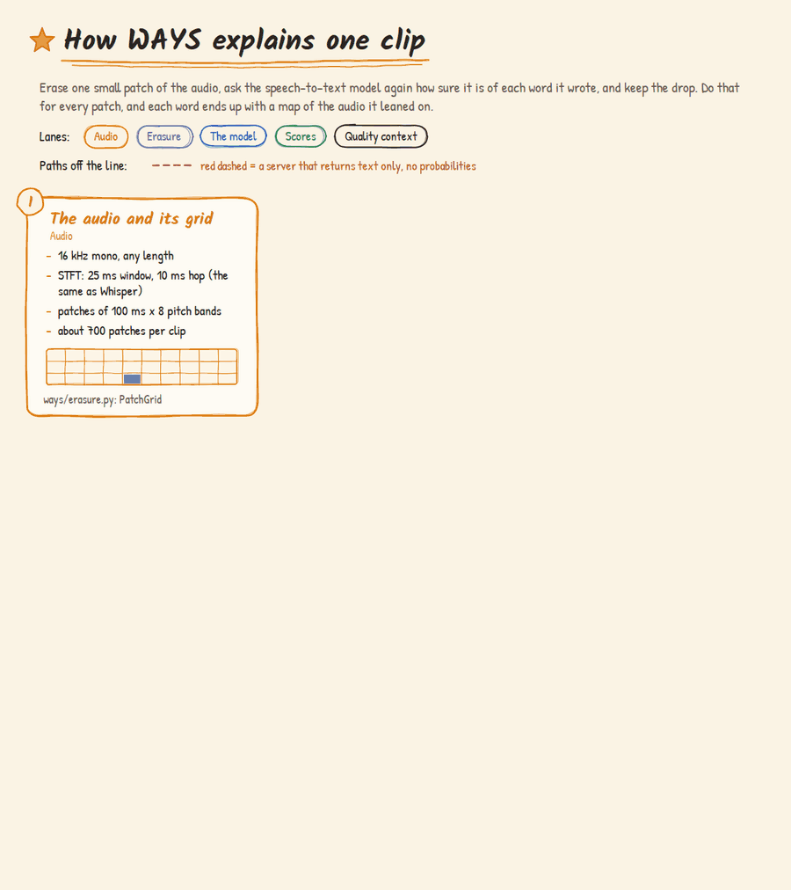
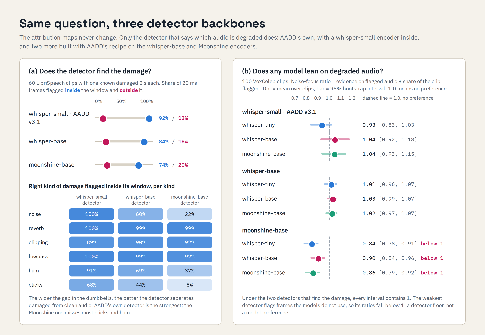
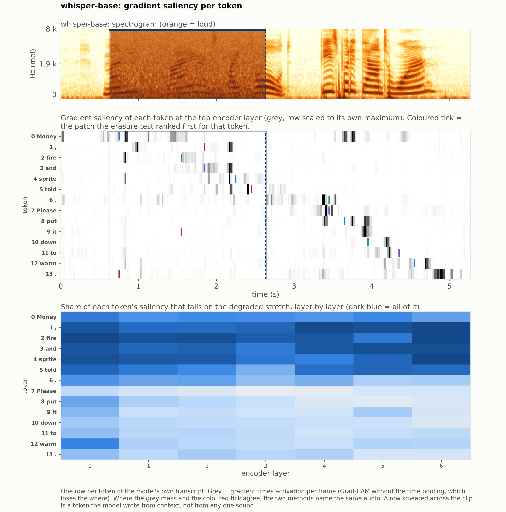

<p align="center">
  
</p>
<h1 align="center">WhatAreYouSaying</h1>
<p align="center"><sub>Which audio did the speech model use for each word it wrote, and was that audio clean?</sub></p>

<p align="center">
  <a href="LICENSE"></a>
  <a href="https://www.python.org/downloads/"></a>
  <a href="requirements.txt"></a>
  <a href="https://github.com/gertelrina/aadd"></a>
  <a href="tests/"></a>
  <a href="provenance/clean_env_run.log"></a>
  <a href="#reproducibility"></a>
</p>
<p align="center">
  <a href="#backends-local-weights-vllm-llamacpp"></a>
  <a href="#results-on-100-random-test-clips"></a>
</p>

<p align="center">
  

<p align="center">
  
  <br><sub>The method on one clip (whisper-base). Erase one patch of the spectrogram, re-score the model's own transcript, note which token got less likely. Repeat for every patch.</sub>
</p>

WhatAreYouSaying (WAYS) tells you, for every token a speech-to-text model wrote, which 100 ms of
audio in which frequency band it leaned on, and whether that audio was clean or degraded. It works
with local Whisper and Moonshine weights, and with any OpenAI-compatible speech server such as vLLM
or llama.cpp. No training, no labels, one forward pass per erased patch.

It builds on two works and nothing else: representation erasure by Li, Monroe and Jurafsky
[[1]](#ref-1), which measures what a neural network uses by deleting parts of its input and
watching the likelihood of the right answer, and AADD by Arina Gertel [[2]](#ref-2), which says
what is wrong with a recording and where, every 20 ms. The speech models are Whisper
[[3]](#ref-3) and Moonshine [[4]](#ref-4). The reproducibility steps follow two works on
re-executable research [[5]](#ref-5) [[6]](#ref-6), drawn in [Reproducibility](#reproducibility).
MIT licence; changes are in [CHANGELOG.md](CHANGELOG.md).

**Contents:** [What it answers](#what-it-answers) · [How it works](#how-it-works) · [What I verified](#what-i-verified) · [100 VoxCeleb clips](#100-voxceleb-clips-three-models) · [Detector backbones](#does-the-detectors-backbone-matter) · [Controlled damage](#controlled-damage-on-librispeech) · [One ambiguous clip](#one-ambiguous-clip-read-in-depth) · [Noise on and off](#real-noise-that-comes-and-goes-voicebank-demand) · [Latent space](#noise-in-the-latent-space) · [Install and use](#install-and-use) · [The tool framework](#the-tool-framework-sound-token-and-aud-cam) · [The figure](#the-figure-plug-and-play) · [Backends](#backends-local-weights-vllm-llamacpp) · [Reproducibility](#reproducibility) · [Limitations](#limitations-and-future-work) · [Status](#status) · [References](#references) · [Layout](#repository-layout) · [Credits and licence](#credits-and-licence)

<details>
<summary><b>Stats for nerds</b> (the grid, the scores, the data, the cost)</summary>

| | |
|---|---|
| erasure grid | 100 ms x 8 mel-spaced bands (0, 372, 745, 1128, 1657, 2433, 3571, 5244, 8000 Hz), on Whisper's STFT (25 ms Hann window, 10 ms hop) |
| erased patch, measured in Whisper's log-mel input | down 33 to 36 dB on average over three real clips, worst patch 17 dB, which leaves it below each recording's own 10th-percentile background level |
| scores per token and patch | surprisal change in nats, Li et al.'s relative change, argmax flip; black-box servers get a 0/1 word-change map |
| cost | one teacher-forced forward pass per patch, batched 64 at a time; 4.3 s per clip for moonshine-base, about 15 s for whisper-base on an RTX 4000 Ada (20 GB) |
| VoxCeleb sample | 100 clips, simple random sample with seed 8001 from a fixed 1 500-clip test slice (sha256 `dfb0451d…`), 862 s of interview audio with human transcripts |
| controlled set | 60 LibriSpeech test-clean utterances, one 2 s degradation each from AADD's synthesiser, clean and degraded twins, three models |
| on-and-off set | 100 VoiceBank-DEMAND sentences (CC BY 4.0), real noise at 2.5 to 17.5 dB switched on and off in 4 to 7 segments per sentence, clean and noisy-throughout twins, three models, 30 min cap per model |
| detectors | AADD v3.1 (whisper-small backbone, 88.6 M parameters); AADD's head on whisper-base and on moonshine-base encoders (21 M each, AADD recipe on LibriSpeech dev-clean); plus AADD v3-lite (CRNN, 1.3 M) and v2 (EfficientNet-B0, 4.0 M) |
| tests | 40 CPU checks of the operator, the formulas, the figures (overlaps, page edges, repeatability, editable text), the latent view and the tool framework, 2 end-to-end HTTP checks against a mock OpenAI-compatible server |

</details>

## What it answers

<p align="center">
  
</p>

A speech model turns a waveform into tokens. When it gets a word wrong, or right against the odds,
I want to know which part of the sound it was listening to, and whether that part was speech or
noise. Attention maps and gradients answer this loosely: in an earlier study of mine, gradient x
input on whisper-tiny kept 92 % of its ranking after the decoder was re-initialised, so it was
mostly reflecting input energy, not the model. Erasure answers it directly: remove the audio, see
what changes. Per clip WAYS gives a map per token over time and frequency, the top patch per token
drawn on the spectrogram with the transcript below it in the same colours, and a noise-focus ratio
per token and per clip: how much of the evidence sits in audio that AADD flags as degraded,
relative to how much of the clip is flagged (1 means no preference).

<p align="center">
  
  <br><sub>One clip, three models. The spectrogram and the AADD strip are identical in every row; only the boxes and the transcript strip change. Same colour and number = same token.</sub>
</p>

## How it works

<p align="center">
  
</p>

<p align="center">
  
  <br><sub>One band of whisper-base's input, one patch at a time. The word "Ron" reacts to one patch and to almost nothing else.</sub>
</p>

Li et al. [[1]](#ref-1) erase one dimension of the input by setting it to zero, then measure the
relative change in the negative log-likelihood of the correct label. For audio the "dimension" is a
patch of the time-frequency plane. With X = STFT(x) in Whisper's analysis settings (window 400
samples, hop 160, Hann, 16 kHz), patch P = (b, t) covers STFT frames [10t, 10t + 10) and the bins of
band b, and erasing it is

$$
\tilde{X}_P = X \odot (1 - \mathbb{1}_P), \qquad x \backslash P = \mathrm{ISTFT}(\tilde{X}_P)
$$

The erased waveform goes to the model through its own front end, so one operator serves Whisper
(log-mel input), Moonshine (raw waveform input) and a remote server (a WAV file over HTTP). With
y = (y₁ … y_K) the model's own greedy transcript and S_k(x) = −log p(y_k | y_<k, x) the surprisal of
token k under teacher forcing, every patch gets three scores from the same forward pass:

$$
\Delta_k(P) = S_k(x \backslash P) - S_k(x), \qquad
r_k(P) = \frac{\Delta_k(P)}{S_k(x)}, \qquad
\mathrm{flip}_k(P) = \big[\arg\max_v p(v \mid y_{<k}, x \backslash P) \neq y_k\big]
$$

Δ is in nats and positive when the patch supported the token; r is Li et al.'s equation 1 with the
sign flipped; flip is their discrete question, "does the decision change". The non-negative mass
m_k(P) = max(Δ_k(P), 0) / Σ max(Δ_k, 0) gives the time profile, the band shares, the top patch, and
the noise-focus ratio against the AADD flags f(t) with clip mean f̄:

$$
\mathrm{NFR}_k = \frac{\sum_t \big(\sum_b m_k(b, t)\big)\, f(t)}{\bar{f}}
$$

<details>
<summary><b>Stats for nerds</b> (the fine print of the operator and the scores)</summary>

* Zeroing coefficients and resynthesising is not exact: the 25 ms windows overlap by 75 %, so the
  new signal's own STFT regains some energy in the patch from the frames and bins around it. WAYS
  applies the projection three times (zero, resynthesise, re-analyse). Measured in Whisper's log-mel
  on three real clips, the patch falls by 33 to 36 dB on average and by at least 17 dB in the worst
  case, below the clip's own 10th-percentile background. Without resynthesis the drop would be
  56 dB; the residual is the price of staying in the waveform domain. The waveform outside the
  patch's time span is unchanged to 1e-5, and only the two patches that share a window edge with P
  lose a little of their own energy (up to about 10 % of P's effect).
* Dividing by S_k(x) is a per-token constant, so every within-token summary is the same from Δ or
  from r; r only matters between tokens and is unstable for tokens the model was nearly certain of
  (S_k ≈ 0), so the summaries use Δ.
* A server that returns only text cannot give S_k. There WAYS re-decodes x\P, aligns the new
  transcript to y word by word with jiwer, and marks each original word that is not inside an
  "equal" alignment chunk: the "relative change in evaluation metric" form of erasure from the same
  paper, at word level, 0 or 1 per patch.
* NFR is 1 when a token spreads its evidence without regard to the flags, above 1 when it leans on
  flagged audio, below 1 when it avoids it. It is undefined with no flagged frames and trivially 1
  when every frame is flagged, so the tables report it on the clips with 5 to 95 % of frames flagged
  ("informative" clips) as well as on all clips. Uncertainty is a 10 000-resample bootstrap over
  clips (seed 8001); model differences are paired on the same clips.

</details>

## What I verified

Every formula above has a test in `tests/`, and the numbers are what those tests and the smoke runs
measured on this machine. `pytest tests -q` runs the CPU checks in about half a minute.

<details>
<summary><b>Stats for nerds</b> (every check and its result)</summary>

| check | how | result |
|---|---|---|
| ISTFT inverts STFT | random signal through both | max error 1e-5 |
| bands are disjoint and cover 0 to 8 kHz | bin ranges | 9 edges, 201 bins, no gaps |
| erasing a 550 Hz tone from band 1 | energy in the patch before and after | 19 dB down; the band-0 neighbour and the waveform outside the patch unchanged |
| erasing white noise in every band | same | 12.5 to 19.6 dB down |
| the erased patch in the model's input | Whisper log-mel, 200 random patches on each of 3 real clips | 33 to 36 dB down on average, 17 dB worst, below the clip's own background |
| the synthetic backend recovers the planted patch | a fake model whose surprisal rises by exactly 2 nats when its patch is erased | top patch found for both tokens; Δ within 0.1 of 2.0; r = Δ / S₀ exact; exactly one flip; other patches move less than 0.3 |
| mass normalisation and band shares sum to 1 | `token_mass`, `token_summary` | exact |
| NFR = 1 for uniform mass, 2 when all mass is on the flagged half | synthetic flags | exact |
| WER counts and normalisation | known sentences | S, D, I, N as expected; punctuation and case ignored |
| teacher-forced surprisal equals the generation scores | whisper-base and moonshine-base on the example clip | max difference 6.5e-6 (Moonshine); Whisper identical by construction |
| scoring twice gives the same number | same clip twice | difference 0.0 |
| black-box word-change map agrees with the white-box flips | mock OpenAI-compatible server backed by whisper-tiny, both routes | every changed word sits at or after a flipped token, 2 tests pass |
| AADD through the Python API equals the CLI scan | first sample clip, v3.1 | max difference 5e-5, flag agreement 100 % |
| the figures | synthetic arrays, long titles, 40-word transcripts, known windows | zero overlapping texts, nothing off the page, same bytes twice, every string editable |

</details>

## 100 VoxCeleb clips, three models

Three small models, the same 100 clips: a simple random sample (seed 8001) from a fixed 1 500-clip
VoxCeleb test slice, 862 s of interview audio with human transcripts as reference. Every patch of
every clip was erased once per model: 695 patches per clip on average, 69 456 teacher-forced
forward passes per model. Brackets are 95 % bootstrap intervals over clips.

<p align="center">
  
</p>

* **The maps are concentrated and model-specific.** A token's single most important patch carries
  30 % (whisper-tiny), 26 % (whisper-base) and 31 % (moonshine-base) of its mass on average, out of
  about 700 patches. The smaller Whisper leans harder on single patches (paired +0.043 [+0.029, +0.058]).
* **Whisper's maps land on the token's own time.** Median distance from a token's top patch to its
  cross-attention timestamp: 0.12 s for whisper-base (80 % within 0.3 s), 0.31 s for whisper-tiny.
* **Evidence sits where the voice is.** All three models put a quarter of each token's mass in the
  0.4 to 0.7 kHz band and almost nothing above 3.6 kHz. Erasing one patch flips a token's choice in
  a minority of cases (45 %, 33 % and 29 % of tokens have any such patch).
* **On this data no model prefers degraded audio.** The noise-focus ratio is 0.93, 1.04 and 1.04 on
  the 22 informative clips, every interval containing 1. The reason is the data as much as the
  models: AADD flags 59 % of all frames, every frame in 32 clips and none in 22, so the flag carries
  little within-clip information here. That is why the two datasets below exist.
* **WER.** whisper-base 0.182 corpus WER, moonshine-base 0.256, whisper-tiny 0.383.

<details>
<summary><b>Stats for nerds</b> (the tables, the paired differences, the band shares, two more clips)</summary>

| model | tokens | WER (mean over clips) | corpus WER | top-patch share | tokens with any flip | noise-focus ratio (v3) | focus, informative clips |
|---|---|---|---|---|---|---|---|
| whisper-tiny | 4034 | 0.35 [0.22, 0.55] | 0.383 | 0.30 [0.29, 0.32] | 0.45 [0.41, 0.48] | 0.97 [0.92, 1.03] | 0.93 [0.83, 1.03] (n=22) |
| whisper-base | 3267 | 0.20 [0.17, 0.22] | 0.182 | 0.26 [0.25, 0.27] | 0.33 [0.30, 0.36] | 1.01 [0.95, 1.10] | 1.04 [0.92, 1.18] (n=22) |
| moonshine-base | 4055 | 0.32 [0.16, 0.57] | 0.256 | 0.31 [0.29, 0.33] | 0.29 [0.26, 0.32] | 1.02 [0.96, 1.09] | 1.04 [0.93, 1.15] (n=22) |

| paired difference | WER | noise-focus ratio | top-patch share |
|---|---|---|---|
| whisper-base - moonshine-base | -0.124 [-0.380, +0.035] | -0.008 [-0.097, +0.077] | -0.050 [-0.069, -0.032] |
| whisper-tiny - whisper-base | +0.151 [+0.023, +0.355] | -0.042 [-0.089, -0.004] | +0.043 [+0.029, +0.058] |
| whisper-tiny - moonshine-base | +0.027 [-0.266, +0.305] | -0.050 [-0.131, +0.016] | -0.007 [-0.031, +0.017] |

| model | 0.0-0.4 kHz | 0.4-0.7 kHz | 0.7-1.1 kHz | 1.1-1.7 kHz | 1.7-2.4 kHz | 2.4-3.6 kHz | 3.6-5.2 kHz | 5.2-8.0 kHz |
|---|---|---|---|---|---|---|---|---|
| whisper-tiny | 0.15 | 0.26 | 0.08 | 0.11 | 0.14 | 0.12 | 0.06 | 0.08 |
| whisper-base | 0.14 | 0.25 | 0.08 | 0.13 | 0.14 | 0.11 | 0.07 | 0.09 |
| moonshine-base | 0.19 | 0.26 | 0.06 | 0.11 | 0.15 | 0.10 | 0.05 | 0.09 |

The per-clip WER means of moonshine and whisper-tiny have wide intervals because each has one clip
where the model looped and produced far more words than the reference. Per clip: 7 s for
whisper-tiny, 14 s for whisper-base and 4 s for moonshine-base on the GPU in
[Reproducibility](#reproducibility). A clip AADD rates clean is
`figures/vox_clean__id10271_gO805KoL2RM_00006.png` (whisper-base and moonshine-base agree on 25 of
26 words); a clip it flags end to end is `figures/vox_degraded__id10295_K1gPy1UKmBE_00007.png` (all
three models get it with one error, and the boxes still sit on the voiced harmonics).

</details>

<p align="center">
  
  <br><sub>How to read the clip figures. Orange is loud and pale is quiet: sound energy, not damage. The blue band is the audio AADD flags as degraded (here noise from 1.5 to 3.8 s, 43 % of the clip). A dashed box and an underlined word mean that word's evidence sits on degraded audio; the row title counts those words against chance. All three models sit at or just above chance here.</sub>
</p>

## Does the detector's backbone matter

AADD v3.1 has a whisper-small encoder inside it, so when it judges the audio that a Whisper model
is explained on, detector and model share a family. To check that the result does not hang on
that, I built two more detectors with AADD's own recipe and head (`experiments/train_detectors.py`),
one on the whisper-base encoder and one on the Moonshine encoder, trained on LibriSpeech dev-clean
in under three minutes apiece (validation frame AUC 0.982 and 0.967). The attribution maps never
change in this check; only the flags the noise-focus ratio is computed against do.

<p align="center">
  
</p>

* On the controlled clips, where the damaged 2 s is known, AADD's own detector is the best of the
  three (92 % of frames flagged inside the window, 12 % outside), the whisper-base detector is close
  (83 % and 17 %), the Moonshine one the weakest (74 % and 20 %).
* Under the two detectors that find the damage, every model's noise-focus ratio sits at 1 with
  intervals containing 1. The Whisper-family overlap does not create a preference for degraded audio.
* Under the weakest detector the ratios drop to 0.84 to 0.90: a detector that is wrong about where
  the damage is flags frames the models do not lean on. Detector quality sets a floor for this
  measure, which is why the two datasets with known damage carry the main claim.

<details>
<summary><b>Stats for nerds</b> (the detectors, and the ratio under each of five)</summary>

| detector | parameters | weights | flags inside the damaged 2 s | flags outside | right class inside |
|---|---|---|---|---|---|
| whisper-small detector (AADD v3.1) | 88.6 M | AADD v3.1 release | 0.92 | 0.12 | 0.91 |
| whisper-base detector | 21.0 M | AADD recipe on LibriSpeech dev-clean | 0.83 | 0.17 | 0.77 |
| moonshine-base detector | 21.0 M | AADD recipe on LibriSpeech dev-clean | 0.74 | 0.20 | 0.58 |

| detector | whisper-tiny | whisper-base | moonshine-base | paired whisper-base − moonshine-base |
|---|---|---|---|---|
| whisper-small detector (AADD v3.1) | 0.93 [0.83, 1.03] (n=22) | 1.04 [0.92, 1.18] (n=22) | 1.04 [0.93, 1.15] (n=22) | +0.004 [-0.088, +0.097] |
| whisper-base detector | 1.01 [0.96, 1.07] (n=65) | 1.03 [0.99, 1.07] (n=65) | 1.02 [0.97, 1.07] (n=65) | +0.007 [-0.023, +0.036] |
| moonshine-base detector | 0.84 [0.78, 0.91] (n=67) | 0.90 [0.84, 0.96] (n=67) | 0.86 [0.79, 0.92] (n=67) | +0.043 [+0.002, +0.086] |
| AADD v3-lite (CRNN, 1.3 M) | 1.04 [0.94, 1.16] (n=17) | 1.00 [0.90, 1.14] (n=17) | 1.00 [0.88, 1.15] (n=17) | +0.000 [-0.050, +0.060] |
| AADD v2 (EfficientNet-B0, 4.0 M, 1 s) | 0.94 [0.85, 1.03] (n=46) | 0.94 [0.85, 1.03] (n=46) | 0.93 [0.84, 1.02] (n=46) | +0.009 [-0.059, +0.076] |

The two extra detectors were trained with AADD's event sampler, coloured noise and a crowd of other
speakers for noise, synthetic room responses for reverb, 4 000 steps of 12 windows each, never on
test-clean (which the controlled set uses).

</details>

## Controlled damage on LibriSpeech

The VoxCeleb flags cover too much of every clip to say whether a model leans on damaged audio, so
the second dataset has ground truth instead of a detector's opinion: 60 LibriSpeech test-clean
utterances (5 to 10 s, seed 8001), each with one degradation inserted into one 2 s window at a
random position with AADD's own v3 synthesiser, ten clips per class: pink noise at 0 dB SNR,
reverberation, clipping, low-pass, mains hum, clicks. The audio outside the window is bit-identical
to the clean twin. Each clip was scored clean and degraded by each model and tokens were matched
between the two transcripts; "in-window tokens" drew at least half their evidence from the window
when the audio was clean.

<p align="center">
  
</p>

* **Damage pulls evidence into the damaged window, it does not push it away.** For tokens spoken
  inside the window, the share of evidence inside it rises from 0.73 to 0.82 for whisper-base
  (paired +0.088 [+0.067, +0.110]), 0.76 to 0.83 for whisper-tiny and 0.76 to 0.84 for
  moonshine-base. Tokens spoken outside the window also lean on it a little more (paired +0.056
  [+0.041, +0.074] for whisper-base). The damaged stretch is where the transcript is fragile, so
  that is where the evidence concentrates. In-window tokens become 0.10 nats more surprising to
  whisper-base, out-of-window tokens 0.02.
* **AADD finds the inserted damage**: 100 % of frames inside a noise or reverb window, 3 to 20 %
  outside, with the right class; clicks are the hardest (70 % inside).
* **Noise and reverberation cost words, the other four barely do.** whisper-tiny goes from 0.09 to
  0.24 WER under noise and 0.15 to 0.37 under reverb; whisper-base loses about half as much. Hum and
  clicks move WER by at most 0.03 and the evidence shares by at most 0.04: a degradation the model
  barely notices barely moves the maps.

<details>
<summary><b>Stats for nerds</b> (per model and per kind of damage)</summary>

| model | WER clean | WER degraded | paired rise | tokens kept | in-window tokens: mass in window, clean -> degraded | paired change | surprisal rise in / out |
|---|---|---|---|---|---|---|---|
| whisper-tiny | 0.08 [0.06, 0.11] | 0.15 [0.11, 0.20] | +0.066 [+0.029, +0.109] | 0.88 [0.84, 0.92] | 0.76 [0.74, 0.78] -> 0.83 [0.81, 0.85] | +0.066 [+0.045, +0.087] | 0.13 [0.08, 0.18] / 0.03 [0.02, 0.05] |
| whisper-base | 0.06 [0.04, 0.08] | 0.09 [0.06, 0.11] | +0.029 [+0.014, +0.046] | 0.93 [0.91, 0.95] | 0.73 [0.72, 0.75] -> 0.82 [0.80, 0.84] | +0.088 [+0.067, +0.110] | 0.10 [0.06, 0.14] / 0.02 [0.01, 0.03] |
| moonshine-base | 0.05 [0.03, 0.07] | 0.09 [0.06, 0.12] | +0.037 [+0.016, +0.061] | 0.94 [0.92, 0.97] | 0.76 [0.74, 0.78] -> 0.84 [0.81, 0.86] | +0.072 [+0.047, +0.099] | 0.09 [0.05, 0.13] / 0.01 [-0.00, 0.02] |

| degradation | AADD flags inside | outside | right class inside | whisper-tiny: WER clean -> deg, mass-in clean -> deg | whisper-base: WER clean -> deg, mass-in clean -> deg | moonshine-base: WER clean -> deg, mass-in clean -> deg |
|---|---|---|---|---|---|---|
| noise | 1.00 | 0.03 | 1.00 | 0.09 -> 0.24, 0.73 -> 0.90 | 0.08 -> 0.16, 0.72 -> 0.89 | 0.07 -> 0.19, 0.73 -> 0.92 |
| reverb | 1.00 | 0.20 | 1.00 | 0.15 -> 0.37, 0.76 -> 0.84 | 0.07 -> 0.14, 0.75 -> 0.90 | 0.06 -> 0.16, 0.76 -> 0.88 |
| clipping | 0.90 | 0.15 | 0.89 | 0.06 -> 0.08, 0.75 -> 0.82 | 0.05 -> 0.07, 0.73 -> 0.81 | 0.07 -> 0.06, 0.77 -> 0.84 |
| lowpass | 1.00 | 0.05 | 1.00 | 0.04 -> 0.07, 0.77 -> 0.84 | 0.04 -> 0.03, 0.73 -> 0.83 | 0.02 -> 0.04, 0.76 -> 0.84 |
| hum | 0.92 | 0.23 | 0.91 | 0.11 -> 0.08, 0.79 -> 0.79 | 0.07 -> 0.07, 0.75 -> 0.75 | 0.05 -> 0.05, 0.77 -> 0.76 |
| clicks | 0.70 | 0.10 | 0.68 | 0.06 -> 0.07, 0.77 -> 0.77 | 0.04 -> 0.04, 0.71 -> 0.75 | 0.04 -> 0.04, 0.79 -> 0.79 |

Reverberation uses synthetic room impulse responses with RT60 0.6 to 1.0 s; 88 to 94 % of tokens
survive the degradation unchanged. On clean LibriSpeech all three models sit at 0.05 to 0.08 WER.

</details>

<p align="center">
  
  <br><sub>LibriSpeech 2094-142345-0024 with pink noise at 0 dB inserted at 0.6 to 2.6 s (dashed). The clean twin is <code>figures/controlled_noise_clean__2094-142345-0024.png</code>.</sub>
</p>

## One ambiguous clip, read in depth

The clip above is the ambiguous case. Inside the noise whisper-base writes "fire and sprite told",
moonshine-base "lions, fight cold", and the gold is "my iron's twite told". The sound-token figure
says those words sit on the noisy stretch and stops there. This section reads the same tokens two
ways, the erasure test and `aud-cam` with `tokens=True` (one backward pass per token through the
encoder, a gradient map per layer next to each token's erasure map), on the degraded recording and
on its clean twin, for both models (`experiments/ambiguous_case.py`).

First, why the word error rate moved on this clip, and why for whisper-base it did not: the clean and
the degraded transcript of each model aligned to the gold, every word placed where its erasure evidence
ranks first (`experiments/ambiguous_wer.py`, from the saved attributions).

<p align="center">
  
  <br><sub>Green filled = right at its place in the sentence, red outline = substitution or insertion.</sub>
</p>

* **The error rate moves only through the noisy two seconds.** After the noise, "put it down to
  warm" is right in all six transcripts and the dialect word "pease" is wrong in all six, and the
  shared words keep their evidence within 0 to 200 ms. Inside the noise the words change in every
  model: whisper-tiny goes from "my iron's tright" to "clients quite", whisper-base from "my iron's
  tried to hold" to "fire and sprite told", moonshine-base from "my earns, Trite" to "lions, fight".
* **The evidence for the window words sinks into the noise.** Their erasure mass inside the window
  rises from 0.71 to 0.76 on the clean recording to 0.88 to 0.90 on the degraded one, while the
  words outside stay at about 0.2. The new words were built from the noisy audio, which is what the
  per-token view below confirms.
* **whisper-base stays at 45 % WER with different errors.** On the clean recording its five errors
  are near misses on the dialect ("Money" for "munny", "tried to hold" for "twite told", "Please"
  for "pease"). On the degraded one they are the same two dialect words plus three invented words
  in the noise. The number did not move because one kind of error replaced another, and only the
  placement shows that.

<details>
<summary><b>Stats for nerds</b> (the clean-to-degraded change per model)</summary>

| model | WER clean -> degraded | words on the noisy stretch | right on it | right outside it | shared words | evidence in the noise, window words | evidence in the noise, outside words |
|---|---|---|---|---|---|---|---|
| whisper-tiny | 27% -> 45% | 4 -> 4 | 2 of 4 -> 1 of 4 | 6 of 7 -> 5 of 6 | 8 | 0.76 -> 0.89 | 0.21 -> 0.20 |
| whisper-base | 45% -> 45% | 4 -> 6 | 2 of 4 -> 2 of 6 | 5 of 8 -> 4 of 5 | 6 | 0.72 -> 0.88 | 0.23 -> 0.26 |
| moonshine-base | 36% -> 55% | 4 -> 3 | 1 of 4 -> 0 of 3 | 6 of 7 -> 5 of 7 | 7 | 0.71 -> 0.90 | 0.21 -> 0.36 |

Words "on the noisy stretch" are those whose first-ranked erasure patch lies inside 0.6 to 2.6 s on
that recording; "told" moves in or out of the window between the two recordings, which is why the
outside counts are not the same size. Evidence in the noise is the mean share of a word's erasure
mass inside the window.

</details>

Then the same tokens through `aud-cam`:

<p align="center">
  
  <br><sub>whisper-base on the degraded recording. Grey = gradient times activation per frame at the top encoder layer, tick = the patch the erasure test ranked first. Below, how much of each token's saliency falls on the noisy 0.6 to 2.6 s, layer by layer. The moonshine-base twin is <code>figures/ambiguous__2094-142345-0024__moonshine-base__deg__aud-cam-tokens.png</code>, the clean recordings end in <code>__clean__aud-cam-tokens.png</code>.</sub>
</p>

**Why the five window words end at 45 % for whisper-base and 55 % for moonshine-base.** Both models
lose the words whose evidence lies wholly inside the noise. The difference is the last word of the
window and how wide each model's evidence is.

* **whisper-base, "Money, fire and sprite told": one of five right.** "fire", "and", "sprite" carry
  93 to 95 % of their erasure mass and 86 to 90 % of their gradient mass on the noise, in maps 0.6
  to 0.8 s wide, and their first-ranked patches sit in the lowest bands (0 and 1 of 8) where the
  pink noise is loudest, on the very patches that "my" and "iron's" use on the clean recording
  (1.35 to 1.65 s). The two readings agree: those words are made of noise. "told" is the one
  window word whose evidence reaches out of the noise, 30 % of its gradient mass lies past 2.63 s
  on the clean tail of the syllable, and it is the one word that is right. "Money" is wrong on
  both recordings: it is the dialect word "munny", and its gradient map is diffuse (1.05 s wide),
  a word the decoder writes from the start of the sentence.
* **moonshine-base, "Money, lions, fight cold": none of four right.** Its gradient maps are 1.2 to
  1.6 s wide for every window token, twice whisper's, so its evidence for each word is spread over
  the whole noisy stretch, and that is already true on the clean recording (0.9 to 1.6 s, "my
  earns, Trite", one of four right). The erasure test still places each token ("l" 1.95 s, "ions"
  1.85 s, "fight" 2.15 s) with 87 to 94 % of its mass in the noise. For the last word the two
  readings disagree: erasure puts "cold" on the same edge patch as whisper's "told" (2.65 s, 59 %
  in the noise), the gradient map stays inside the noise (2.09 s, 63 %). Moonshine wrote that word
  from the noise, not from the surviving syllable, and got "cold" for "told".
* **So the WER gap is one word and one habit.** Where the evidence of a word reaches the clean
  audio, the word comes out right in whisper and not in moonshine; where it does not, both models
  invent, and they invent different words because they weight the noise differently (whisper's
  patches in the lowest bands, moonshine's "ions" and the full stop in bands 4 and 5).

* **Outside the noise the two methods agree token by token.** "Please put it down to warm" sit on
  their own syllables, grey mass and tick a few hundred milliseconds apart, and the tokens that
  appear in both transcripts keep their erasure anchor between the clean and the degraded
  recording: 0 ms moved for whisper's "put" and "down" and for all six of moonshine's words after
  the noise.
* **Inside the noise both methods say the same thing: those words were made from the noisy audio.**
  whisper's "fire", "and", "sprite", "told" carry 93 to 95 % of their erasure mass and 70 to 90 % of
  their gradient mass on the noisy stretch; moonshine's "l", "ions", "fight", "cold" 59 to 94 % and
  57 to 73 %. Neither model guessed from context. They heard the same two seconds and wrote
  different words, which is what the ambiguity is.
* **The encoder keeps the noisy evidence where it belongs.** For the words spoken in the noise the
  share of saliency on the noisy stretch stays at 0.6 to 0.8 through every whisper layer; for the
  words after it the share falls from 0.36 at the input embedding to 0.13 at the top. Moonshine
  shows the same shape (0.5 to 0.7 against 0.35 falling to 0.05).
* **Grad-CAM proper cannot do this job.** With its time-pooled channel weights every token's map
  sits in the middle of the clip, 1 to 3 s wide, and the rank correlation between token order and
  placed time is between -0.35 and 0.46. The per-frame gradient map (Grad-CAM without the pooling)
  reaches 0.89 to 0.94, erasure 0.95 to 0.98 on the clean recording. The per-layer Grad-CAM in
  `aud-cam` stays a hint about layers; the token view uses the per-frame map.
* **What the two methods disagree on is worth reading too.** On the degraded recording the erasure
  test puts whisper's "it" and the final full stop partly on the noisy stretch (62 and 61 % of
  their mass) while their gradient maps stay on the clean audio: erasing the noise changes those
  low-content tokens, which is the decoder leaning on the noisy context for them, not the encoder.

<details>
<summary><b>Stats for nerds</b> (the three placements, every token, the clean-recording control)</summary>

Three ways of placing each token in time. The tokens are in spoken order, so rho(order) near 1 means the placement follows the speech; width is the median effective width of a token's map at the top layer.

| model | recording | method | rho(order) | median width (s) | tokens placed in the window |
|---|---|---|---|---|---|
| whisper-base | degraded | erasure | 0.48 | 0.10 | 57% |
| whisper-base | degraded | grad x act | 0.89 | 0.73 | 50% |
| whisper-base | degraded | Grad-CAM | -0.35 | 1.76 | 64% |
| moonshine-base | degraded | erasure | 0.70 | 0.10 | 50% |
| moonshine-base | degraded | grad x act | 0.94 | 1.22 | 50% |
| moonshine-base | degraded | Grad-CAM | 0.46 | 2.58 | 25% |
| whisper-base | clean | erasure | 0.95 | 0.10 | 38% |
| whisper-base | clean | grad x act | 0.93 | 0.67 | 50% |
| whisper-base | clean | Grad-CAM | 0.16 | 1.21 | 62% |
| moonshine-base | clean | erasure | 0.98 | 0.10 | 44% |
| moonshine-base | clean | grad x act | 0.94 | 1.18 | 56% |
| moonshine-base | clean | Grad-CAM | -0.03 | 2.43 | 44% |

Per token on the degraded recording (top layer). cam_t / width: where the gradient map sits and how spread it is; cam_in / erase_in: share of the gradient map / of the erasure mass on the noisy stretch; band: the frequency band (0 = lowest of 8) the erasure test ranked first.

**whisper-base: 'Money, fire and sprite told. Please put it down to warm.'**

| k | token | cam_t (s) | width (s) | cam_in | erase_t (s) | erase_in | band | reading |
|---|---|---|---|---|---|---|---|---|
| 0 | Money | 2.21 | 1.05 | 0.46 | 0.75 | 0.98 | 1 | diffuse |
| 1 | , | 1.89 | 0.47 | 0.89 | 1.85 | 0.91 | 5 | degraded |
| 2 | fire | 1.61 | 0.70 | 0.88 | 1.55 | 0.93 | 1 | degraded |
| 3 | and | 2.11 | 0.78 | 0.86 | 1.85 | 0.94 | 0 | degraded |
| 4 | sprite | 1.91 | 0.57 | 0.90 | 2.25 | 0.95 | 4 | degraded |
| 5 | told | 2.26 | 0.69 | 0.70 | 2.45 | 0.95 | 1 | degraded |
| 6 | . | 2.57 | 1.05 | 0.26 | 3.45 | 0.69 | 1 | diffuse |
| 7 | Please | 3.36 | 1.00 | 0.11 | 3.45 | 0.14 | 4 | clean |
| 8 | put | 3.48 | 0.47 | 0.09 | 3.65 | 0.42 | 4 | clean |
| 9 | it | 3.33 | 0.50 | 0.11 | 1.55 | 0.62 | 1 | split |
| 10 | down | 3.63 | 0.39 | 0.08 | 3.95 | 0.29 | 4 | clean |
| 11 | to | 3.03 | 0.87 | 0.18 | 4.35 | 0.04 | 1 | clean |
| 12 | warm | 3.65 | 0.75 | 0.22 | 4.55 | 0.07 | 3 | clean |
| 13 | . | 4.01 | 1.02 | 0.12 | 0.75 | 0.61 | 1 | diffuse |

**moonshine-base: 'Money, lions, fight cold. These put it down to warm.'**

| k | token | cam_t (s) | width (s) | cam_in | erase_t (s) | erase_in | band | reading |
|---|---|---|---|---|---|---|---|---|
| 0 | M | 1.47 | 1.55 | 0.14 | 0.85 | 0.85 | 0 | diffuse |
| 1 | oney | 1.67 | 1.37 | 0.67 | 0.95 | 0.97 | 0 | diffuse |
| 2 | , | 2.23 | 1.41 | 0.69 | 2.25 | 0.85 | 0 | diffuse |
| 3 | l | 2.06 | 1.58 | 0.69 | 1.95 | 0.87 | 0 | diffuse |
| 4 | ions | 2.37 | 1.48 | 0.73 | 1.85 | 0.94 | 4 | diffuse |
| 5 | , | 2.02 | 1.20 | 0.74 | 1.45 | 0.73 | 5 | diffuse |
| 6 | fight | 2.37 | 1.41 | 0.57 | 2.15 | 0.93 | 1 | diffuse |
| 7 | cold | 2.09 | 0.85 | 0.63 | 2.65 | 0.59 | 1 | degraded |
| 8 | . | 2.87 | 1.34 | 0.18 | 2.65 | 0.42 | 1 | diffuse |
| 9 | These | 3.71 | 1.23 | 0.05 | 3.35 | 0.09 | 5 | diffuse |
| 10 | put | 3.59 | 0.85 | 0.06 | 3.75 | 0.08 | 4 | clean |
| 11 | it | 3.57 | 0.73 | 0.04 | 3.75 | 0.44 | 4 | clean |
| 12 | down | 3.76 | 0.80 | 0.03 | 3.95 | 0.43 | 4 | clean |
| 13 | to | 3.74 | 0.83 | 0.04 | 4.35 | 0.29 | 1 | clean |
| 14 | warm | 4.01 | 1.10 | 0.09 | 4.35 | 0.07 | 1 | diffuse |
| 15 | . | 4.38 | 1.01 | 0.06 | 1.45 | 0.58 | 4 | diffuse |

Control: tokens that appear in both transcripts of a model, and how far the erasure test and the gradient map moved them between the clean and the degraded recording. After the noise the audio is identical, so the anchors should stay.

| model | token | erase_t clean | erase_t degraded | cam_t clean | cam_t degraded | moved (erasure, ms) | moved (gradient, ms) |
|---|---|---|---|---|---|---|---|
| whisper-base | Money | 0.65 | 0.75 | 1.65 | 2.21 | +100 | +562 |
| whisper-base | , | 1.55 | 1.85 | 1.89 | 1.89 | +300 | +5 |
| whisper-base | Please | 3.35 | 3.45 | 3.24 | 3.36 | +100 | +116 |
| whisper-base | put | 3.65 | 3.65 | 3.30 | 3.48 | +0 | +182 |
| whisper-base | it | 3.75 | 1.55 | 3.18 | 3.33 | -2200 | +143 |
| whisper-base | down | 3.95 | 3.95 | 3.46 | 3.63 | +0 | +164 |
| whisper-base | warm | 4.35 | 4.55 | 3.70 | 3.65 | +200 | -50 |
| moonshine-base | M | 1.55 | 0.85 | 1.49 | 1.47 | -700 | -24 |
| moonshine-base | oney | 0.75 | 0.95 | 1.09 | 1.67 | +200 | +578 |
| moonshine-base | These | 3.35 | 3.35 | 3.49 | 3.71 | +0 | +217 |
| moonshine-base | put | 3.75 | 3.75 | 3.43 | 3.59 | +0 | +157 |
| moonshine-base | it | 3.75 | 3.75 | 3.43 | 3.57 | +0 | +145 |
| moonshine-base | down | 3.95 | 3.95 | 3.37 | 3.76 | +0 | +387 |
| moonshine-base | to | 4.35 | 4.35 | 3.32 | 3.74 | +0 | +422 |
| moonshine-base | warm | 4.35 | 4.35 | 4.08 | 4.01 | +0 | -63 |

</details>

## Real noise that comes and goes: VoiceBank-DEMAND

When the noise comes and goes inside a sentence, does each word's evidence follow the word, or
drift into the noise? The third dataset is the VoiceBank-DEMAND test set [[7]](#ref-7), CC BY 4.0,
downloaded from Edinburgh DataShare with the archives' SHA-256 checked in `experiments/demand.py`:
VCTK sentences from two speakers, each released clean and with one real DEMAND recording (bus,
cafe, living room, office, public square) mixed in at 2.5 to 17.5 dB, sample-aligned. I cut each
sentence into 4 to 7 segments and took each from the clean or the noisy twin in a random pattern
with at least two noisy runs and two clean runs, so "noisy, clean, noisy, clean, clean, noisy" inside
one sentence with real noise and known boundaries. 100 clips (seed 8001), three conditions each:
clean, noisy throughout, on and off. The truth for where a word is spoken is whisper-base's word
timestamp on the clean recording, matched to each model's words by string alignment.

<p align="center">
  
</p>

* **The evidence follows the word, not the noise.** 78 to 79 % of words land on the same kind of
  audio they were spoken on (chance 52 %), and 74 to 76 % in the very segment they were spoken in
  (chance 23 %), for all three models. Intervals: `experiments/results/demand/summary.md`.
* **A word spoken in noise draws about 70 % of its evidence from the noisy segments; a word spoken
  in clean audio draws 36 to 37 %**, below the 51 % of the clip that is noisy. Clean words are not
  pulled into the noise next to them.
* **AADD sees the pattern but blurs its edges.** It flags no frame of the clean recordings, 69 % of
  frames when the noise runs throughout, and on the on-and-off clips 77 % of the noisy frames but
  also 42 % of the clean ones, merging 2.4 noisy runs per clip into 1.5 spans. That is why the
  counts here use the known boundaries, and why the VoxCeleb flags should be read as coarse.
* **The words survive.** WER on the on-and-off clips is 0.09 for the Whisper models and 0.05 for
  moonshine-base, within 0.02 of clean. Each model ran under a 30 minute cap (24, 12 and 2 minutes).

<p align="center">
  
  <br><sub>p257_003, bus noise at 7.5 dB in the pattern noisy, clean, noisy, clean, clean, clean, noisy (dashed). The row titles count against the known windows. The same sentence with the noise throughout is <code>figures/demand_noisy__p257_003.png</code>.</sub>
</p>

## Noise in the latent space

The attribution says which audio each word used. This view asks what the degraded audio does to
the model's own representation, layer by layer (`ways/latent.py`, `ways aud-cam`). **Spill-over**:
erase the degraded stretch with the same operator, run the encoder on both signals, and measure
how much each layer's representation of each clean frame moves. It should not move if the layer
kept clean speech apart from the noise. **Grad-CAM per layer**: the gradient of the transcript's
summed surprisal with respect to every encoder layer, pooled the Grad-CAM way, every layer shown as
in AADD's own reading of a Whisper encoder, labelled as a hint next to the spill-over.

<p align="center">
  
  <br><sub>whisper-base on the partly degraded clip. Inside the noise (the boxed stretch) every layer moves when the noise is erased. Outside it, the clean frames move more the deeper the layer: the noise leaking into the representation of clean speech. The Moonshine twin is <code>figures/latent__moonshine-base__id10274_89UnsytX6Y8_00006.png</code>.</sub>
</p>

Over the 60 controlled clips the spill-over outside the window grows with depth in every model:
whisper-tiny from 0.00 at the input to 0.19 at its top layer, whisper-base from 0.00 to 0.20,
moonshine-base from 0.12 to 0.29. Moonshine's input embedding already moves outside the window
because its encoder applies a GroupNorm with a single group right after its convolutions, which
normalises over the whole clip. The Grad-CAM focus on the degraded stretch stays between 0.8 and
1.2 in every layer of every model but one, and its correlation with loudness is weak, so the
gradients do not single out loud or degraded frames. The representation shift does.

<details>
<summary><b>Stats for nerds</b> (whisper-base per layer on the controlled set)</summary>

| layer | spill-over outside | shift inside | CAM focus on degraded | rho(CAM, loudness) |
|---|---|---|---|---|
| 0 | 0.00 [0.00, 0.01] | 0.35 [0.34, 0.35] | 0.98 [0.81, 1.17] | -0.05 [-0.11, 0.01] |
| 1 | 0.04 [0.04, 0.05] | 0.49 [0.48, 0.50] | 0.89 [0.78, 1.00] | 0.00 [-0.06, 0.07] |
| 2 | 0.06 [0.05, 0.06] | 0.51 [0.50, 0.52] | 0.82 [0.73, 0.90] | -0.03 [-0.09, 0.02] |
| 3 | 0.09 [0.08, 0.09] | 0.66 [0.66, 0.67] | 0.85 [0.76, 0.95] | -0.12 [-0.18, -0.07] |
| 4 | 0.13 [0.12, 0.14] | 1.42 [1.35, 1.49] | 0.99 [0.87, 1.13] | -0.02 [-0.07, 0.03] |
| 5 | 0.15 [0.14, 0.16] | 1.29 [1.25, 1.34] | 0.85 [0.76, 0.94] | -0.03 [-0.09, 0.02] |
| 6 | 0.20 [0.19, 0.22] | 1.01 [1.00, 1.02] | 1.08 [0.97, 1.19] | -0.02 [-0.07, 0.02] |

The one exception on CAM focus is Moonshine's layer 3 on the VoxCeleb clips (1.6, interval 0.9 to
2.2); no loudness correlation has an interval edge beyond 0.35. Tables for every model, on the
VoxCeleb clips and the controlled set: `experiments/results/latent/<model>/summary.md`.

</details>

## Install and use

```bash
git clone https://github.com/AlveeeRahman/WhatAreYouSaying && cd WhatAreYouSaying
python -m venv .venv && . .venv/bin/activate
pip install --extra-index-url https://download.pytorch.org/whl/cu128 -r requirements.txt   # or /cpu
pip install --no-deps -e .
pytest tests -q
```

Python 3.12 in any virtual environment. The first call downloads the model from the Hugging Face
Hub and, with `--aadd`, the AADD checkpoint (about 180 MB for v3), so it needs internet once; add
`--revision <commit>` to pin the model snapshot. A GPU is optional for one clip. Nothing in the
repository assumes a home directory or a machine layout: the scripts call whatever `python` is on
the path (or `PY=`), the experiments read a data folder through `WAYS_DATA=/path/to/it` (layout
in `experiments/common.py`), and every path in a provenance file is written relative to this
repository or as `$WAYS_DATA/...`. Re-running the experiments is described in
[docs/reproducibility.md](docs/reproducibility.md#re-running).

```bash
ways explain clip.wav --backend hf-whisper --model openai/whisper-base --aadd --figure --out out/
ways quality clip.wav                      # just the AADD timeline
```

```python
import soundfile as sf
from ways import explain, load_backend
from ways.metrics import token_summary, clip_summary
from ways.quality import Quality

wav, sr = sf.read("clip.wav", dtype="float32")          # 16 kHz mono
att = explain(load_backend("hf-whisper", "openai/whisper-base"), wav)   # delta, rel, flip: [tokens, 8 bands, patches]
probs = Quality("v3").frames(wav)                        # AADD, [frames of 20 ms, 12 classes]
rows = token_summary(att, probs)                         # one dict per token: top patch, band shares, focus ratio
print(clip_summary(att, rows, probs))                    # att.save(path) / Attribution.load(path) keep the arrays
```

## The tool framework: sound-token and aud-cam

A WAYS tool is one question about one clip, with a name, a one-line summary, a JSON schema and a
`run(wav, sr, **kwargs)` that returns a `ToolResult`. Two ship with the package. `sound-token`
answers "which audio did each word use, and was that audio clean or degraded". `aud-cam` answers
"what does the degraded audio do inside the encoder, layer by layer". The registry in `ways.tools`
drives everything else: `ways tools` lists what is registered, every tool is a CLI subcommand,
`schemas()` hands the tools to a language model, and `call(name, audio=...)` runs one by name. A
package of your own adds a tool by registering a `Tool` under the `ways.tools` entry-point group
([docs/tools.md](docs/tools.md), [CONTRIBUTING.md](CONTRIBUTING.md)).

```bash
ways tools                       # sound-token  any backend  ...  /  aud-cam  white-box backends  ...
ways sound-token clip.wav --backend hf-whisper=openai/whisper-base --backend hf-moonshine=UsefulSensors/moonshine-base --aadd --out out/clip
ways aud-cam     clip.wav --backend hf-whisper=openai/whisper-base --aadd --granular --out out/clip
```

`sound-token` writes `out/clip__sound-token.png` and an SVG twin. `aud-cam` writes
`out/clip__aud-cam.png`, with `--granular` the Grad-CAM lane, the spill-over lane and the
per-layer summary as their own figures, and with `--tokens` a gradient saliency per token (one
backward pass each) with its own figure and per-token summary. Both print the `ToolResult` as JSON.

<p align="center">
  
</p>

```python
from ways.tools import sound_token, aud_cam, call, schemas

res = sound_token(wav, sr, backends=[("hf-whisper", "openai/whisper-base")], aadd=True, out="out/clip",
                  text={"title": "my clip", "caption": "my caption"})    # any heading or sentence of the figure
res.summary["models"][0]["focus_ratio_mean"], res.figure, res.data["attributions"]
res = aud_cam(wav, sr, backend=("hf-whisper", "openai/whisper-base"), window=(1.5, 3.8), out="out/clip", granular=True, tokens=True)
res.summary["per_layer"][-1]["shift_out"], res.figures["spillover"], res.summary["per_token"], res.figures["tokens"]
tools = schemas()                                  # OpenAI function shape; rename parameters to input_schema for Anthropic
call("aud-cam", audio="clip.wav", aadd=True, out="out/clip", granular=True).to_json()
```

`aud-cam` needs a white-box backend because it reads the encoder; `sound-token` also works through
`openai-compat` with the black-box word-change map.

## The figure, plug and play

Every clip figure in this repository comes from one self-contained file, `ways/figure.py` (numpy
and matplotlib only). Copy it into any Python project and call it with your own audio, your own
degradation detector and your own attribution method.

```python
from ways.figure import ways_figure

ways_figure(
    wav, 16000,                               # mono waveform, any length
    quality=probs, quality_hop=0.02,          # any detector: [frames, classes] probabilities, seconds per frame
    quality_classes=["noise", "music", "reverb"],
    models=[{"name": "my-asr", "tokens": ["hello", "world"],
             "top": [(2, 14), (3, 20)],       # per word: (band, time index) of the audio patch it used most
             "patch_s": 0.1, "n_bands": 8, "wer": 0.1}],
    window=None,                              # or known damaged spans, counted against instead of the detector
    text={"title": "my clip", "x_time": "seconds", "caption": "my own caption"},   # any heading, axis name or sentence
    style={"width_in": 10, "font_size": 11},  # colours, fonts, sizes
    out="my_clip.png")                        # PNG at 300 dpi plus an SVG twin
```

Three rules are enforced in code. **Every string is data**: headings, lane titles, axis names,
verdict sentences and the caption are fields of `FigureText` and `LatentText`, colours and sizes
are `FigureStyle`. **No overlapping text, ever**: labels are placed from measured text widths, every
text box is checked against every other and against the page edge after drawing, and the function
raises `LayoutError` rather than write a bad figure. **Same inputs, same bytes**: bundled font,
fixed SVG hash salt, no dates in the metadata, and a test compares the SHA-256 of two runs.

## Backends: local weights, vLLM, llama.cpp

| backend | reached how | score | tested against |
|---|---|---|---|
| `hf-whisper` | transformers, in process | Δ, r, flip | whisper-tiny, whisper-base, 100 clips each |
| `hf-moonshine` | transformers, in process | Δ, r, flip | moonshine-base, 100 clips |
| `openai-compat` | HTTP, `/v1/audio/transcriptions` or `/v1/chat/completions` with `input_audio` | word changed, 0/1 | `tests/mock_server.py` (answers both routes with whisper-tiny) |

```bash
vllm serve openai/whisper-large-v3 --port 8000
ways explain clip.wav --backend openai-compat --route transcriptions --base-url http://localhost:8000/v1 \
     --model openai/whisper-large-v3 --patch 0.2 --bands 4 --out out/
```

The black-box path costs one request per patch, so a coarser grid is the sensible default. I have
not run a live vLLM or llama.cpp server for this repository; the client is the official `openai`
package and the request shapes are the ones both servers document ([docs/backends.md](docs/backends.md)).

## Reproducibility

<p align="center">
  
</p>

The five steps come from Sciunits [[5]](#ref-5), which packages code, data and the recorded run
together, and from the 2026 study of dependency gaps in AI-generated code [[6]](#ref-6), which
measures what a project claims against what loads when it runs. Each step is a file in this
repository, named on its card. The full checklist is [docs/reproducibility.md](docs/reproducibility.md)
and the audit against the paper is [docs/reproducibility_audit.md](docs/reproducibility_audit.md).
Everything in `experiments/results/` ran on one NVIDIA RTX 4000 Ada (20 GB), Ubuntu, Python
3.12.3, torch 2.11.0+cu128, transformers 5.5.4. Continuous integration is not set up yet; the
commands a workflow would run are `make test` and `make lint`.

<details>
<summary><b>Stats for nerds</b> (how the results were made, step by step)</summary>

<p align="center">
  
</p>

* The 100 clips are `default_rng(8001).choice(1500, 100, replace=False)` on a test slice with a
  recorded sha256, disjoint from the development and held-out slices (the script asserts it). The
  LibriSpeech set and the VoiceBank-DEMAND archives are hashed the same way.
* `requirements.txt` pins every version; AADD is pinned to a git commit because it is not on PyPI.
  My first draft said `aadd==3.1.0`, and the clean-environment run caught it. Model weights are
  pinned to Hugging Face snapshot commits (`experiments/common.py`).
* Every model pass writes `provenance.json` with the git commit, Python, torch and CUDA versions,
  the GPU, input hashes, model commits, seeds, the claimed dependency list and the runtime
  dependency list, plus the difference between the two.
* `scripts/reproduce_clean_env.sh` builds a fresh venv, installs only `requirements.txt` (CPU
  torch), runs the tests, imports every third-party module the code uses, and records what loaded:
  passed, 15 claimed packages, 60 distributions loaded, 83 resolved versions in
  `provenance/requirements-lock.txt`.

</details>

## Limitations and future work

* **The erasure is not a hard zero** (33 to 36 dB down on average, 17 dB worst) because of the
  window overlap, and a patch's two time neighbours lose up to about 10 % of its effect.
* **Teacher forcing scores the model's own transcript.** Δ says how much a patch supported what the
  model wrote, not what it should have written; the WER column stays next to the maps for that reason.
* **AADD is a detector, not ground truth**, and its flags blur at boundaries. The noise-focus ratio
  is reported on the clips where it is informative and under five detectors, and the main claims
  rest on the two datasets with known damage.
* **Moonshine has no timestamps**, so the distance-to-timestamp summary exists only for Whisper.
* **Grad-CAM with time-pooled weights carries no per-token time information** on these encoders
  (shown on the ambiguous clip), so the per-layer CAM is a hint about layers and the token view uses
  the per-frame gradient map, itself a saliency and not an erasure test.
* **No live vLLM or llama.cpp run yet**, only the mock server. Three small models, 260 clips in all:
  enough for paired comparisons with intervals, not for claims about large models or other languages.

## Status

* Done (0.2.2): operator, three backends, scores, summaries, AADD context, the figure system, the
  latent view, the tool framework with two registered tools and plug-in discovery, the per-token
  gradient view and the ambiguous-clip experiment, tests, the three datasets through three models,
  the detector-backbone check, clean-environment run, provenance.
* Next: a CI workflow once Actions minutes are available (the test command is fixed); a live vLLM
  transcription run; a larger model on the same clips.

## References

<a id="ref-1"></a>[1] J. Li, W. Monroe, and D. Jurafsky, "Understanding neural networks through representation erasure," *arXiv:1612.08220*, Dec. 2016. [arXiv](https://arxiv.org/abs/1612.08220)

<a id="ref-2"></a>[2] A. Gertel, "AADD: Automatic Audio Degradation Detection," software, version 3.1.0, 2026, MIT licence. [GitHub](https://github.com/gertelrina/aadd) · [doi:10.5281/zenodo.24352878](https://doi.org/10.5281/zenodo.24352878)

<a id="ref-3"></a>[3] A. Radford, J. W. Kim, T. Xu, G. Brockman, C. McLeavey, and I. Sutskever, "Robust speech recognition via large-scale weak supervision," in *Proc. ICML*, 2023. [arXiv](https://arxiv.org/abs/2212.04356)

<a id="ref-4"></a>[4] N. Jeffries, E. King, M. Kudlur, G. Nicholson, J. Wang, and P. Warden, "Moonshine: Speech recognition for live transcription and voice commands," *arXiv:2410.15608*, 2024. [arXiv](https://arxiv.org/abs/2410.15608)

<a id="ref-5"></a>[5] D. H. Ton That, G. Fils, Z. Yuan, and T. Malik, "Sciunits: Reusable research objects," in *Proc. IEEE 13th Int. Conf. on e-Science*, 2017. [arXiv](https://arxiv.org/abs/1707.05731)

<a id="ref-6"></a>[6] B. P. Vangala, A. Adibifar, A. Gehani, and T. Malik, "AI-generated code is not reproducible (yet): An empirical study of dependency gaps in LLM-based coding agents," *arXiv:2512.22387*, v3, Mar. 2026. [arXiv](https://arxiv.org/abs/2512.22387)

<a id="ref-7"></a>[7] C. Valentini-Botinhao, "Noisy speech database for training speech enhancement algorithms and TTS models," University of Edinburgh, School of Informatics, Centre for Speech Technology Research, 2017, CC BY 4.0. [DataShare](https://datashare.ed.ac.uk/handle/10283/2791). Speech from the CSTR VCTK corpus, noise from DEMAND (J. Thiemann, N. Ito, and E. Vincent, 2013).

## Repository layout

<details>
<summary><b>Stats for nerds</b> (every folder and what it holds)</summary>

| Path | What it holds |
|---|---|
| `ways/erasure.py` | the STFT patch grid and the erasure operator |
| `ways/attribution.py` | `explain()`: Δ, r and flip per token and patch; the black-box word-change map |
| `ways/backends/` | `hf_whisper.py`, `hf_moonshine.py`, `openai_compat.py` (vLLM, llama.cpp) |
| `ways/quality.py` | AADD wrapper, flagged mask, degraded intervals |
| `ways/metrics.py` | token and clip summaries, noise-focus ratio, WER, bootstrap |
| `ways/figure.py` | the clip figure, the latent figure and the three granular aud-cam figures, self-contained: text and style as data, overlap and page-edge check, repeatable bytes |
| `ways/latent.py` | spill-over under erasure and Grad-CAM per encoder layer |
| `ways/plots.py` | the method, comparison and controlled-summary figures |
| `ways/provenance.py` | the provenance manifest (claimed and runtime dependencies, hashes, model commits, public paths) |
| `ways/tools/` | the tool framework: `base.py` (Tool, ToolResult), `registry.py` (register, get, schemas, entry-point discovery), `sound_token.py`, `aud_cam.py` |
| `ways/cli.py` | `ways sound-token`, `ways aud-cam`, `ways explain`, `ways latent`, `ways quality` |
| `tests/` | operator, formula, figure and tool checks; mock OpenAI-compatible server and the HTTP test |
| `experiments/` | sample selection, the three-model runs, the detector runs, the controlled LibriSpeech set (`controlled.py`), the VoiceBank-DEMAND set (`demand.py`), the latent runs; `common.py` holds the data-folder layout and the pinned model revisions |
| `experiments/results/` | per-clip rows, per-token tables, summaries, provenance (npz maps are not committed) |
| `figures/` | every figure in this README and its SVG twin |
| `docs/` | backends, reproducibility checklist and audit; `docs/images/`: the icon, the hand-drawn workflow figures and the two charts (sources in `src/`, rendered by `render.py`), the GIFs |
| `provenance/` | clean-environment run log, runtime dependency set, lock file |
| `scripts/reproduce_clean_env.sh` | the clean-environment execution test |
| `Makefile`, `CHANGELOG.md`, `CONTRIBUTING.md`, `SECURITY.md`, `CITATION.cff` | day-to-day targets, release notes, how to add a tool, what the code does with the network, how to cite |

</details>

## Credits and licence

WhatAreYouSaying is released under the MIT licence (see `LICENSE`). AADD [[2]](#ref-2) is MIT and
keeps its licence; Whisper weights are Apache-2.0, Moonshine weights MIT, transformers Apache-2.0.
The VoxCeleb audio and transcripts used in `experiments/` are not part of this repository; only
clip ids, per-clip and per-token numbers, and figures are. LibriSpeech and VoiceBank-DEMAND are
CC BY 4.0.
